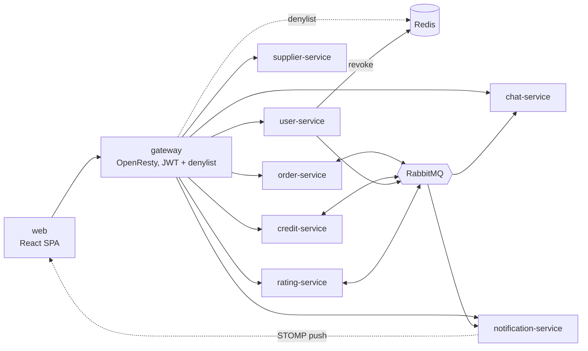

<!--
  AI-assisted (CS3219 AI Usage Policy disclosure):
  Tool: Claude Code (Fable 5), 2026-09-10; revised 2026-09-19. The
  2026-09-20 MCP server configuration entry was made with Claude Code
  (Opus 5); the other 2026-09-20 entries are Fable 5.
  Scope: team allocation table and repository-structure notes
  transcribed from team decisions (2026-09-10); the AI Use Summary
  section is maintained as the policy's consolidated disclosure.
  2026-11-02, Claude Code (Fable 5), issue #258: AI Use Summary
  extended for the Rate Your Experience modal (issue #256 — a belated
  paragraph; the work shipped in PR #278 with its usage-log entries but
  no paragraph here) and for the N1 documentation pass itself (issue
  #258, the new docs/rating-service.md + .mmd and the doc updates it
  touches).
  Author review: Leong Wei Zhi, pending pull request review.
  2026-11-06, Claude Code (Opus 5.5), issue #48 (DP11): AI Use Summary
  extended for the realistic demo usernames. Author review: Leong Wei
  Zhi, pending pull request review.
  2026-11-08, Claude Code (Fable 5.1), issue #48 (DP17): the DP11 paragraph
  notes this change ships as its own PR off main. Author review: Leong Wei
  Zhi, pending pull request review.
  2026-11-08, Claude Code (Fable 5.1), issue #48 (DP7, DP10): the cloud
  deployment paragraph extended for the simplified re-plan. Author review:
  Leong Wei Zhi, pending pull request review.
  2026-11-08, Claude Code (Fable 5.1), issue #48 (DP18 to DP21): the cloud
  deployment paragraph extended for HTTPS. Author review: Leong Wei Zhi,
  pending pull request review.
  2026-11-09, Claude Code (Fable 5.1), issue #48 (EKS re-platform): a
  cloud deployment paragraph added for the move to EKS and RDS. Author
  review: Leong Wei Zhi, pending pull request review.
  2026-11-10, Claude Code (Opus 5.5), issue #48 (DP9, DP21): an
  availability paragraph added. Author review: Leong Wei Zhi, pending
  pull request review. PR #323 review: the PDB values corrected and the
  no-surge rollouts added.
  2026-11-09, Claude Code (Opus 5.5), issue #48 (DP20): AI Use Summary
  extended for continuous deployment. Author review: Leong Wei Zhi,
  pending pull request review.
  2026-11-08, Claude Code (Fable 5.1): AI Use Summary extended for the
  admin-test flake fix. Author review: Leong Wei Zhi, pending pull request
  review.
  2026-11-08, Claude Code (Opus 5.5), issue #308: AI Use Summary extended
  for the owner upgrade from the profile page. Author review: Leong Wei
  Zhi, pending pull request review.
  2026-11-09, Claude Code (Opus 5.5), PR #309 review: the #308 paragraph
  now records the code-first order. Author review: Leong Wei Zhi,
  pending pull request review.
  2026-11-09, Claude Code (Opus 5.5): AI Use Summary extended for the
  notification sound preview; PR #314 review (Copilot): its sentence
  reworded so the subject reads singular. Author review: Leong Wei Zhi,
  pending pull request review.
  2026-10-31, Claude Code (Fable 5): AI Use Summary extended for the
  public profile's joined date and deliveries-completed count (issue
  #280), and the #257 paragraph's deviation sentence updated to point
  there.
  2026-10-28, Claude Code (Opus 5): AI Use Summary extended for the
  rating-events exchange and the rating.submitted contract (issue
  #249). Same day, PR #269's main merge: the AI Use Summary was the
  only conflict here — both sides had appended a 2026-10-28 paragraph
  (#233's live refresh and #249's) — so both were kept, main's first;
  nothing reworded or removed.
  2026-09-19: foc-contracts structure note added per team decision D15
  (docs/notification-service.md).
  2026-09-20: AI Use Summary wording extended for the notification
  retry/DLQ implementation (issue #65), then again for the retention
  purge scheduler (issue #68), the ArchUnit broker-isolation test
  (issue #69), and the project MCP server configuration (developer
  tooling only); and again for the user-service Spring Boot scaffold
  (issue #84).
  2026-09-22, Claude Code (Sonnet 5): extended again for the
  supplier-service Spring Boot scaffold and the compose.yaml/AGENTS.md/
  .env.example wiring that went with it.
  2026-09-21: AI Use Summary wording extended for the web/ SPA
  scaffold (issue #108).
  2026-09-23: AI Use Summary extended for the user-service first-owner
  bootstrap (issue #97) by Claude Code (Opus 5.5); and again for the
  user-db infrastructure and user-service JPA schema (issues #85/#86)
  by Claude Code (Fable 5); and again for the user-service profile
  endpoints (issue #95) by Claude Code (Opus 5.5).
  2026-09-25: AI Use Summary extended for the owner-setup change
  (setup no longer limited to one owner; a setup token expiry and a
  setup log line were added and then removed) by Claude Code (Opus 5.5).
  2026-09-26: AI Use Summary extended for the supplier-service list
  endpoint (issue #133 — search/filter/paging) and the accompanying
  removal of the zone feature's remaining frontend wiring, by Claude
  Code (Sonnet 5).
  2026-09-27: AI Use Summary extended for the user-service soft delete
  and day-31 purge (issue #93) by Claude Code (Fable 5), on PR #136
  Copilot review.
  2026-09-28: AI Use Summary extended for the "Nearest to Me" sort
  fallback fix on PR #134 review (LeongWZ), by Claude Code (Sonnet 5);
  and again for the supplier-service GET /suppliers sort-validation fix
  on the same PR's review, also by Claude Code (Sonnet 5); and again to
  add the 2026-09-27 "Nearest to Me" distance-sort feature itself
  (PR #134), which PR #134 review (LeongWZ) flagged as missing from
  both this summary and ai/usage-log.md — disclosed here retroactively,
  by Claude Code (Sonnet 5); and again for the supplier image-URL
  normalization fix (broken images from the seed CSV's GitHub blob
  links), also by Claude Code (Sonnet 5).
  2026-09-26: AI Use Summary extended for the user-service admin
  endpoints (issue #96) by Claude Code (Opus 5.5).
  2026-09-27: AI Use Summary extended for the user-service soft delete
  and day-31 purge (issue #93) by Claude Code (Fable 5), on PR #136
  Copilot review.
  2026-09-27: AI Use Summary extended for the PR #135 review fixes
  (issue #96) by Claude Code (Opus 5.5).
  2026-09-29: AI Use Summary extended for the user-service OTP email
  sending (issue #88 — insert-after-verify sign-up, Gmail SMTP/Mailpit,
  pending_signups replacing the otps table) by Claude Code (Fable 5),
  on PR #150 Copilot review (the summary had missed the change); and
  again for that PR's author-review fixes (repeat sign-ups can no longer
  hijack a pending sign-up; resend cooldown) by Claude Code (Opus 5); and
  again for its re-review fixes and the web sign-up OTP screen (issue
  #109) by Claude Code (Opus 5).
  2026-09-30: AI Use Summary extended for the user-service account-update
  flows (issue #92) by Claude Code (Fable 5).
  2026-10-07: AI Use Summary extended for the user-service and web review
  follow-ups (issues #154 and #138, PR #162) by Claude Code (Opus 5.5).
  2026-10-09: AI Use Summary extended for the web profile screens
  (issue #112, PR #149) and that PR's two Copilot-review rounds, by
  Claude Code (Opus 5) — the summary had no entry for #112.
  2026-10-10: that #162 clause extended for its re-review fixes by
  Claude Code (Opus 5.5); and the #149 clause for that PR's team review
  (@Sinnez1) and issue #167, the gate-code refactor that came out of it,
  by Claude Code (Opus 5).
  2026-10-10: AI Use Summary extended for the PR #168 review fixes by
  Claude Code (Opus 5.5).
  2026-10-10: AI Use Summary extended for the order-service Spring Boot
  scaffold and its compose.yaml/AGENTS.md/.env.example wiring by
  Claude Code (Opus 5.5).
  2026-10-11: AI Use Summary extended for the order-service Requests
  entity/repository skeleton by Claude Code (Opus 5.5).
  2026-10-11: AI Use Summary extended for the credit operations (issue
  #169) by Claude Code (Opus 5.5); the conflict markers the PR #168
  merge left in this header were removed, keeping both sides. Same day:
  that clause extended for the team-review fixes, and again for the
  PR #175 review fixes.
  2026-10-11: merge-conflict markers left in this header by an earlier
  merge resolved (both sides kept, in date order), and the AI Use
  Summary extended for the logout denylist + API gateway (issue #151),
  by Claude Code (Fable 5).
  2026-10-11: AI Use Summary extended for password reset + account
  recovery (issue #94, PR #179), by Claude Code (Fable 5) — the PR #179
  Copilot review flagged the summary as not covering #94.
  2026-10-12: the #94 clause extended for the PR #179 human-review
  round (@Sinnez1), by Claude Code (Fable 5).
  2026-10-12: AI Use Summary extended for the credit reply outbox and
  outbox publisher (issue #170) by Claude Code (Opus 5.5).
  2026-10-12: AI Use Summary extended for the issue #67 remaining scope
  (web STOMP client + CONNECT-time denylist, D23) by Claude Code
  (Fable 5), on PR #185 Copilot review (the summary had missed the
  change).
  2026-10-12: AI Use Summary extended for the web revoked-session
  sign-out (issue #178, PR #182) by Claude Code (Fable 5).
  2026-10-13: the #170 clause extended for the PR #188 review round
  (Leong Wei Zhi), by Claude Code (Opus 5.5).
  2026-10-13: AI Use Summary extended for the credit read API
  (issue #172) by Claude Code (Opus 5.5).
  2026-10-13: the #178 clause extended for the PR #182 human-review
  round (@Sinnez1), by Claude Code (Opus 5).
  2026-10-14: the #172 clause extended for the PR #189 review
  follow-ups, by Claude Code (Opus 5.5).
  2026-10-10: AI Use Summary extended for the order-service Spring Boot
  scaffold and its compose.yaml/AGENTS.md/.env.example wiring by
  Claude Code (Opus 5.5).
  2026-10-11: AI Use Summary extended for the order-service Requests
  entity/repository skeleton by Claude Code (Opus 5.5).
  2026-10-17: AI Use Summary extended for the order-service request
  state machine by Claude Code (Opus 5.5), then for the Requests
  createdAt default (PR review fix).
  2026-10-17: AI Use Summary extended for the order-service request
  events (RequestsService, outbox, credit reply listener) by Claude
  Code (Opus 5.5), then for the RequestsController endpoints, then
  for the order-service ownership checks, then for the manual-testing
  scripts, stubs and the gateway order route, then for the /create field
  checks, the accepted / collected events and the expiry and
  auto-complete timers, then for the read endpoints and their filters,
  then for the web order pages on the real order API.
  2026-10-14: AI Use Summary extended for the credit request event
  listener (issue #171) by Claude Code (Opus 5.5).
  2026-10-14: the #67 clause extended for the PR #185 human-review
  round (@Sinnez1), by Claude Code (Fable 5).
  2026-10-14: that #178 clause extended again for the PR #182 second
  review round, by Claude Code (Opus 5).
  2026-10-16: the #171 clause extended for the PR #190 review round
  (Leong Wei Zhi), by Claude Code (Opus 5.5); same day, again for its
  re-review.
  2026-10-16: the #67 clause extended for the PR #185 re-review rounds
  (@Sinnez1) by Claude Code (Opus 5) — the STOMP frame policing round
  the 2026-10-14 line claims but never wrote into the clause, and the
  client's ERROR-frame policy.
  2026-10-16: PR #185 rebased onto main twice the same day (PRs #187
  and #190 landed) — the conflicts this header, the AI Use Summary,
  `.env.example` and `compose.yaml` carried resolved by keeping both
  sides with nothing reworded or removed; in the second pass the two
  order-service lines main had meanwhile moved into date order were
  left to main's copy rather than re-added here, and this branch's #67
  lines take their own date positions, by Claude Code (Opus 5).
  2026-10-16: PR #182 rebased onto main twice the same day (first with
  PRs #187/#188/#189 landed, then with #190/#185) — the conflicts this
  header, the AI Use Summary and `ai/usage-log.md` carried resolved by
  keeping both sides in date order, no clause reworded; in the second
  pass `web/src/routes/index.tsx` also conflicted with #185's
  NotificationProvider layout route, resolved by keeping that route and
  moving this branch's `handle: { requiresSession: true }` onto the
  nested ProtectedRoute it gates, by Claude Code (Opus 5).
  2026-10-16: AI Use Summary extended for the credit expiry and
  redistribution scheduler (issue #173) by Claude Code (Opus 5.5);
  same day, extended for the PR #193 review fixes.
  2026-10-16: AI Use Summary extended for the server half of issue #178
  (PR #183) by Claude Code (Opus 5) — the summary covered the web half
  only.
  2026-10-16: PR #183 rebased onto main now that its base PR #179 has
  merged — the conflicts `docs/gateway.md`, `AdminService.java` and
  `AdminServiceTest.java` carried resolved by keeping both sides, and
  the one claim #179's approval follow-up left stale (a removed admin's
  token keeping ADMIN until its exp) corrected, by Claude Code
  (Opus 5).
  2026-10-17: AI Use Summary extended for the web credit balance and
  history (issue #174) by Claude Code (Opus 5.5); same day, extended
  for the admin dashboard's Common Pool box.
  Reviewed by: Leong Wei Zhi (via pull request).
  2026-10-17: the #178 clause extended for the PR #183 human-review
  round (@Sinnez1) and the branch rebased again for #180's merge, by
  Claude Code (Opus 5).
  2026-10-17, Codex (GPT-6), PR #180 review: added the web #94
  disclosure and the missing 2026-10-16 main-sync coverage.
  Author review: Leong Wei Zhi to review via PR #180.
  2026-10-17, Codex (GPT-6.1 Sol), issue #98: disclosed the user-service
  Docker-unavailable test skips and verification documentation.
  PR #197 review: disclosed CI's rejection of skipped user-service tests.
  2026-10-17, Claude Code (Opus 5), PR #199 review: AI Use Summary
  extended for the web half of issue #66 (the Notification Center) and
  that PR's review round — the summary had the backend half only.
  Author review: Leong Wei Zhi to review via pull request.
  2026-10-17: AI Use Summary extended for the upcoming credit expiries
  (issue #196: the route and the credits page) by Claude Code
  (Opus 5.5).
  2026-10-18: AI Use Summary extended for the issue #165 follow-ups
  (a duplicate reservation resends its reply, the contract test's
  parties check, the credit legend) by Claude Code (Opus 5.5).
  2026-10-19: AI Use Summary extended for the credit outbox retention
  purge (issue #218) by Claude Code (Opus 5.5).
  2026-10-19: AI Use Summary extended for the supplier bookmarks N8
  documentation (issues #225-#227) by Claude Code (Sonnet 5.5); same
  day, extended for D13 (how the supplier list flags and orders
  bookmarks).
  Author review: Ryan Ang, pending pull request review.
  2026-10-20: AI Use Summary extended for the user-service
  AuthServiceTest Mockito matcher fix by Copilot SDK in VS Code (model
  not exposed).
  Author review: Kwey Xiu Xi to review via PR.
 
  2026-10-20: AI Use Summary extended for the order lists' state groups
  and My Requests' PENDING refetch, and for lost races answered 409, by
  Claude Code (Opus 5.5).
  Author review: Aung Ko Khant, pending pull request review.
  2026-10-20: AI Use Summary extended for the D3 demo Postman
  collection (docs/postman/) by Claude Code (Fable 5).
  Author review: Leong Wei Zhi, pending pull request review.
  2026-10-21: AI Use Summary extended for the N3 dispute event
  contracts and the rejection's reasonCode (issue #234), and
  docs/disputes.md (the N3 decisions, transcribed), by Claude Code
  (Opus 5.5).
  Author review: Ryan Ang, pending pull request review.
  2026-10-22: AI Use Summary extended for order-service's Flyway
  baseline (issue #238) and the PR #243 review follow-ups, by Claude
  Code (Opus 5.5).
  Author review: Ryan Ang, pending pull request review.
  2026-10-23: AI Use Summary extended for the PR #244 review fixes, by
  Claude Code (Opus 5.5).
  Author review: Ryan Ang, pending pull request review.
  2026-10-23: AI Use Summary extended for order-service failed-order
  management (issue #240), by Claude Code (Opus 5.5).
  Author review: Ryan Ang, pending pull request review.
  2026-10-25: AI Use Summary extended for credit-service's split
  settlement of request.dispute-resolved (issue #235), by Claude Code
  (Opus 5.5).
  Author review: Ryan Ang, pending pull request review.
  2026-10-25: AI Use Summary extended for credit-service's admin list
  of long-held reservations (issue #236) and the PR #247 and PR #210
  review follow-ups, by Claude Code (Opus 5.5).
  Author review: Ryan Ang, pending pull request review.
  2026-10-26: AI Use Summary extended for notification-service's
  dispute-event tests (issue #237), by Claude Code (Opus 5.5).
  Author review: Ryan Ang, pending pull request review.
  2026-10-26: AI Use Summary extended for order-service disputes
  (issue #239), by Claude Code (Opus 5.5).
  Author review: Ryan Ang, pending pull request review.
  2026-10-26: AI Use Summary extended for the rating-service scaffold
  (issue #250), and the Repository Structure tree updated now that the
  N1 nice-to-have fills the <n2h-service> slot, by Claude Code
  (Fable 5).
  Author review: Leong Wei Zhi, pending pull request review.
  2026-10-27: AI Use Summary extended for the admin failed and stuck
  orders (issue #242), by Claude Code (Opus 5.5).
  Author review: Ryan Ang, pending pull request review.
  2026-10-28: AI Use Summary extended for the PR #265 review fixes, by
  Claude Code (Opus 5.5).
  Author review: Ryan Ang, pending pull request review.
  2026-10-27: AI Use Summary extended for the order pages' push-driven
  live refresh (issue #233), by Claude Code (Fable 5); extended again
  2026-10-28 for the PR #264 review round, by Claude Code (Opus 5).
  Author review: Leong Wei Zhi, pending pull request review.
  2026-10-28: AI Use Summary extended for the user events that open and
  close credit accounts (issue #267), by Claude Code (Opus 5.5).
  2026-10-29: AI Use Summary extended for report a problem and the admin
  dispute queue (issue #241), by Claude Code (Opus 5.5).
  Author review: Ryan Ang, pending pull request review.
  2026-10-30: AI Use Summary extended for rating-service's
  request.completed ingest (issue #251), by Claude Code (Fable 5);
  extended again the same day for the PR #271 review fixes.
  Author review: Leong Wei Zhi, pending pull request review.
  2026-10-30: AI Use Summary extended for rating-service's submit
  rating API (issue #252), by Claude Code (Fable 5); extended again
  the same day for the PR #272 review fix.
  Author review: Leong Wei Zhi, pending pull request review.
  2026-10-31: chat-service added to Repository Structure and the AI Use
  Summary extended for requester-courier chat (N6), by Claude Code
  (Opus 5.5).
  Author review: Ko-Khan, pending pull request review.
  2026-10-30: AI Use Summary extended for rating-service's profile
  read APIs (issue #253), by Claude Code (Fable 5).
  Author review: Leong Wei Zhi, pending pull request review.
  2026-10-30: AI Use Summary extended for rating-service's report-a-user
  API (issue #254), by Claude Code (Fable 5); extended again the same
  day for the PR #274 review fix.
  Author review: Leong Wei Zhi, pending pull request review.
  2026-10-30: AI Use Summary extended for the notification on
  rating.submitted (issue #255), by Claude Code (Fable 5).
  Author review: Leong Wei Zhi, pending pull request review.
  2026-10-30: AI Use Summary extended for the notification-service
  dropped-courier prune and the Notification Center timing fixes
  (issue #266) by Claude Code (Fable 5).
  2026-10-31: AI Use Summary extended for the PR #277 review fixes
  (prune reorder bound/guard, Center pager bookkeeping, badge re-sync
  on mount) by Claude Code (Fable 5).
  2026-11-01: AI Use Summary extended for the own-profile entry link and
  the rater's review readback (issue #284) by Claude Code (Opus 5).
  Author review: Leong Wei Zhi, pending pull request review.
  2026-11-08: AI Use Summary extended for issue #305 (cross-replica push,
  duplicate-key ack, Flyway baseline) by Claude Code (Fable 5.1).
  Author review: Leong Wei Zhi, pending pull request review.
  2026-11-08: AI Use Summary extended for the push-triggered credit
  balance refresh (Credit NFR1.1) by Claude Code (Opus 5.5), then
  rewritten for its rework into the credit-change notification (PR
  #313). Author review: Ryan Ang, pending pull request review.
  2026-11-09: AI Use Summary extended for the balance refresh on
  request.created by Claude Code (Opus 5.5). Author review: Ryan Ang,
  pending pull request review.
  2026-11-10: AI Use Summary extended for the credit-service component
  diagram refresh by Claude Code (Opus 5.5). Author review: Ryan Ang,
  pending pull request review.
  2026-11-10, Claude Code (Opus 5.5): README rewritten as a project
  overview (features, architecture, local setup, demo accounts, tests,
  deployment, docs index); the AI Use Summary body replaced by a link to
  ai/usage-log.md, which keeps every entry. Author review: Leong Wei Zhi,
  pending pull request review.
-->

# Favours on Campus (FoC)

A peer-to-peer campus errand platform (CS3219 AY2627 Sem 1, Team 23).
Students post requests to have an item collected from a store or facility
on campus; other students accept and deliver them. Every favour is paid in
**credits**, a closed economy: credits cannot be bought, withdrawn or
exchanged for money.

**Live deployment:** <https://foc23.ddnsfree.com>

---

## Features

| Who | What they can do |
| --- | --- |
| Requester | Browse and search campus suppliers, post a delivery request with a credit reward, track it live, cancel it, confirm completion, report a problem, rate the courier |
| Courier | Browse open requests, accept one, mark it collected and delivered, chat with the requester, rate the requester |
| Admin | Manage suppliers, users and roles; review disputes, failed and stuck orders; view the common credit pool |
| Everyone | OTP-verified sign-up, password reset and account recovery, real-time notifications, credit balance and history, public profiles with ratings |

Selected nice-to-haves: N1 ratings, N2 request history, N3 disputes,
N4 centralized logging, N5 cloud deployment with CI/CD on Kubernetes,
N6 requester–courier chat, N7 admin dashboard, N8 supplier bookmarks.

---

## Architecture

Microservices, one per top-level folder, each with its own PostgreSQL
database. The browser reaches every backend through one API gateway;
services talk to each other through RabbitMQ events.



| Service | Responsibility | Design doc |
| --- | --- | --- |
| `user-service` | Accounts, JWT auth, OTP email, roles, profiles | [wiki](https://github.com/AY2627S1-CS3219-P23/foc/wiki) |
| `supplier-service` | Supplier/landmark CRUD, search, filters, bookmarks | [`docs/supplier-service.md`](docs/supplier-service.md) |
| `order-service` | Request lifecycle: create, accept, collect, complete, expire, disputes | [`docs/disputes.md`](docs/disputes.md) |
| `credit-service` | Balances, reservations, transfers, expiry, history | [`docs/credit-service.md`](docs/credit-service.md) |
| `notification-service` | Event-driven in-app notifications, retries, live push | [`docs/notification-service.md`](docs/notification-service.md) |
| `rating-service` | Ratings for completed orders, profile summaries, user reports | [`docs/rating-service.md`](docs/rating-service.md) |
| `chat-service` | Requester–courier chat on accepted orders | [`docs/chat-service.md`](docs/chat-service.md) |
| `gateway` | Single entry point, token check, logout denylist | [`docs/gateway.md`](docs/gateway.md) |

**Async workflow (M6):** creating a request runs a saga: order-service
asks credit-service to reserve the reward, and on the reply publishes
`request.created`. Later state changes (`accepted`, `collected`,
`completed`, `cancelled`, ...) move or release the credits and fan out
to notifications and ratings. Events go through transactional outboxes
and are processed idempotently. Full picture:
[`docs/architecture.md`](docs/architecture.md).

**Tech stack:** React + TypeScript (Vite, Tailwind) · Java + Spring Boot
(Spring Data JPA, Maven) · PostgreSQL · RabbitMQ · Redis · OpenResty ·
Docker Compose · AWS EKS + RDS (Terraform).

---

## Running locally

Prerequisite: Docker with Compose.

```sh
cp .env.example .env
# fill in at least: JWT_SECRET (32+ bytes), RABBITMQ_PASSWORD,
# CHAT_INTERNAL_TOKEN and the seven *_DB_PASSWORD values;
# set USER_SEED_DEMO=true for demo accounts
docker compose up --build
```

| URL | What |
| --- | --- |
| <http://localhost:5173> | Web app |
| <http://localhost:8090/api/&lt;service&gt;/> | API gateway (the only way into the backends) |
| <http://localhost:8025> | Mailpit inbox: sign-up and reset OTP emails land here |

Each service database is published on a loopback port for inspection; the
port table is in [`AGENTS.md`](AGENTS.md#mcp-servers-agent-tooling).
Suppliers are seeded from [`data/`](data/).

### Demo accounts

With `USER_SEED_DEMO=true` the user service seeds, on first start:

| Role | Username(s) | Password |
| --- | --- | --- |
| Owner | `daniel_koh` | `OwnerPass123` |
| Admin | `priya_menon`, `farhan_ismail`, `chloe_ng` | `AdminPass123` |
| Student | `weiling_tan`, `arjun_nair`, ... (100 users) | `StudentPass123` |

The passwords are public: never enable the seeder on a real deployment.
The full list is in [`user-service/README.md`](user-service/README.md); a
runnable Postman walkthrough of the request flow is in
[`docs/postman/`](docs/postman/README.md).

---

## Development

Backends build with each service's own Maven wrapper. Install the shared
contracts library first:

```sh
(cd foc-contracts && ./mvnw install)
cd order-service && ./mvnw test      # integration tests need Docker (Testcontainers)
```

Frontend:

```sh
cd web && npm ci
npm run dev       # Vite dev server
npm test          # Vitest
npm run lint
```

Service-specific notes live in each folder's `AGENTS.md` / `README.md`.
CI (`.github/workflows/ci.yml`) runs every suite and builds every image on
each pull request; `main` is protected and needs one approval.

---

## Cloud deployment

The same images run on an AWS EKS cluster with one RDS PostgreSQL
instance, provisioned by Terraform in [`infra/`](infra/). Merges to
`main` deploy automatically once CI passes, rebuilding only the images
that changed.

- Design and decisions: [`docs/deployment.md`](docs/deployment.md)
- Runbook: [`infra/README.md`](infra/README.md)

---

## Repository structure

```text
.
├── web/                    React frontend
├── gateway/                API gateway (OpenResty)
├── user-service/
├── supplier-service/
├── order-service/
├── credit-service/
├── notification-service/
├── rating-service/         N1
├── chat-service/           N6
├── foc-contracts/          shared event contracts (library, not a service)
├── infra/                  Terraform + Kubernetes manifests (N5)
├── data/                   supplier seed data
├── docs/                   design docs and Postman collection
├── ai/usage-log.md         AI usage log
└── compose.yaml            local stack
```

---

## Team

| Name | Service in charge | Nice-to-have |
| ----- | ----- | ----- |
| Kwey Xiu Xi | User Service | Cloud Deployment and DevOps |
| Alastair Tan Choon Wei | Supplier Service | Supplier Bookmarks |
| Aung Ko Khant | Order Service | Centralized Logging |
| Ryan Ang Jun Wen | Credit Service | Order History |
| Leong Wei Zhi | Notification Service | Rating System |

---

## AI Use Summary

AI tools were used under the CS3219 AI Usage Policy (project document,
Appendix 2). Every AI-assisted change, with its tool, prompt, scope and
author review, is recorded in [`ai/usage-log.md`](ai/usage-log.md).
