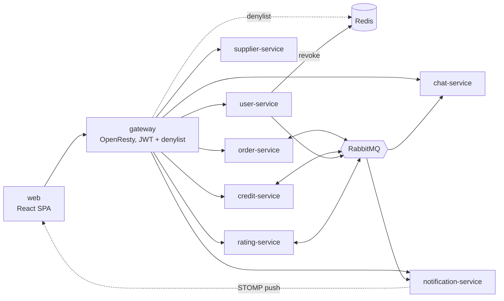

<!--
  AI-assisted (CS3219 AI Usage Policy disclosure):
  Tools: Claude Code (Fable 5, Fable 5.1, Opus 5, Opus 5.5, Sonnet 5,
  Sonnet 5.5), Claude (Sonnet 5), Claude Sonnet 4.6, Codex (GPT-6,
  GPT-6.1 Sol), Copilot SDK in VS Code (model not exposed); 2026-09-10 to
  2026-11-10.
  Scope: team table and repository structure transcribed from team
  decisions; 2026-11-10 (Claude Code, Opus 5.5) rewritten as a project
  overview, the former AI Use Summary paragraphs replaced by a link to
  ai/usage-log.md. The per-change record for this file, including every
  paragraph that summary held, is in ai/usage-log.md and git history.
  2026-11-10 (Claude Code, Opus 5.5): AI Use Summary restored in the
  project document's project-level disclosure format (tools, prohibited
  phases avoided, used for, verification, prompts link).
  Author review: Leong Wei Zhi, pending pull request review.
-->

# Favours on Campus (FoC)

A peer-to-peer campus errand platform (CS3219 AY2627 Sem 1, Team 23).
Students post requests to have an item collected from a store or facility
on campus; other students accept and deliver them. Every favour is paid in
**credits**, a closed economy: credits cannot be bought, withdrawn or
exchanged for money.

**Live deployment:** <https://foc23.ddnsfree.com>

---

## Team Members

| Name | Service In-Charge | Nice-to-have |
| ----- | ----- | ----- |
| Kwey Xiu Xi | User Service | Cloud Deployment and DevOps |
| Alastair Tan Choon Wei | Supplier Service | Supplier Bookmarks |
| Aung Ko Khant | Order Service | Requester-Courier Chat |
| Ryan Ang Jun Wen | Credit Service | Dispute Resolution |
| Leong Wei Zhi | Notification Service | Rating System |

---

## Features

| Who | What they can do |
| --- | --- |
| Requester | Browse and search campus suppliers, post a delivery request with a credit reward, track it live, cancel it, confirm completion, report a problem, rate the courier |
| Courier | Browse open requests, accept one, mark it collected and delivered, chat with the requester, rate the requester |
| Admin | Manage suppliers, users and roles; review disputes, failed and stuck orders; view the common credit pool |
| Everyone | OTP-verified sign-up, password reset and account recovery, real-time notifications, credit balance and history, public profiles with ratings |

Nice-to-haves: N1 ratings, N3 disputes, N5 cloud deployment with CI/CD
on Kubernetes, N6 requester–courier chat, N8 supplier bookmarks.

---

## Architecture

Microservices, one per top-level folder, each with its own PostgreSQL
database. The browser reaches every backend through one API gateway;
services talk to each other through RabbitMQ events.



| Service | Responsibility | Design doc |
| --- | --- | --- |
| `user-service` | Accounts, JWT auth, OTP email, roles, profiles | [wiki](https://github.com/AY2627S1-CS3219-P23/foc/wiki) |
| `supplier-service` | Supplier/landmark CRUD, search, filters, bookmarks | [`docs/supplier-service.md`](docs/supplier-service.md) |
| `order-service` | Request lifecycle: create, accept, collect, complete, expire, disputes | [`docs/disputes.md`](docs/disputes.md) |
| `credit-service` | Balances, reservations, transfers, expiry, history | [`docs/credit-service.md`](docs/credit-service.md) |
| `notification-service` | Event-driven in-app notifications, retries, live push | [`docs/notification-service.md`](docs/notification-service.md) |
| `rating-service` | Ratings for completed orders, profile summaries, user reports | [`docs/rating-service.md`](docs/rating-service.md) |
| `chat-service` | Requester–courier chat on accepted orders | [`docs/chat-service.md`](docs/chat-service.md) |
| `gateway` | Single entry point, token check, logout denylist | [`docs/gateway.md`](docs/gateway.md) |

**Async workflow (M6):** creating a request runs a saga: order-service
asks credit-service to reserve the reward, and on the reply publishes
`request.created`. Later state changes (`accepted`, `collected`,
`completed`, `cancelled`, ...) move or release the credits and fan out
to notifications and ratings. Events go through transactional outboxes
and are processed idempotently. Full picture:
[`docs/architecture.md`](docs/architecture.md).

**Tech stack:** React + TypeScript (Vite, Tailwind) · Java + Spring Boot
(Spring Data JPA, Maven) · PostgreSQL · RabbitMQ · Redis · OpenResty ·
Docker Compose · AWS EKS + RDS (Terraform).

---

## Running locally

Prerequisite: Docker with Compose.

```sh
cp .env.example .env
# fill in at least: JWT_SECRET (32+ bytes), RABBITMQ_PASSWORD,
# CHAT_INTERNAL_TOKEN and the seven *_DB_PASSWORD values;
# set USER_SEED_DEMO=true for demo accounts
docker compose up --build
```

| URL | What |
| --- | --- |
| <http://localhost:5173> | Web app |
| <http://localhost:8090/api/&lt;service&gt;/> | API gateway (the only way into the backends) |
| <http://localhost:8025> | Mailpit inbox: sign-up and reset OTP emails land here |

Each service database is published on a loopback port for inspection; the
port table is in [`AGENTS.md`](AGENTS.md#mcp-servers-agent-tooling).
Suppliers are seeded from [`data/`](data/).

### Demo accounts

With `USER_SEED_DEMO=true` the user service seeds demo accounts at every
start, re-creating any that are missing: an owner (`daniel_koh`), three
admins (`priya_menon`, `farhan_ismail`, `chloe_ng`) and 100 students
(`weiling_tan`, `arjun_nair`, ...). The cloud deployment seeds them too.
Their passwords and the full list are in
[`user-service/README.md`](user-service/README.md); a runnable Postman
walkthrough of the request flow is in
[`docs/postman/`](docs/postman/README.md).

---

## Development

Backends build with each service's own Maven wrapper. Install the shared
contracts library first:

```sh
(cd foc-contracts && ./mvnw install)
cd order-service && ./mvnw test      # integration tests need Docker (Testcontainers)
```

Frontend:

```sh
cd web && npm ci
npm run dev       # Vite dev server
npm test          # Vitest
npm run lint
```

Service-specific notes live in each folder's `AGENTS.md` / `README.md`.
CI (`.github/workflows/ci.yml`) runs every suite and builds every image on
each pull request; `main` is protected and needs one approval.

---

## Cloud deployment

The same images run on an AWS EKS cluster with one RDS PostgreSQL
instance, provisioned by Terraform in [`infra/`](infra/). Merges to
`main` deploy automatically once CI passes, rebuilding only the images
that changed.

- Design and decisions: [`docs/deployment.md`](docs/deployment.md)
- Runbook: [`infra/README.md`](infra/README.md)

---

## Repository structure

```text
.
├── web/                    React frontend
├── gateway/                API gateway (OpenResty)
├── user-service/
├── supplier-service/
├── order-service/
├── credit-service/
├── notification-service/
├── rating-service/         N1
├── chat-service/           N6
├── foc-contracts/          shared event contracts (library, not a service)
├── infra/                  Terraform + Kubernetes manifests (N5)
├── data/                   supplier seed data
├── docs/                   design docs and Postman collection
├── ai/usage-log.md         AI usage log
└── compose.yaml            local stack
```

---

## AI Use Summary

Project-level disclosure under the CS3219 AI Usage Policy (project
document, Appendix 2).

**Tools:** Claude Code (Fable 5, Fable 5.1, Opus 5, Opus 5.5, Sonnet 4.6,
Sonnet 5, Sonnet 5.5), Claude (Sonnet 5), Codex (GPT-6, GPT-6.1 Sol),
GitHub Copilot (Copilot SDK in VS Code; Copilot pull request review),
Claude pull request review in CI.

**Prohibited phases avoided:** requirements elicitation and
prioritization; sprint planning; architecture and design decisions.
Requirements, service boundaries, data schemas, interfaces and
trade-offs were decided by the team (decision IDs in `docs/`); AI was
used only afterwards, to implement and document those decisions. Where a
task needed a choice, the tool listed neutral options and the member
chose; the choice is recorded in the log.

**Used for:**

- Generating boilerplate and scaffolding: Spring Boot service skeletons,
  Dockerfiles and `compose.yaml` wiring, the Vite/React SPA shell, the
  `foc-contracts` event records.
- Implementing team-specified features from issues and design docs, with
  unit and integration tests (JUnit, Testcontainers, Vitest).
- Infrastructure for the cloud deployment: Terraform, Kubernetes
  manifests, GitHub Actions CI and continuous deployment.
- Debugging, refactoring, and addressing pull request review comments.
- Documentation: design-doc transcription, READMEs, the Postman demo
  collection, this disclosure.
- Pull request review: Copilot and Claude reviewers comment on pull
  requests; the author accepts or declines each comment, and a human
  teammate approves the merge.

**Retained / rejected:** AI output was edited or discarded when it did
not fit the team's decisions. For example, the first web scaffold (PR
#118) was closed as over-built and redone barebones in PR #123; AI
review suggestions that conflicted with team decisions were declined in
the review thread.

**Verification:** all AI output reviewed, edited and tested by the
authors: the service test suites and web lint/build/tests run locally
and in CI, and every change merges through a pull request approved by a
teammate. AI-influenced files carry an attribution header (tool, date,
scope, author review).

**Prompts / key exchanges:** see [`ai/usage-log.md`](ai/usage-log.md),
one entry per AI-assisted change with its tool, prompts, scope and
author review.
