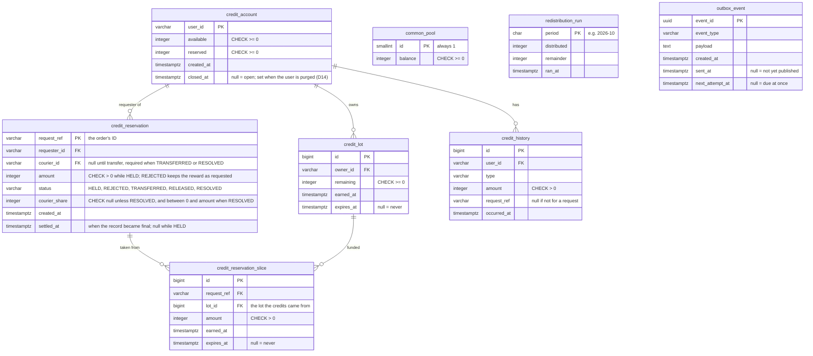

<!--
  AI-assisted (CS3219 AI Usage Policy disclosure):
  Tool: Claude Code (Opus 5.5), 2026-10-09.
  Scope: typo and punctuation fixes, and the author's own rewording of
  D3 applied verbatim (PR #163 Copilot review). No design content was
  written or decided by the tool in this change.
  2026-10-09, PR #163 review (Leong Wei Zhi): pre-saga residue removed (ownership
  note, error-mapping row, lot spend order, closed-economy rule,
  legend), the two invariants stated as Leong Wei Zhi proposed and the
  author chose, and the Notification row updated for the author's
  decision that request.submitted notifies the requester.
  2026-10-10: the author's decisions for the request event handler and
  topology written in (D10, D11, the handler row, the operation results
  table and its rules, the failure rows, F1.2.1 and NFR1.1). The
  decisions are the author's; the tool transcribed them. Same day: the
  "Read API contract" section, from the author's written contract.
  2026-10-10, PR #168 review (Leong Wei Zhi): the reserve results split
  by refusal cause, the duplicate-reply wording, the unhandled-event
  rule and the below-5 s bound on the retry delay restored. The
  decisions are the team's; the tool transcribed them.
  2026-10-11, issue #169 (team review of the credit operations): a
  release returns credits to the lot they came from, so a slice
  references its lot and a drained lot is kept (schema V1 amended); the
  sign-up amount and the earned-credit lifetime are configuration; a transfer
  whose courier is the requester is processed normally; each operation
  logs one line. The decisions are the team's; the tool transcribed
  them.
  Same day: "How lots are spent, returned and expired" written from
  the implementation as it stands, at the author's instruction. The
  expiry granularity and the spendable window it describes are also
  listed under "Open items".
  Same day, PR #175 review (Copilot, Leong Wei Zhi), team decisions
  transcribed: a completion with no record is retried, then
  dead-lettered (`NO_RESERVATION`); a lot's credits expire at the first
  expiry run after `expires_at`, which runs daily; the expiry instant
  stays calendar months in UTC and is displayed in Asia/Singapore; a
  `REJECTED` record keeps the reward as requested and has `settled_at`
  set. The two expiry items left "Open items". Further team decisions
  on that review: an event naming no courier (transfer) or no requester
  (release with no record) is `INVALID_STATE`, and the log line is per
  operation that changes credits, written after the commit.
  2026-10-12, issue #170, team decisions transcribed: the outbox
  publisher polls every 1 s as a fixed delay, publishes at most 100
  replies in a poll and waits up to 5 s for each confirm; a reply
  returned as unroutable is skipped and tried again on the next poll,
  with no cap on attempts, and every other failure stops the poll (an
  unreachable broker, a lost connection, a nack, a confirm not received
  in time). The team first had a nack and a missing confirm skipped as
  well, and revised it the same day: they mean the broker is in
  trouble, not that one reply is bad, so going on only multiplies the
  waits.
  2026-10-13, PR #188 review (Leong Wei Zhi), team decision
  transcribed: a reply returned as unroutable is not due again for
  30 s (`outbox_event.next_attempt_at`, a new column) and a poll reads
  only the unsent replies that are due, so replies no queue takes
  cannot fill every batch and hold back the ones behind them. Still no
  cap on attempts.
  2026-10-14, issue #171, team decision transcribed: when the broker
  does not accept a failed event's retry copy, the original is
  requeued at once instead of being left unacknowledged.
  2026-10-16, PR #190 review (Leong Wei Zhi), team decisions
  transcribed: a returned retry copy dead-letters the original; a
  nacked or unconfirmed one requeues it after a 5 s pause; a confirm
  timeout may leave the event as two copies (new failure-table row).
  Same day, re-review: the returned-copy row notes that a missing
  dead-letter queue discards the event.
  2026-10-16, issue #173, team decisions transcribed: the expiry runs
  daily at 00:00 and the redistribution on the 1st at 00:10, both in
  Asia/Singapore, which also decides the month a run counts as; the
  expiry is one transaction per account; a month with an empty pool is
  still recorded; a redistribution missed while the service was down
  runs at startup, after an expiry run, the order of a normal night.
  2026-10-16, PR #193 review (Leong Wei Zhi), team decision transcribed:
  one routine, daily at 00:00 and at startup, sweeps then redistributes
  a month with no recorded run; the 00:10 job is dropped, so a failed
  redistribution is retried the next day (D12, failure-table rows).
  2026-10-17, issue #174, team decisions transcribed: the admin routes
  in the Read API contract (a pool summary with a share preview and the
  next run, and the paged runs), for ADMIN and OWNER.
  2026-10-17, issue #196, team decisions transcribed: GET
  /credits/me/expiries in the Read API contract (its route, response
  shape, order, which credits count, and how often the web app reads
  it), and the REST API component row.
  2026-10-17, PR #210 review (Leong Wei Zhi), team decision transcribed:
  the web app reads the expiries on every balance poll, since reading
  them only on a balance change missed changes that cancel out; and the
  "No window" bullet states the real upper bound on the list.
  2026-10-18, issue #165 (Leong Wei Zhi's PR #163 re-review), the
  reviewer's suggestion taken by the team: a redelivered
  `request.submitted` on a `HELD` or `REJECTED` record sends its
  reply again (the handler row and two failure rows); and the
  legend states where it differs from `architecture.md`'s. The tool
  transcribed them. Same day, at the author's instruction: the Credit
  F2.1.3 traceability row's right-hand column reworded to the
  behaviour as implemented.
  PR #212 review (Leong Wei Zhi), the reviewer's suggestions taken by
  the author: the Credit F2.1.3 requirement text restored and the item
  kept in "Requirements to revise" for the team; the resent reply
  described as rebuilt from the event with the record's decision; and
  the redelivery failure row names the two cases in which the resend
  comes into play.
  2026-10-19, issue #218, team decisions transcribed: D13, the outbox
  retention purge (sent rows only, 30 days from `sent_at`, daily at
  03:00 Asia/Singapore, both configuration, the window at least 1 day,
  a partial index on `sent_at`, and nothing but `outbox_event` purged,
  with the reason); the components, the `outbox_event` table row and
  the failure table updated to match.
  2026-10-21, issue #234, team decisions transcribed: the rejection
  reply carries `reasonCode` beside `reason` (DSP-12, @Nullable per
  D18).
  2026-10-25, issue #235, team decisions transcribed: the RESOLVED
  status, `courier_share` and the split settlement of
  `request.dispute-resolved` (DSP-4, DSP-8, DSP-13); what the other
  events do on a RESOLVED record; and the rule above the event table
  (a matching event is a duplicate, a contradicting one INVALID_STATE),
  in the team's words.
  2026-10-25, issue #236, team decisions transcribed: GET
  /credits/admin/reservations/held in the admin routes (HELD only,
  olderThan an ISO-8601 duration that is not negative, default PT1H,
  held at or before the cutoff, oldest first, at most 100, an object
  around the list) and its 400s. Same day, PR #247 review follow-ups,
  the review's suggestions taken by the team: the listener and handler
  rows name the resolution, D9 points to DSP-4, the slice row says what
  a slice records after a resolution, and V5's CHECK keeps
  `courier_share` to RESOLVED records.
  PR #248 review, the review's suggestions taken by the team: the
  held-reservations list says whether it was cut off (`truncated`), and
  V5's partial index on the HELD rows serves it. Later PR #248 review
  suggestions taken: a blank olderThan takes the default, and the
  accepted durations are named (days and smaller).
  2026-10-28, issue #267: the team's user-event decisions (USR-1 to
  USR-9) written in as D14, with closed_at and CLOSURE in the schema,
  the closed-account invariant, the user-event table, and the account
  closure open item marked done. The decisions are the team's; the
  tool transcribed them. Same day, PR review (team decisions): D14's
  correlationId, the blank-userId dead-letter, the User Service's
  independence from the broker and its outbox retention. Then USR-8
  revised (team decision): every insert of a user row writes
  user.created, owner setup and the demo seeder included.
  Author review: Ryan Ang, pending pull request review.
-->

# FoC Credit Service — Architecture Design

**Scope:** component-level design of `credit-service/`, covering
Credit Service requirements (F1 closed credit economy, F2 credit reservation, F3 credit transfer, F4 credit balance and history, F5 transfer atomicity, F6 redistribution, NFR1 responsiveness, NFR2 integrity), and the other requirements that it serves: rejecting request creation when the reward exceeds the available balance (Order F1.1.4) and viewing credit balance on the user profile (User Service F8.1). \
Companion diagram:
[`credit-service.mmd`](credit-service.mmd) \
High-level system architecture: [`architecture.md`](architecture.md)

## Design decisions
| # | Concern | Decision | Serves |
| --- | --- | --- | --- |
| D1 | Persistence | **PostgreSQL** accessed via Spring Data JPA and use of `@Transactional`| F5, NFR2.1 |
| D2 | Concurrency control | **Pessimistic row locks** | F2.1.2, NFR2.1 |
| D3 | Duplicate detection | **One held-credits record per request**, with a unique request reference. Its status records what has already been decided and done, so a redelivered event changes nothing and never produces a second, different reply. | NFR2.2, NFR2.2.1 |
| D4 | Expiry model | Earned credits live in lots that expire 3 months after they are earned into a common pool. Lots are spent in soonest expiry order first. A release returns credits to the lot they were taken from, so they keep their expiry and place in that order. Redistributed credits expiry are started the date they are received. The lifetime is configuration (`CREDIT_EARNED_CREDIT_LIFETIME_MONTHS`, default 3): `expires_at` is the instant the credits were earned plus that many calendar months, in UTC. A lot's credits expire at the first expiry run after `expires_at`; until then they are spent like any other. | F6.1–F6.1.2 |
| D5 | Credit history | **Append-only**: each row has type, amount, timestamp and request reference. Filters will use JPA. | F4.1.1, F4.1.2, F4.1.3 |
| D6 | Account provisioning | **Get or create method inside Credit Service**. Call is made idempotent by a unique user ID. Account with 5 available credits is created the first time a trusted ID is seen; the amount is configuration (`CREDIT_SIGN_UP_CREDITS`, default 5) and applies to accounts created after it is set. Every path that writes a row referencing a user get-or-creates that user's account first: a balance or history read (the JWT's user), reserve (the requester), release, including the amount-0 `RELEASED` record (the requester), and transfer (the courier; the requester's already exists, since the `HELD` record references it). Since D14, `user.created` also opens the account; get-or-create stays the permanent fallback (users from before the events, an event not yet processed) and never reopens a closed account. | F1.1, F1.1.1, F1.1.2 |
| D7 | Cross-service consistency | **Saga between the Order and Credit Services, by choreography.** Each service reacts to the other's events, and the request's status in the Order Service is the saga's state. No synchronous call exists between the two services. | F2, F3, NFR2 |
| D8 | Reservation | Saga step 1. The Credit Service consumes `request.submitted`, reserves or refuses, and replies with `credit.reserved` or `credit.reservation-rejected`. | F2.1, F2.1.2, F2.1.3 |
| D9 | Transfer and release | Saga endings. `request.completed` transfers the held credits. `request.cancelled` and `request.expired` release them, with release being the compensation for a reservation. A disputed request has a third ending, `request.dispute-resolved`, which divides them (DSP-4, `docs/disputes.md`). | F2.1.1, F3.1, NFR1.1 |
| D10 | Reply publishing | **Transactional outbox.** The reply is written to an outbox table in the same transaction as the balance change, and a publisher sends it to the broker with publisher confirms and the mandatory flag: a reply is marked sent only when the broker confirmed it and did not return it as unroutable. The publisher polls every 1 s, as a fixed delay so that one poll never overlaps the next, publishes at most 100 replies in a poll and waits up to 5 s for each confirm. A reply returned as unroutable is not due again for 30 s, and a poll reads only the unsent replies that are due, so replies no queue takes cannot fill every batch and hold back the ones behind them. | NFR2.1 |
| D11 | Event failure handling | Transient failures go to a retry queue and are redelivered after a short delay, up to a fixed number of attempts, then to a dead-letter queue. Events that conflict with the recorded state go straight to the dead-letter queue. A `request.completed` with no record is not such a conflict: its reservation may not have been applied yet, so it is retried like a transient failure. The queue layout is the Notification Service's (a work, a retry and a dead-letter queue), with two differences: the five consumed routing keys are bound one by one instead of `request.#`, and the retry delay is 2 s with up to 5 attempts (`CREDIT_RETRY_TTL_MS`, `CREDIT_RETRY_MAX_ATTEMPTS`). The service declares both the `request-events` and `credit-events` exchanges, so it starts without the Order Service. | F5.1.1, NFR2.1 |
| D12 | Scheduler | Done by a **cron job** through use of `@Scheduled`. One routine runs daily at 00:00 Asia/Singapore time and once at startup: the expiry sweep, then, if the current Singapore month has no `redistribution_run` row, that month's redistribution. The order inside the routine puts what expired into the pool before it is shared out, so the redistribution happens at 00:00 on the 1st, straight after that night's sweep. A month that is missed (the service down) or whose run fails is completed by the next run, at startup or the next day. The expiry is one transaction per account. A month is recorded in `redistribution_run` even when the pool is empty. | F6.1.1, F6.1.2 |
| D13 | Outbox retention | A **scheduled purge** deletes the replies sent more than 30 days ago (`CREDIT_OUTBOX_RETENTION_DAYS`, default 30, at least 1 or the service does not start), daily at 03:00 Asia/Singapore time (`CREDIT_OUTBOX_PURGE_CRON`), away from the 00:00 routine of D12. Only sent rows (`sent_at` not null) are deleted: an unsent row is a reply the Order Service is still waiting for, and deleting it would leave that request stuck in pending. The window counts from `sent_at`, since a row's job ends at delivery. A partial index on `sent_at` covers the sent rows, so the purge's condition matches it exactly. Nothing but `outbox_event` is purged: `credit_reservation`, `credit_history`, `credit_lot` and `credit_reservation_slice` are the ledger and are kept. This differs from the Notification Service, which purges its `processed_events`: there that table is only a duplicate check, while here the duplicate check is `credit_reservation`, which is also the record of every request's credits. | NFR2.1 |
| D14 | Account lifecycle | **User events** (issue #267, team decisions USR-1 to USR-9). The User Service publishes `user.created` whenever a user row is inserted (USR-8, revised): a verified sign-up (after OTP verification, not at the pending sign-up), a verified owner setup, and each account the demo seeder creates, all through one shared creation method, and `user.purged` for each account the day-31 purge deletes, through its own transactional outbox written in the same transaction, to one `user-events` topic exchange. Each carries the envelope and `userId` only, with no `parties`. `user.created` opens the account with the sign-up credits; `user.purged` closes it: the row is kept with `closed_at` set, every available credit (the sign-up ones included) moves to the common pool with a `CLOSURE` history row, held reservations settle normally, and any credits that reach a closed account afterwards (a release, a transfer, a dispute share) go on to the pool in the same transaction with a `CLOSURE` row. Duplicates and reordering are decided by the account's state, with no processed-events table (see "User events" below). Redistribution and the pool preview count open accounts only, through one query. No soft-delete or restore event: shares received during the 30-day window return to the pool at closure. Deploy order: `foc-contracts`, then the Credit Service, then the User Service. A user event's `correlationId` is the user's ID, so every event about one user can be traced together. An event with a blank `userId` is dead-lettered at once, before any query. The User Service starts and serves login and sign-up without the broker: compose does not make it wait for RabbitMQ, its RabbitMQ health check is off, and the exchange is declared when the publisher first connects, so an event published before the Credit Service has bound its queue is returned and retried from the outbox. Sent user events are deleted 30 days after they were sent, never an unsent one, as the Credit Service's replies are (D13). | F1.1, F6.1.1, F1 (closed economy) |

## The saga
 
| Step | Service | Local transaction | Publishes | If it fails |
| --- | --- | --- | --- | --- |
| 1 | Order | Save the request as `pending` | `request.submitted` (request, requester, reward) | N/A |
| 2 | Credit | Reserve the reward, or record the refusal | `credit.reserved` or `credit.reservation-rejected` | Refusal goes to step 3b |
| 3a | Order | `pending` → `created`. The request becomes visible to couriers | `request.created` | N/A |
| 3b | Order | `pending` → `rejected` (ends here) | `request.rejected` | N/A |
| 4 | Order | The request reaches `completed`, `cancelled` or `expired` | the matching request event | N/A |
| 5 | Credit | Transfer on `completed`; release on `cancelled` or `expired` | nothing | Cannot be refused. Retried until done |
 
- **Compensation:** release undoes a reservation. It runs when the
  request is cancelled or expires, including a `pending` request the
  Order Service gives up on because no reply arrived in time.
- **Point of no return:** delivery confirmation. After `request.completed`
  the transfer must happen and is only ever retried.
- **Eventually consistent:** a request is briefly `pending` before it is
  `created` or `rejected`, and balances change shortly after a request
  is completed, cancelled or expired, not in the same instant.

The four saga events, `request.submitted`, `request.rejected`,
`credit.reserved` and `credit.reservation-rejected`, are defined in
`foc-contracts` (records, registry entries and fixtures).

## Components

Ownership note: the Credit Service serves a read-only REST API to the
Web App; every balance change arrives as a request event. Its state lives only in its own PostgreSQL database (database-per-service). The only timer-driven work is the scheduler, the outbox publisher and the outbox retention purge.

| Component | Responsibility |
| --- | --- |
| **Credit account REST API** (Spring Boot) | For the Web App, authenticated by the user's JWT: returns the caller's available and reserved balance (F4.1) and their transaction history with amount and date-range filters (F4.1.2, F4.1.3), and the caller's credits that will expire, with their dates (F6.1, issue #196). The routes and shapes are in "Read API contract". |
| **Request event listener** (Spring AMQP) | Consumes `request.submitted`, `request.completed`, `request.cancelled`, `request.expired` and `request.dispute-resolved` from the Credit Service's own queue, hands each to the request event handler, and settles the delivery on its answer: acknowledge after the commit, dead-letter an event that conflicts with the request's record, and send any failure to the retry queue (D11). |
| **Request event handler** (Spring Boot, `@Transactional`) | Owns the transaction for one event. Turns it into a reserve (F2.1), transfer (F3.1), release (F2.1.1) or resolve (DSP-4) operation and, for a reservation, writes the reply to the outbox in the same transaction (D10). Imports no broker types. |
| **Error mapping** (Spring Boot, `@RestControllerAdvice`) | Maps invalid query parameters on the read API (for example the history's amount and date-range filters) to HTTP error responses. Event-path failures never reach it: they are refused with a reply or dead-lettered (see "How each event is handled"). |
| **Idempotent credit operations service** (Spring Boot, `@Transactional`) | Core logic: provisions accounts with 5 available / 0 reserved, once per user (F1.1.1, F1.1.2). It reserves only if available credit >= amount needed (F2.1, F2.1.2, F2.1.3) and releases, transfers or divides (a resolved dispute, DSP-4) each request's held credits at most once (F2.1.1, F3.1.1, F3.1.2, NFR2.2.1). It spends lots in soonest-expiry order, with the never-expiring sign-up lot last, returns released credits to the lots they came from (D4), and commits balance change, held-credits status, lots, history rows and the outgoing reply in one transaction (F5.1, NFR2.1). It logs one line per operation that changes credits (the request, the users affected, the amount and the outcome) and one per account created, each written after the transaction commits. |
| **Credit history** (Spring Boot) | Appends one immutable row per transaction such as account provision, reservation, release, transfer, expiry, redistribution, with timestamps and request reference (F4.1.1). It will also serve the filtered history queries (F4.1.2, F4.1.3). |
| **Outbox publisher** (Spring Boot, `@Scheduled`) | Reads the unsent replies that are due from the outbox table, publishes them to the `credit-events` exchange with the mandatory flag, and marks each one sent once the broker confirms it without returning it. A returned reply stays unsent and is due again 30 s later (D10); until then no poll reads it. It is logged with its event ID and the poll goes on to the next reply, since a return is the one failure that is about a single reply. Any other failure stops the poll: the broker cannot be reached, the connection is lost, the broker nacks the reply, or no confirm arrives within 5 s. Each means the broker is in trouble, so every other reply would fail the same way. The replies not yet sent stay unsent for the next poll. There is no cap on attempts. |
| **Outbox retention purge** (Spring Boot, `@Scheduled`) | Once a day, deletes the replies sent longer ago than the retention window, in one statement. Unsent replies and every other table are left alone (D13). |
| **Expiry and redistribution scheduler** (Spring Boot, `@Scheduled`) | Once a day, moves earned credits past their expiry into the common pool (F6.1), one account per transaction. At the start of each month, it shares the pool equally in integer amounts (F6.1.1) and gives the remainder to random users (F6.1.2), in one transaction. Times and zone in D12. |
| **Credit Database** (PostgreSQL) | Holds credit accounts, held credits records, credit lots, common pool and history. |

## Database
 
### Choice: relational (PostgreSQL)
 
| What the Credit Service needs | Why a relational database fits |
| --- | --- |
| **Multi-row atomic updates** A transfer changes two accounts, one reservation, a credit lot, two history rows, and nothing if any part fails (F5.1, NFR2.1). | One ACID transaction spans all of those rows and tables. |
| **Safe concurrent updates** Two requests from the same requester, or a duplicate completion event, must not overdraw or pay twice (F2.1.2, NFR2.2). | `SELECT … FOR UPDATE` makes competing operations on the same account or reservation run one after the other. |
| **Strong consistency on reads** A user who has just reserved credits must see the reduced balance (F4.1). | Reads see committed data immediately. |
| **The queries** Balance by user, history by user filtered by amount or date range (F4.1.2, F4.1.3); lots by owner in expiry order; lots past their expiry. | All are simple indexed lookups and range scans on structured rows.  |
 
### Schema
 
User and request IDs are stored as opaque strings, since they belong to
other services. All amounts are integers (F1.2).
 

 
| Table (entity) | Represents | Why  |
| --- | --- | --- |
| `credit_account` (`CreditAccount`) | **A user's credit balances.** One row per user. | The primary key on `user_id` makes get-or-create happen once per user (D6). `available` and `reserved` are columns so that the balance read is one row and the non-negative rule is a `CHECK` (F2.1.2). `closed_at` marks an account whose user was purged (D14): the row is kept because its reservations, lots and history reference it, and a closed account is never reopened. |
| `credit_reservation` (`Reserved`) | **The reservation for one order.** One row per request. | The primary key on `request_ref` is the duplicate check (D3, NFR2.2.1). `status` records the outcome; `REJECTED` records a refusal so a redelivery gets the same answer. `courier_id` is filled in at transfer. `RESOLVED` records a dispute settled by dividing the reward (DSP-4): `courier_share` is the courier's part and the requester's is `amount - courier_share`; the courier is recorded even when their share is 0, and the stored split lets a repeated resolution be told from a conflicting one (DSP-13). `amount` is checked only while `HELD`: a `REJECTED` row holds the reward as it was requested, including zero or negative, and the amount-0 `RELEASED` row holds 0. `settled_at` is the moment the record became final, so it is set on a `REJECTED` row when it is written. The `HELD` rows are indexed by `created_at` and `request_ref` for the admin list of long-held reservations; the index is partial, so it holds only what is held now while the table keeps a row for every order. |
| `credit_reservation_slice` | Which lots a reservation's credits came from. | Lets a release return credits to the lot they came from, with its expiry and place in the spend order (D4). `lot_id` references that lot; `amount` is always positive. Indexed by `request_ref`, which is how a release and a resolution read them back. Slices are kept after the request is settled, as the record of how much was taken from each lot at reservation time: a resolution that refunds part of a slice leaves its `amount` as it was. |
| `credit_lot` (`CreditLot`) | A user's available credits, split by expiry date. | Needed for 3-month expiry (F6.1). A null `expires_at` marks the sign-up credits, which never expire. A row is kept when spent to zero: its slices reference it and a release may refill it. The spend order and the expiry run only look at lots with something remaining, which is what both lot indexes cover. |
| `credit_history` (`CreditHistoryEntry`) | **The record of every credit operation.** Append-only. | One row per affected account per operation (F4.1.1). `amount` is always positive and `type` says which way it moved. Indexed by user and time for the history view (F4.1.2, F4.1.3). |
| `common_pool` | Expired credits awaiting redistribution. | A single row, enforced by `CHECK (id = 1)` (F6.1). |
| `redistribution_run` (`RedistributionRun`) | Months already redistributed. | The primary key on `period` lets only one run per month commit (F6.1.1). |
| `outbox_event` (`OutboxEvent`) | Replies waiting to be published. | Written in the same transaction as the balance change (D10). The unsent rows are indexed by `created_at`, which is the publisher's poll. A reply the broker returned as unroutable is given a `next_attempt_at`, and the poll leaves it out until then. The sent rows are indexed by `sent_at`, which is the retention purge: a reply is deleted 30 days after it was sent, an unsent one never (D13). |
 
History `type` values and what each does to the account's balances:
 
| Type | `available` | `reserved` |
| --- | --- | --- |
| `PROVISION` | + amount | |
| `RESERVE` | − amount | + amount |
| `RELEASE` | + amount | − amount |
| `TRANSFER_OUT` (requester) | | − amount |
| `TRANSFER_IN` (courier) | + amount | |
| `EXPIRY` | − amount | |
| `REDISTRIBUTION` | + amount | |
| `CLOSURE` (closed account, D14) | − amount | |
 
### How available, reserved and total are stored
 
- **Available** and **reserved** are two integer columns on the user's
  `credit_account` row.
- **Total is not stored.** It is always `available + reserved`, computed
  when read.
- Reserving moves an amount from `available` to `reserved` in a single
  `UPDATE` of one row, so the total is unchanged by construction.
`available` and `reserved` could be derived by summing lots and held
reservations instead. 
 
### How their consistency is maintained
 
1. **One transaction per operation.** The account row, the reservation,
   the lots, the history rows and any outgoing reply are written
   together or not at all (F5.1, NFR2.1).
2. **Row locks in a fixed order** (D2): reservation, then accounts by
   ascending user ID, then the common pool. Concurrent operations on the
   same rows queue up instead of reading stale balances. A user's lots
   are read and changed only under that user's account lock, by the
   scheduler too.
3. **Database constraints.** A negative balance, a second reservation
   for the same request, a held reservation with no amount, a
   transfer with no courier, a resolution with no courier or a
   courier share outside its amount, or a courier share on a record
   that is not `RESOLVED` is rejected by PostgreSQL even if the service
   code is wrong.
4. **Two invariants** that every operation preserves, and that can be
   checked at any time (each check must return no rows):
   - a `HELD` reservation whose `amount` differs from the sum of its
     slices;
   - an account whose `reserved` differs from the sum of the amounts
     of its `HELD` reservations.

   And, since D14, a third: a closed account with `available` other
   than 0.
5. **The history is an independent second record.** Replaying a user's
   history rows with the table above reproduces their `available` and
   `reserved`, so the two can be reconciled against each other. Across
   all users, `sum(available + reserved) + common_pool.balance` equals
   the sum of all `PROVISION` rows.

## Diagram legend

Based on the notation of [`architecture.md`](architecture.md), with two differences: the thin arrow `-->` here also covers database access over JDBC, and the plain line `---` (database access in `architecture.md`) is not used.

| Notation | Meaning |
| --- | --- |
| Rectangle | A software component (Spring Boot beans inside the service, or a neighbouring service) |
| Cylinder | The PostgreSQL database owned by the service |
| Thin arrow `-->` | Synchronous call (REST/JSON over HTTP, an in-process call, or database access over JDBC), caller --> callee |
| Thick arrow `==>` | Asynchronous message flow through the broker (AMQP) |
| Dotted arrow `-.->` | Errors handed to the error handler |
| `FR… / NFR…` on a line | The requirement the relationship implements |

**Glossary:** JPA = Java Persistence API, REST = HTTP/JSON web APIs, AMQP = the messaging protocol RabbitMQ speaks, held = credits held for one request between reservation and transfer or release, saga = a sequence of local transactions in different services, linked by messages, where a failed step is undone by a compensating step, outbox = a table of messages waiting to be published, written in the same transaction as the data they describe.

## Requirement traceability

| Requirement | Satisfied by |
| --- | --- |
| Credit F1.1 - allocate 5 credits at sign-up | Get-or-create: the account is created with its starting credits the first time the user is seen (D6): their first page load after logging in, or the first event that names them, whichever comes first. A user never observes a starting balance other than 5. |
| Credit F1.1.1 - reserved balance 0 at sign-up | Account is created with `reserved = 0` |
| Credit F1.1.2 - available balance 5 at sign-up | Account is created with `available = 5`, as one non-expiring lot |
| Credit F1.2 - credits spent only in integer amounts | Amounts are integers >= 1 and stored as integers |
| Credit F1.2.1 - reject non-integer reservation and transfer | The reward is an integer field in the event. A fractional reward fails conversion and is dead-lettered rather than truncated, and a reward below 1 is refused by the reserve operation, which records it as `REJECTED`. A transfer carries no amount of its own: it moves exactly the amount recorded at reservation. |
| Credit F2.1 - reserve from available when a request is created | `request.submitted` event: the amount moves from `available` to `reserved` and a `HELD` record is written |
| Credit F2.1.1 - release on cancellation or expiry | `request.cancelled` or `request.expired` event: status changes from `HELD` to `RELEASED`, the amount returns to `available` |
| Credit F2.1.2 - available never below zero | The account row is locked before the balance check, and a database `CHECK` constraint rejects a negative balance |
| Credit F2.1.3 - reject creation when available < reward | The reserve operation refuses it without changing the balance and records it as `REJECTED`, and `credit.reservation-rejected` (reason "insufficient available credits") is published in the same transaction; the Order Service moves the request from `pending` to `rejected`. A redelivered `request.submitted` sends the same rejection again, even if the balance has since grown. |
| Credit F3.1 - transfer reserved credits on completion | `request.completed` event: status changes from `HELD` to `TRANSFERRED` |
| Credit F3.1.1 - deduct from requester's reserved balance | Requester's `reserved` decreases by the held amount |
| Credit F3.1.2 - add to courier's available balance | Courier's `available` increases by the same amount, as a new credit lot earned at transfer time |
| Credit F4.1 - view available and reserved balances | Credit account REST API returns both fields of the caller's account |
| Credit F4.1.1 - record reservation, release, transfer | One history row per transaction with timestamp and request reference |
| Credit F4.1.2 - view transaction history | Credit account REST API returns the caller's history |
| Credit F4.1.3 - filter history by amount or date range | JPA Specification queries on the credit history |
| Credit F5.1 - atomic transfers | One database transaction for the whole transfer |
| Credit F5.1.1 - revert on partial failure such as a crash | PostgreSQL rolls back the uncommitted transaction. The event was not acknowledged, so the broker redelivers it and the whole transfer runs again. |
| Credit F6.1 - expire earned credits after 3 months into a pool | Scheduler moves the remaining amount of each expired lot into the common pool |
| Credit F6.1.1 - redistribute equally, in integers, monthly | Scheduler gives each credit account `floor(pool / accounts)` at the start of each month |
| Credit F6.1.2 - redistribute the remainder randomly | Remainder (always fewer credits than accounts) goes 1 credit each to randomly chosen accounts |
| Credit NFR1.1 - balances updated within 5 s of delivery | The event is consumed as soon as the Order Service publishes it. The retry delay is configured below 5 s (2 s by default) so that one retry still meets the target. |
| Credit NFR2.1 - revert to pre-transaction balance on transfer failure | Single transaction rolls back |
| Credit NFR2.1.1 - both balances match their pre-transaction values | Same rollback as NFR2.1 above |
| Credit NFR2.2 - prevent duplicate payments | Unique request reference on the held-credits record, locked and checked in the same transaction |
| Credit NFR2.2.1 - identical transfer requests for one confirmation processed once | The first event moves the status to `TRANSFERRED`. A repeat finds that status and changes nothing. |
| Order F1.1.4 - reject creation when reward > available | Same mechanism as Credit F2.1.3 |
| User F8.1 - credit balance on the own profile | Web App reads the balance from the Credit account REST API (F4.1) |

## Read API contract

The three `/credits/me` routes return the caller's own data,
identified by the JWT; there is no route for another user's. Each one
creates the caller's account on first use (D6), so a balance always
exists and none answers 404. The admin routes ("Admin routes" below)
read only the common pool and its redistributions, never a user's
data, and only for `ADMIN` and `OWNER`.

### `GET /credits/me`

The caller's balance.

```json
{ "available": 5, "reserved": 0, "total": 5 }
```

`total` is `available + reserved`, computed when read.

### `GET /credits/me/history`

A page of the caller's history rows, newest first.

```json
{
  "content": [
    { "id": 42, "type": "RESERVE", "amount": 3, "requestRef": "r-1", "occurredAt": "2026-10-10T08:00:00Z" }
  ],
  "page": 0, "size": 20, "totalElements": 1, "totalPages": 1
}
```

| Field | Meaning |
| --- | --- |
| `id` | The row's ID; a stable key for the web app |
| `type` | One of the history types in "Database" |
| `amount` | Always positive. Whether the row is a gain or a loss follows from `type` |
| `requestRef` | The request the row is for; null if it is not for a request |
| `occurredAt` | When it happened |

The page has supplier-service's `PageResponse` shape. The order is
fixed: `occurredAt` descending, then `id` descending. There is no sort
parameter.

| Parameter | Default | Meaning |
| --- | --- | --- |
| `page` | 0 | Page number, from 0 |
| `size` | 20 | Rows per page, 1 to 100 |
| `minAmount` | none | Lowest amount, inclusive |
| `maxAmount` | none | Highest amount, inclusive |
| `from` | none | Start of the date range, inclusive |
| `to` | none | End of the date range, exclusive |

Every filter is optional and they combine. An exact amount is
`minAmount` equal to `maxAmount`.

`from` and `to` are full ISO-8601 instants with an offset, the format of
`occurredAt`. A date alone is refused: the server would have to pick a
time zone, and only the browser knows the user's.

| Value | Result |
| --- | --- |
| `2026-10-10T08:00:00Z` | Valid |
| `2026-10-10T16:00:00+08:00` | Valid, the same instant |
| `2026-10-10` | 400 |
| `2026-10-10T08:00:00` (no offset) | 400 |

For the web page:

- Turn the picked dates into instants in the user's local zone. `from`
  is the start of the first day; `to` is the start of the day after the
  last day, because `to` is exclusive.
- Send UTC (`Z`), which is what `toISOString()` produces. A `+08:00`
  offset must be encoded as `%2B08:00` in the query string, or the `+`
  arrives as a space and the request is a 400.

### `GET /credits/me/expiries`

The caller's credits that will expire, one item per lot still holding
some, soonest first (F6.1, D4). The web app reads it when the credits
page opens and again on every balance poll. Reading it only when the
balance changed would miss changes that cancel out between two polls,
such as the midnight expiry run followed by a redistribution share of
the same size.

```json
{
  "items": [
    { "amount": 3, "expiresAt": "2027-01-12T07:41:09.123456Z" },
    { "amount": 2, "expiresAt": "2027-01-20T02:05:44Z" }
  ]
}
```

| Field | Meaning |
| --- | --- |
| `items` | One item per lot still holding credits that will expire |
| `items[].amount` | The credits left in that lot; at least 1 |
| `items[].expiresAt` | When they expire: the lot's `expires_at` as stored, in the format of `occurredAt` |

- **Order:** `expiresAt` ascending, then the lot's ID, so the order is
  stable. Lot IDs are not returned; two items with the same `expiresAt`
  are expected, and the web app groups items by Singapore date.
- **Left out:** the sign-up credits, which never expire; drained lots;
  and credits held by a reservation, which are in no lot's `remaining`
  until released and cannot expire while held.
- **No window:** every lot still holding credits is listed. A user has
  one lot per transfer received or redistribution share in the last
  three months, so a busy courier can hold hundreds: about 450 at five
  completed errands a day. The web app chooses what to highlight (the
  next 7 days); a window or limit, if ever needed, would be a query
  parameter.
- **Past dates:** an item's `expiresAt` may already have passed while
  its lot waits for that night's expiry run, for example after a
  release returned credits to it. The web app shows it as "expires
  tonight".
- **The list is an object**, so fields such as a total can be added
  without breaking clients.

Nothing expiring is 200 with `"items": []`. The route takes no
parameters, so its only error is the 401 below.

### Admin routes

For the admin dashboard; the token's `role` must be `ADMIN` or `OWNER`.
None of the routes writes anything.

#### `GET /credits/admin/pool`

```json
{
  "poolBalance": 37, "accounts": 10, "share": 3, "remainder": 7,
  "lastRun": { "period": "2026-10", "distributed": 12, "remainder": 2, "ranAt": "2026-09-30T16:00:00Z" },
  "nextRunAt": "2026-10-31T16:00:00Z"
}
```

| Field | Meaning |
| --- | --- |
| `poolBalance` | The common pool's balance |
| `accounts` | Every credit account, which is who a redistribution shares the pool among. A user has one from their first credit read or event, so it can be fewer than the registered users |
| `share`, `remainder` | A preview of a redistribution now (F6.1.1, F6.1.2): `share` = `floor(poolBalance / accounts)` each, and 1 more to `remainder` accounts chosen at random. Both 0 when there are no accounts. The run itself counts again under its locks |
| `lastRun` | The latest recorded month, as in the route below; null before the first |
| `nextRunAt` | When the scheduler next redistributes (D12): the 1st of next month at 00:00 Asia/Singapore once this Singapore month is recorded, otherwise the next 00:00, when the daily routine finds it missing |

#### `GET /credits/admin/redistributions`

A page of recorded months, newest `period` first, in the `PageResponse`
shape, with `page` (from 0) and `size` (1 to 100, default 20) as on the
history route. No other parameters.

```json
{
  "content": [ { "period": "2026-10", "distributed": 12, "remainder": 2, "ranAt": "2026-09-30T16:00:00Z" } ],
  "page": 0, "size": 20, "totalElements": 1, "totalPages": 1
}
```

`distributed` counts every credit taken from the pool, the remainder
included.

#### `GET /credits/admin/reservations/held`

The reservations still `HELD` that were made at or before now minus
`olderThan`, oldest first, at most 100 (DSP-5). The dashboard checks
them against the Order Service in one batch call and flags the ones
whose order has finished (DSP-11). `olderThan` is a day- or
time-based ISO-8601 duration (days and smaller, such as `PT1H` or
`P7D`; weeks, months and years are refused), default `PT1H`, also when
it is sent blank; it must not be negative, and `PT0S` lists every
reservation held so far. There is no status parameter and no paging.

```json
{
  "items": [
    { "requestId": "42", "requesterId": "7", "amount": 3, "heldSince": "2026-10-25T03:12:00Z" }
  ],
  "truncated": false
}
```

| Field | Meaning |
| --- | --- |
| `requestId` | The Order Service's request ID (`request_ref`) |
| `requesterId` | Whose credits are held |
| `amount` | How many are held |
| `heldSince` | When the reservation was made |
| `truncated` | `true` when more reservations matched than the 100 listed, so the dashboard can tell "exactly 100" from "100 of more" |

- **The list is an object**, as on `/credits/me/expiries`, so fields
  can be added without breaking clients.
- Reservations made at the same instant are ordered by `requestId`, so
  two reads of an unchanged table list the same 100.

Nothing held is 200 with `"items": []` and `"truncated": false`.

### Errors

| Status | When |
| --- | --- |
| 400 problem+json | An amount that is not an integer or is below 1; `minAmount` above `maxAmount`; `from` or `to` not a full instant with an offset; `from` not before `to`; `page` below 0; `size` outside 1 to 100; `olderThan` not a day- or time-based ISO-8601 duration, or negative |
| 401 problem+json | A missing or invalid token |
| 403 problem+json | An admin route called with a role other than `ADMIN` or `OWNER` |

No history is an empty page, not an error, and so is a `page` past the
last one: 200 with empty `content`.

### Implementation notes

- `page` and `size` are plain integer request parameters with their
  bounds validated, and the page request is built by hand. Spring's
  `Pageable`, which supplier-service takes, would turn a negative page
  into 0 and cap an oversized size silently, so the 400s above would
  never happen; it would also admit a `sort` parameter.
- `from` and `to` bind as `OffsetDateTime` in the ISO date-time format
  and are converted to `Instant`, so both the `Z` and the offset forms
  parse.

## How each event is handled
 
The listener hands the event to the request event handler, which
applies it in **one transaction**, including any reply written to the
outbox. The operation locks the held-credits record by request
reference, then the affected accounts in ascending user ID order. The
listener acknowledges the event only after the commit.

The rule behind every cell: an event that matches what already
happened to the reservation is a duplicate (acknowledge, change
nothing). An event that contradicts it is `INVALID_STATE`
(dead-letter for a person to inspect).
 
| Event | No record | `HELD` | `REJECTED` | `TRANSFERRED` | `RELEASED` | `RESOLVED` |
| --- | --- | --- | --- | --- | --- | --- |
| `request.submitted` | Enough balance: reserve, write `HELD`, reply `credit.reserved`. Otherwise write `REJECTED`, reply `credit.reservation-rejected`. | Reply `credit.reserved` again; nothing else changes | Reply `credit.reservation-rejected` again, with the reason worked out from the recorded reward; nothing else changes | Nothing (duplicate) | Nothing: the request was already cancelled | Nothing (duplicate) |
| `request.completed` | Retry; dead-letter after the maximum attempts | Transfer to the courier; set `TRANSFERRED` | Dead-letter | Same courier: nothing (duplicate). A different courier: dead-letter | Dead-letter | Dead-letter |
| `request.cancelled`, `request.expired` | Get-or-create the requester's account, then write `RELEASED` with amount 0, so a late `request.submitted` is ignored | Release to the requester; set `RELEASED` | Nothing | Dead-letter | Nothing (duplicate) | Dead-letter |
| `request.dispute-resolved` | Retry; dead-letter after the maximum attempts | Shares adding up to the amount: divide it between courier and requester; set `RESOLVED`. Otherwise dead-letter (DSP-8) | Dead-letter | Dead-letter | Dead-letter | Same courier and split: nothing (duplicate). Otherwise dead-letter (DSP-13) |
 
Reserve gets or creates the requester's account, consumes lots
soonest-expiry first and stores the slices on the record. Transfer gets
or creates the courier's account and adds the amount as a new lot.
Release returns each slice to the lot it came from; with no
record it gets or creates the requester's account before writing the
amount-0 `RELEASED` record (D6). A resolution gets or creates both
accounts, the courier's even for a share of 0, since the record
references it. Each writes its history rows in the
same transaction, including the sign-up lot and `PROVISION` row of an
account it creates. When an account the operation credits is closed
(D14), its lots are emptied into the common pool before the commit,
with a `CLOSURE` row after the row that credited it.

### User events

`user.created` and `user.purged` (D14) arrive on the service's own
`credit-service.user-events` queue, with the same retry and
dead-letter queues and values as the request events (D11). Each is
applied in one transaction and acknowledged after the commit; every
cell below is acknowledged, a reordered pair included. An event with a
blank `userId` names no account and is dead-lettered at once, without a
retry. An exception is retried and then dead-lettered, as for a request
event.

| Event | No account | Open account | Closed account |
| --- | --- | --- | --- |
| `user.created` | Create it with the sign-up credits (`PROVISION`) | Nothing (duplicate) | Nothing: the events arrived out of order, and the account is never reopened |
| `user.purged` | Create a closed placeholder holding nothing, with no sign-up credits, so a late `user.created` or get-or-create cannot grant them | Close it: move every available credit to the common pool (`CLOSURE`), set `closed_at`; held credits stay held | Nothing (duplicate) |

### How lots are spent, returned and expired

A lot is a batch of credits earned together. It records when they were
earned and when they expire, never when they are spent.

**When a lot is created**

| Event | Lot | Expiry |
| --- | --- | --- |
| Account created | The sign-up credits | Never |
| A request completes | The reward, for the courier | The configured lifetime after the transfer (3 months by default) |
| Redistribution | Each user's share of the pool | Starts on the date received (D4) |

**Expiry date.** `expires_at` is the instant the credits were earned
plus the configured lifetime in calendar months
(`CREDIT_EARNED_CREDIT_LIFETIME_MONTHS`), in UTC, to the microsecond.
It is not rounded to a day. Where the target month is shorter, the
date falls back to its last day. The web page displays it in
Asia/Singapore. With the default lifetime of 3 months:

| Earned at (UTC) | Expires at (UTC) |
| --- | --- |
| 2026-10-11 08:04:05 | 2027-01-11 08:04:05 |
| 2026-11-30 15:00:00 | 2027-02-28 15:00:00 |

Spending, reserving or releasing never changes a lot's expiry. A
lot's credits expire at the first expiry run after `expires_at`, not
at that instant; until then they are spent like any other. The run is
daily.

**Spending.** A reservation takes from the requester's lots soonest
expiry first, with the never-expiring sign-up lot last. Two lots with
the same expiry are taken in the order they were created. It writes one
slice per lot it took from and one `RESERVE` history row for the whole
amount. A lot taken to zero stays in the table.

A reservation of 5 by a user holding three lots:

| Lot | Before | Taken | After | Slice |
| --- | --- | --- | --- | --- |
| Lot 1 (expires first) | 1 | 1 | 0 | 1 from lot 1 |
| Lot 2 | 2 | 2 | 0 | 2 from lot 2 |
| Lot 3 (expires last) | 2 | 2 | 0 | 2 from lot 3 |

A reservation of 4 instead leaves lot 3 with 1, and its slice is 1.

**Release.** Each slice goes back to its own lot, so the three lots
above end as they began, with their expiry and spend order unchanged.

**Transfer.** The courier receives the whole amount as one new lot. The
requester's lots stay as the reservation left them, and the slices
remain as the record of which lots funded the request.

**Resolution** (DSP-4). The courier's share is one new lot, as in a
transfer, and the requester's share goes back through the slices
latest expiry first. In detail:

1. **A courier share of 0 creates no lot**, as a share of 0 on either
   side writes no history row for it. The courier's account is still
   created and locked, since the record references it.
2. **A slice is refilled in part** where the requester's share runs
   out inside it.
3. **"Latest expiry first" puts the never-expiring sign-up credits
   first**: the reverse of the spend order, so the requester gets back
   the credits that last longest.
4. **Refunded credits go back into their original lots**; if a lot
   expired while the credits were held, the next midnight sweep moves
   them to the pool, the same as a release (below).

With the three slices above and a requester's share of 3, lot 3 gets
back 2 and lot 2 gets back 1; lot 1 stays at 0.

**A lot that expires while its credits are held.** The expiry run only
moves what remains in a lot, so held credits are untouched. On a
release they return to the lot, which is now past its expiry:

1. The credits are back in the requester's available balance and can be
   reserved again.
2. The next expiry run moves them to the common pool, with an `EXPIRY`
   history row.

Until that run, a lot past its expiry is spent like any other, and
first, since it has the soonest expiry.

### What each operation answers

The handler acts on the operation's result. `INVALID_STATE` (the
record conflicts with the operation, or the event is missing a field)
dead-letters at once. `NO_RESERVATION` is thrown as a
`ReservationNotFoundException`, so the event is rolled back and
retried, and dead-letters only after the maximum attempts. `SETTLED`
and `DUPLICATE` are both acknowledged and differ only for logs and
tests.

| Operation | Record found | Result |
| --- | --- | --- |
| reserve | none | `RESERVED`, `REJECTED_INSUFFICIENT_CREDITS` or `REJECTED_INVALID_AMOUNT` |
| reserve | any record | `DUPLICATE` |
| transfer | `HELD` | `SETTLED` |
| transfer | `TRANSFERRED`, same courier | `DUPLICATE` |
| transfer | `TRANSFERRED`, different courier | `INVALID_STATE` |
| transfer | `REJECTED`, `RELEASED` or `RESOLVED` | `INVALID_STATE` |
| transfer | none (writes nothing) | `NO_RESERVATION` |
| transfer | any or none, the event names no courier (null or blank) | `INVALID_STATE` |
| release | `HELD` | `SETTLED` |
| release | none (writes the amount-0 `RELEASED` record) | `SETTLED` |
| release | any record, the event names no requester (null or blank) | As for that record's status: a `HELD` record is `SETTLED` from the record |
| release | none, the event names no requester (writes nothing) | `INVALID_STATE` |
| release | `RELEASED` or `REJECTED` | `DUPLICATE` |
| release | `TRANSFERRED` or `RESOLVED` | `INVALID_STATE` |
| resolve | `HELD`, shares adding up to the amount | `SETTLED` |
| resolve | `HELD`, shares not adding up to the amount (writes nothing) | `INVALID_STATE` |
| resolve | `RESOLVED`, same courier and split | `DUPLICATE` |
| resolve | `RESOLVED`, a different courier or split | `INVALID_STATE` |
| resolve | `REJECTED`, `TRANSFERRED` or `RELEASED` | `INVALID_STATE` |
| resolve | none (writes nothing) | `NO_RESERVATION` |
| resolve | any or none, the event names no courier, or a share is null or negative | `INVALID_STATE` |

- **Replies.** Only `RESERVED` and the two `REJECTED_*` results write a
  reply. A `DUPLICATE` writes none: a record exists, and its reply, if
  one was owed, was committed with it. The amount-0 `RELEASED` record
  from a cancel that arrived first never owed one.
- **Reply fields.** A new random `eventId`, `occurredAt` at the time of
  writing, `producer` `credit-service`, the request event's
  `correlationId`, empty `parties`, and the reward as `amount`.
- **A reward below 1** is recorded as `REJECTED`, like an insufficient
  balance. The reserve result says which
  (`REJECTED_INVALID_AMOUNT` or `REJECTED_INSUFFICIENT_CREDITS`), and
  the reply's `reason` and `reasonCode` (`INVALID_AMOUNT` or
  `INSUFFICIENT_CREDITS`) follow the result. `reasonCode` is for code,
  `reason` for people; the contract marks `reasonCode` `@Nullable`
  (D18), but this service always sets it.
- **A request event with no handler** is acknowledged and logged with
  its type and `eventId`, not dead-lettered: only the five bound events
  reach the queue, so it was published there by hand. A test fails the
  build if an event is bound without a handler.
- **A refusal** still gets or creates the requester's account, which the
  record references, and writes no history row of its own. Creating an
  account always writes its sign-up lot and `PROVISION` row.
- **The amount-0 `RELEASED` record** writes no `RELEASE` history row.
- **A different courier on a repeated transfer** is `INVALID_STATE`, so
  the conflicting event is inspected rather than ignored.
- **A transfer with no record** writes nothing, unlike a release with no
  record: no amount-0 record and no courier account. Its
  `request.submitted` may still be waiting in the retry queue, so the
  completion is retried until the reservation is there to transfer.
- **An event missing a user ID.** A transfer checks the courier before
  it looks the record up, so a completion naming none is dead-lettered
  at once instead of being retried as `NO_RESERVATION`. A release
  with no requester is settled from the record if one exists,
  otherwise dead-lettered: the event's requester is needed only to
  create the account the amount-0 record references, and refusing a
  release of a `HELD` record would leave its credits held with nothing
  to settle them. A `request.submitted` naming no requester is for the
  listener to reject before it reaches the operations (#171).
- **A resolution** checks the courier and both shares before it looks
  the record up, as a transfer checks its courier, so a resolution
  missing one is dead-lettered at once instead of retried. Whether the
  shares add up to the amount needs the record, so that is checked
  after. With no record it is retried like a completion: its
  `request.submitted` may still be in the retry queue.
- **Log lines** are written after the transaction commits, so an
  attempt that rolls back leaves none from the operations; the listener
  logs the failure and the retry.
- **A `REJECTED` record** stores the reward as it was requested, zero or
  negative included, with `settled_at` set: the record is final from
  the moment it is written.
- **A release** returns the credits to the requester on the record, not
  the one named in the event, each slice to the lot it was taken from.
  No lot is created.
- **A transfer whose courier is the requester** is processed like any
  other: `SETTLED`, with the credits back in that user's available
  balance as a newly earned lot. The Order Service never sends one;
  refusing it would strand the held credits.

## Failure and retry behaviour
 
| Scenario | Outcome |
| --- | --- |
| Credit Service crashes mid-operation | PostgreSQL discards the uncommitted transaction; the unacknowledged event is redelivered (F5.1.1, NFR2.1) |
| Credit Service crashes after committing but before publishing the reply | The reply is in the outbox and is published when the service restarts |
| The same event is delivered twice | The second delivery finds the record in its new status and changes nothing (NFR2.2.1). A redelivered `request.submitted` on a `HELD` or `REJECTED` record also sends its reply again, rebuilt from the event with the decision the record holds. The outbox publisher never drops a reply, so this only comes into play when the `request.submitted` is delivered again after its reply was enqueued: a crash between the handler's commit and the ack, or an operator replaying the submission (from the DLQ or by hand) |
| A reply is published twice | The Order Service ignores a reply for a request that is no longer `pending` |
| A refused `request.submitted` is redelivered after the requester's balance has grown | The `REJECTED` record stands and the same rejection is sent again; the request is not approved the second time |
| Two deliveries of one event are processed at the same time | Once a record exists, the lock on it makes them run one after the other; the second changes nothing. Two first deliveries have no record to lock: the second insert fails on the `request_ref` primary key, that event goes to the retry queue, and its redelivery finds the record and changes nothing |
| A reply is published while no queue is bound to `credit-events` (the Order Service has not started) | The broker returns it as unroutable, so it stays unsent in the outbox and is tried again every 30 s until a queue is bound. Between attempts no poll reads it, so the replies behind it are not held back |
| The broker is unreachable, the connection is lost, the broker nacks a reply, or no confirm arrives within 5 s, while the outbox is being published | The poll stops at that reply. It and the replies after it stay unsent, the ones already confirmed stay marked sent, and the next poll, 1 s later, starts again from the oldest unsent |
| A reply stays unsent for longer than the retention window (the broker down, or no queue bound to `credit-events`) | The retention purge leaves it alone, since it deletes only sent rows (D13). It is published once the broker takes it, and purged 30 days after that |
| A `request.submitted` carries a fractional reward | It fails conversion and is dead-lettered. No reply is sent, so the request is cancelled when the Order Service's waiting time runs out |
| Two reservations by the same requester race past the balance | The lock on the account makes them run one after the other; the second is refused if the balance is now insufficient (F2.1.2) |
| Credit Service is down when a request is submitted | The request stays `pending` and the event waits in the durable queue. It is confirmed when the Credit Service is back, or cancelled if the Order Service's waiting time runs out first. |
| The Order Service gives up on a `pending` request, then the reservation happens anyway | The Order Service has already published `request.cancelled`, which releases the reservation. It ignores the late `credit.reserved`. |
| A `request.completed` arrives before its reservation (its `request.submitted` is still in the retry queue) | Retried, then dead-lettered after the attempt cap. A retry that finds the `HELD` record transfers it as usual |
| A `request.dispute-resolved` arrives before its reservation | Retried, then dead-lettered after the attempt cap, as for `request.completed` (DSP-13) |
| A `request.dispute-resolved` whose shares do not add up to the held amount | Dead-lettered at once; nothing changes and the credits stay held (DSP-8) |
| Credit Service is down when delivery is confirmed | The Order Service completes the request regardless. The transfer runs when the Credit Service is back. |
| Database is briefly unavailable while an event is processed | The event goes to the retry queue and is redelivered after the retry delay (2 s); after the maximum attempts (5) it is dead-lettered for inspection |
| An event failed, and the broker returns its copy for the retry queue as unroutable (the retry queue does not exist) | The original is dead-lettered at once. No retry can succeed while the queue is missing, so nothing loops on it. If the dead-letter queue is missing too, the broker discards the event, as it would for any other dead-letter |
| An event failed, and the broker nacks its copy for the retry queue or does not confirm it within 5 s | The original is requeued after a 5 s pause (up to 10 s after a timeout: the 5 s wait for the confirm, then the pause), without using up an attempt, rather than left unacknowledged and invisible until the service restarts. With one consumer the pause holds up the events behind it, which would fail the same way while the broker is in trouble. It repeats once every 5 s and stops when the broker recovers |
| A retry copy's confirm times out | The original is requeued, so the event may run as two copies, each with its own attempt count. Balances are unaffected (idempotent handler); the dead-letter queue may hold the same event twice |
| A user's lot expires while its credits are held | Nothing happens to the held credits. If the request is released later, the slice returns to its lot, which is past its expiry, and the next expiry run moves it to the pool. |
| Scheduler runs twice for one month (restart, overlap, or more than one instance) | The unique `period` key lets only one run commit |
| The startup run and the 00:00 run overlap (the service starts at midnight) | Both sweep, but each account's lots are read again under its lock, so a lot is moved once; the redistribution checks the month's row again after its locks, and the key stops a second insert |
| The service is down at 00:00 on the 1st | The routine runs at startup: the sweep moves what expired meanwhile into the pool, then the month, which has no `redistribution_run` row, is redistributed. The sweep runs at every startup; with nothing past expiry it reads one query and locks nothing |
| The redistribution fails while the service is up (the database briefly unavailable, a lock timeout) | It rolls back, so the month has no `redistribution_run` row and the next day's run redistributes it. The failure is logged at ERROR on each day it repeats |
| The redistribution fails every day until the month ends | That month is never recorded. No credits are lost: they stay in the pool and are shared out with the next month's redistribution |
| One account's expiry fails (a lock timeout, the database briefly unavailable) | Only that account's transaction rolls back; the others commit. Its lots are still past their expiry, so the next day's run moves them |

## Closed-economy

`Sum over all users (available + reserved) + common pool = number of credits ever created`

Credits are created only by the one-time account provision (F1.1, D6). The credit operation moves credits and destroys none: reserve (available → held), release (held → available), transfer (held → courier), expiry (lot → common pool), redistribution (pool → users), closure (a closed account's available → common pool, D14).

## What this design needs from other services
 
| Service | Need | Why |
| --- | --- | --- |
| Order Service | Two new request states: `pending` (before the reply) and `rejected` (final) | The saga needs somewhere for a request to wait and somewhere for a refused one to end |
| Order Service | Hide `pending` requests from couriers | A request without reserved credits must not be accepted |
| Order Service | Save a state change and its event in the same database transaction, and publish from there (transactional outbox) | A lost `request.submitted` strands a request; a lost `request.completed` leaves a courier unpaid |
| Order Service | Consume `credit.reserved` and `credit.reservation-rejected` on its own queue, ignoring replies for requests that are no longer `pending` | Saga steps 3a and 3b |
| Order Service | Cancel a request that stays `pending` past a waiting time, publishing `request.cancelled` | Without it, a lost or dead-lettered reply strands the request |
| Order Service | Publish `request.cancelled` only when a request is finally cancelled, never when a courier withdraws and the request returns to created (Order F5.2) — a withdrawal publishes `request.dropped` instead, which this service does not consume | A withdrawal must leave the credits held |
| `foc-contracts` | Records and registry entries for the four new events, and a `credit-events` exchange name; since D14, `user.created` and `user.purged` and a `user-events` exchange name | Shared contracts |
| Notification Service | Nothing to build: `request.submitted` and `request.rejected` arrive through its existing `request.#` binding and notify the requester, who is in `parties` on both | The requester sees the submission, and `request.rejected` is the only way they learn of a refusal |
| Web App | Show `pending` and `rejected` requests to the requester, and warn before submitting when the reward exceeds the displayed balance | The server's answer is no longer immediate |
| User Service | Publish `user.created` when a verified sign-up inserts the user row and `user.purged` for each account the day-31 purge deletes, through a transactional outbox (D14) | A purged user must stop receiving redistribution shares and their credits must return to the pool; D6's get-or-create stays the fallback, so a lost `user.created` costs nothing |
 
## Requirements to revise
 
The saga changes behaviour that the D1 backlog states. These need
rewording by the team:
 
- **Order F0.1** lists six request states; this design adds `pending`
  and `rejected`.
- **Order F1.1** says a new request's state is set to created; it is
  now `pending` first.
- **Order F1.1.4 and Credit F2.1.3** say request creation is rejected
  when the balance is insufficient. The request is now accepted as
  `pending` and rejected shortly afterwards.
- **Order NFR1.1** measures 5 seconds from entering the created state,
  so it is unaffected, but there is no stated limit on how long a
  request may stay `pending`. One should be added.


## Open items

- **Account closure**: done for the day-31 purge by D14 (issue #267).
  A soft-deleted account (User F3.1.3, F6.1.3) keeps its balance during
  the 30-day window and may receive redistribution shares there; the
  team accepted that (USR-5), since closure returns them to the pool.
- **Shared messaging code**: the converter that turns broker messages
  into typed events lives in `notification-service`. The Credit and
  Order Services need the same code, and both need an outbox publisher;
  need to decide whether to copy or share them.