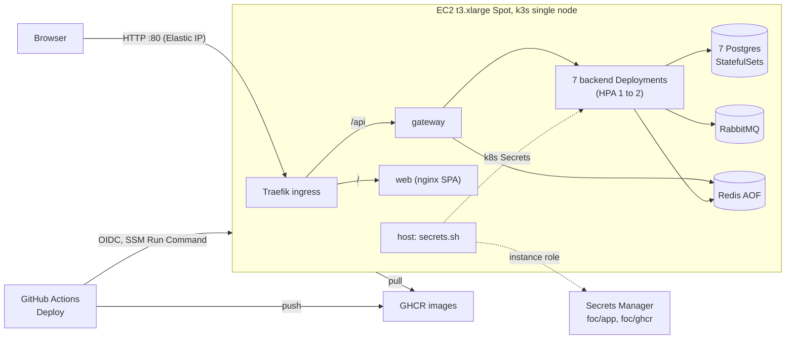

<!--
  AI-assisted (CS3219 AI Usage Policy disclosure):
  Tool: Claude Code (Opus 5.5), 2026-11-05, issue #48 (N5 cloud deployment).
  Scope: transcription of the team's cloud-deployment design. Every
  decision below was made by Leong Wei Zhi via neutral options Q&A
  (factual option comparisons and price lookups only; the tool
  recommended nothing); this document records them. Implementation and
  this write-up by the tool, per the allowed-use rules.
  Author review: Leong Wei Zhi, pending pull request review.
  2026-11-08, Claude Code (Fable 5.1): rewritten as a stand-alone page.
  DP7 and DP10 were re-decided that day through further options rounds;
  the options-considered tables list the alternatives as facts only,
  with no reasons, by Leong Wei Zhi's choice. Same day: the platform
  reason added, as stated by Leong Wei Zhi; the tool added only the
  facts of what a second node takes.
  Author review: Leong Wei Zhi, pending pull request review.
-->

# Cloud deployment (N5, issue #48)

FoC runs in the cloud as one EC2 Spot instance in the NUS Innovation
Sandbox account, running k3s. The same images as `docker compose` run
there. It stays up until about 2026-11-19 and is then destroyed with
nothing kept. The runbook is [`infra/README.md`](../infra/README.md).
Local `docker compose` stays the development stack and the demo fallback.

## What runs where

Traefik is the reverse proxy k3s ships with. It owns port 80 on the
host and routes by path: `/api` to the gateway, everything else to the
web container. The gateway stays the only route to the backend services,
as in compose. The web container serves static files only.

## Decisions

Decider: Leong Wei Zhi, by options Q&A, on 2026-11-05 and 2026-11-08.
The AI tool presented facts and prices only.

| # | Topic | Choice |
| --- | --- | --- |
| DP1 | Account, region | NUS Innovation Sandbox account, `ap-southeast-1` (its SCPs allow writes there and in `us-east-1` only) |
| DP2 | Host | One EC2 **t3.xlarge Spot** (4 vCPU, 16 GB), persistent request, **stop** on interruption, CPU credits `standard` |
| DP3 | Runtime | **k3s** single node: Traefik ingress, local-path volumes, metrics-server |
| DP4 | Data stores | In-cluster StatefulSets: 7 Postgres (supplier `postgres:16`, the rest `17`), RabbitMQ, Redis with AOF (G7 unchanged) |
| DP5 | Public access | Elastic IP, plain HTTP on port 80, no domain. Only port 80 open; shell through SSM Session Manager |
| DP6 | IaC | Terraform, state in S3 (`use_lockfile`), a bootstrap stack for the bucket |
| DP7 | Secrets | AWS Secrets Manager (`foc/app`, `foc/ghcr`). `secrets.sh` on the host copies them into k8s Secrets at first boot and on every deploy, through the instance role. IMDS hop limit 1, so pods cannot use that role |
| DP8 | Images, rollout | GHCR, pushed by GitHub Actions; rollout by SSM Run Command from an OIDC role trusted for `main` only |
| DP9 | Replicas | 1 per Deployment at rest, HPA min 1 / max 2 on CPU 70 % (N5.4), except chat and notification, which run exactly one replica (DP10) |
| DP10 | Backends at 2 replicas | No multi-replica hardening in the services. chat and notification run one replica, no HPA: a STOMP push reaches only the replica that holds the socket, which the team rates unsafe (issue #305 tracks cross-replica delivery). The other services scale to 2; their scheduled jobs then run on both replicas per tick, accepted because the jobs are idempotent (Leong Wei Zhi, 2026-11-08, on review) |
| DP11 | Demo data | Seed on in the cloud; realistic usernames everywhere, same passwords and counts |
| DP12 | Lifetime | Up to about 2026-11-19, then `terraform destroy`, nothing kept |
| DP13 | Repo layout | `infra/` (Terraform + manifests), the second non-service top-level folder |

## Options considered

Rows are the options, columns their properties as checked on the day.
The chosen row names its decision. No reasons are recorded, by Leong Wei
Zhi's choice, except where a reason is quoted.

### Platform, against the $50 budget

| Option | Managed pieces | 2-week cost | Chosen |
| --- | --- | --- | --- |
| EKS + 7 RDS + Amazon MQ + ElastiCache | all | ~$280 to 350 | |
| One EC2 Spot host + k3s, everything in-cluster | none | ~$30 | DP2 to DP4 |

Reason, as stated by Leong Wei Zhi (2026-11-08): the budget is $50, and
k3s is Kubernetes, so the single node can grow into more nodes later
instead of moving to a new platform.

### Runtime on the host

| Option | New files | Scaling path | N5.4 wording ("Kubernetes") | Chosen |
| --- | --- | --- | --- | --- |
| Docker Compose + a cloud override file | ~2 | `--scale` on one host, gateway DNS round-robin, no autoscaler | not met | |
| k3s with plain manifests only (no Terraform, secrets by hand) | ~20 manifests | HPA on the node; `k3s agent` join later | met | |
| k3s with Terraform, Secrets Manager and the SSM deploy path | ~35 | HPA on the node; `k3s agent` join later | met | DP3, DP6 to DP8 |

### Provisioning

| Option | Tooling | State | Teardown | Chosen |
| --- | --- | --- | --- | --- |
| AWS CLI script | AWS CLI v2 | none, resources found by tag | delete by tag | |
| CloudFormation | AWS CLI v2 | kept by AWS | `delete-stack` | |
| Terraform | Terraform (not installed locally; run from its Docker image) | S3 bucket from a bootstrap stack | `destroy` twice | DP6 |
| Console, documented | none | none | manual | |

### Secrets

| Option | Where the values sit | Reader | New value reaches pods | Chosen |
| --- | --- | --- | --- | --- |
| Env file on the host | host disk, plaintext | compose, or `kubectl create secret --from-env-file` | edit + restart | |
| Secrets Manager + External Secrets Operator | AWS | ESO pod through the instance role; IMDS hop limit 2, so any pod can use the role | hourly sync | |
| Secrets Manager + a static IAM key for ESO | AWS; the key in Terraform state | ESO pod | hourly sync | |
| Secrets Manager, copied by the host at deploy | AWS | `secrets.sh` on the host; IMDS hop limit 1 | next Deploy run | DP7 |
| GitHub Actions secrets | GitHub | the deploy workflow writes the file | next Deploy run | |

### Deploy path

| Option | Inbound port | Credentials held in GitHub | N5.3.3 | Chosen |
| --- | --- | --- | --- | --- |
| Manual on the host | none (SSM) | none | not met | |
| Actions, GHCR, SSH | 22 | a deploy key | met | |
| Actions, GHCR, SSM over OIDC | none | none (OIDC role) | met | DP8 |
| Pull-based timer on the host | none | none | met; outcome visible on the host only | |

### Backends at 2 replicas

Facts: 6 of 7 services run `@Scheduled` jobs; notification and chat push
STOMP from a per-JVM simple broker; supplier and notification use
`ddl-auto: update`; supplier and user seed at startup.

| Option | Service code changed | Behaviour at 2 replicas | Chosen |
| --- | --- | --- | --- |
| HPA on gateway + web only | none | backends never reach 2 | |
| HPA 1 to 2 everywhere, no hardening | none | the table below, split STOMP sockets included | |
| HPA 1 to 2 except chat and notification at one replica, no hardening | none | scheduled jobs run twice (accepted as idempotent); no split sockets | DP10 |
| ShedLock on the jobs + STOMP fanout over AMQP | user, order, credit, rating, chat, notification | jobs once, pushes everywhere; notification dedupe and first-boot races remain | |
| Full hardening: ShedLock, fanout, Flyway baselines + seed lock, insert-first dedupe + single active consumer | all 7 services | all covered | |

## Scaling

| Lever | Today | What it takes |
| --- | --- | --- |
| Replicas | HPA 1 to 2 at CPU 70 % on every Deployment except chat and notification (one replica, issue #305) | nothing; `kubectl -n foc get hpa` shows it |
| Headroom | CPU requests at every HPA max are about 3.0 of 4 vCPU | an HPA max above 2 needs a bigger host |
| Vertical | t3.xlarge | the `instance_type` variable and `terraform apply` (the host restarts) |
| Horizontal | one node | a second instance running `k3s agent` with the server's URL and join token (not provisioned). Between the nodes: 6443/tcp to the server, 8472/udp for flannel, 10250/tcp for metrics. Local-path volumes stay on the node that created them, so the StatefulSets keep running on the first node |

## Behaviour at 2 replicas (DP10)

chat and notification do not scale out: one replica each, no HPA, until
issue #305 delivers pushes across replicas. The other services may reach
2 replicas; their scheduled jobs then run twice per tick, which the team
accepts because the jobs are idempotent. The HPA only adds the second
replica while CPU stays above 70 %, and removes it about five minutes
after CPU drops.

| Services | At 2 replicas | What would change it |
| --- | --- | --- |
| user, order, credit, rating | each scheduled job runs on both replicas per tick; accepted, the jobs are idempotent | a scheduler lock (ShedLock) |
| notification, chat | a STOMP push reaches only the replica that holds the browser's socket; not accepted, so both stay at one replica | fanning pushes out over AMQP (issue #305) |
| notification | the same event could be processed twice (read-then-insert dedupe); not reached at one replica | insert-first dedupe and a single active consumer (issue #305) |
| supplier | `ddl-auto: update` and the seeder race only when two replicas start against an empty database. The HPA starts at 1, so first boot is one replica | a Flyway baseline and an advisory lock on the seed |

Below the CPU threshold every Deployment runs one replica and none of
this occurs.

## Cost (2 weeks, AWS price files, 2026-11-05)

| Item | ~USD |
| --- | --- |
| t3.xlarge Spot (~$0.074/h, floats) | 25 |
| 40 GB gp3 | 2 |
| Elastic IP ($0.005/h) | 2 |
| Secrets Manager (2 secrets) | 0.5 |
| **Total** | **~30** |

## Lifetime

Up until about 2026-11-19 (D4 on 2026-11-11, Week 13 demo). Then
`terraform destroy` in `infra/terraform` and in its `bootstrap/`. Secrets
are deleted without a recovery window, the volumes go with the instance,
nothing is kept.
