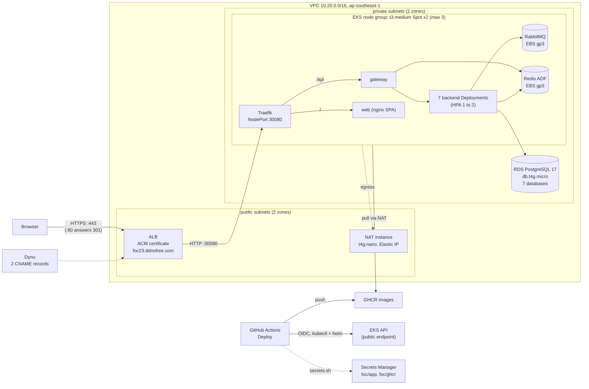

<!--
  AI-assisted (CS3219 AI Usage Policy disclosure):
  Tool: Claude Code (Opus 5.5), 2026-11-05, issue #48 (N5 cloud deployment).
  Scope: transcription of the team's cloud-deployment design. Every
  decision below was made by Leong Wei Zhi via neutral options Q&A
  (factual option comparisons and price lookups only; the tool
  recommended nothing); this document records them. Implementation and
  this write-up by the tool, per the allowed-use rules.
  Author review: Leong Wei Zhi, pending pull request review.
  2026-11-08, Claude Code (Fable 5.1): rewritten as a stand-alone page
  for the single k3s host; the HTTPS decisions added the same day.
  Author review: Leong Wei Zhi, pending pull request review.
  2026-11-09, Claude Code (Fable 5.1), issue #48 (EKS re-platform):
  replaced by this stand-alone page for the EKS design, by Leong Wei
  Zhi's choice; the k3s host stays as a row in the platform table. The
  decisions were re-taken in five options rounds that day (budget $250,
  deadline 2026-12-11); prices come from the ap-southeast-1 price files
  of 2026-11-09. Reasons are quoted where Leong Wei Zhi gave them.
  Author review: Leong Wei Zhi, pending pull request review.
-->

# Cloud deployment (N5, issue #48)

FoC runs in the cloud on an Amazon EKS cluster in the NUS Innovation
Sandbox account: two Spot nodes in private subnets, one RDS PostgreSQL
instance holding the seven service databases, RabbitMQ and Redis in the
cluster on EBS volumes, and an Application Load Balancer that serves
`https://foc23.ddnsfree.com` with an AWS Certificate Manager certificate.
The same images as `docker compose` run there. It stays up until
2026-12-11 and is then destroyed with nothing kept. The runbook is
[`infra/README.md`](../infra/README.md). Local `docker compose` stays the
development stack and the demo fallback.

## What runs where

The load balancer holds the certificate and is the only way in: every
node answers Traefik's NodePort to the load balancer's security group and
to nothing else, and the private subnets have no route from the internet.
Traefik routes by path, `/api` to the gateway and everything else to the
web container; the gateway stays the only route to the backend services,
as in compose. Outbound traffic (image pulls, OTP mail, the AWS APIs a
node calls when it joins) leaves through the NAT instance's one Elastic
IP. The Deploy workflow talks to the cluster's API endpoint directly with
`kubectl` and `helm`.

## Decisions

Decider: Leong Wei Zhi, by options Q&A, on 2026-11-05, 2026-11-08 and
2026-11-09 (the platform, nodes, network, data stores, secrets, deploy
access, ingress, credentials, lifetime and the pool size were re-decided
on 2026-11-09). The AI tool presented facts and prices only.

| # | Topic | Choice |
| --- | --- | --- |
| DP1 | Account, region | NUS Innovation Sandbox account, `ap-southeast-1` (its SCPs allow writes there and in `us-east-1` only) |
| DP2 | Platform | **Amazon EKS**, Kubernetes 1.37, authentication by access entries (`API` mode); vpc-cni, kube-proxy and CoreDNS as EKS installs them; add-ons: metrics-server, EBS CSI driver, Pod Identity agent |
| DP3 | Nodes | One managed node group of **t3.medium Spot**: 2 running, maximum 3 (the third added by hand); x86, since the images are built for `linux/amd64`; IMDS hop limit 1 so pods cannot use the node role |
| DP4 | Network and data stores | Nodes and the database in **private subnets** (two zones); egress through a **NAT instance** (fck-nat on an on-demand `t4g.nano`, one Elastic IP). **One RDS PostgreSQL 17 `db.t4g.micro`** with the seven service databases. RabbitMQ and Redis (AOF, G7 unchanged) stay StatefulSets on **EBS gp3** volumes |
| DP5 | Public access | `https://foc23.ddnsfree.com` through the load balancer (DP17, DP18). No node has a public address; the cluster API endpoint is public for GitHub Actions and private for the nodes |
| DP6 | IaC | Terraform, state in S3 (`use_lockfile`), a bootstrap stack for the bucket |
| DP7 | Secrets | AWS Secrets Manager (`foc/app`, `foc/ghcr`); `secrets.sh` copies them into k8s Secrets **from the Deploy job**, with the deploy role, on every deploy. `foc/app` also carries the database address and the RDS master credentials |
| DP8 | Images, rollout, cluster access | GHCR, pushed by GitHub Actions and tagged `<commit>-<run id>`; the Deploy job runs `deploy.sh` itself: `kubectl` and `helm` against the EKS API under an **access entry with cluster-admin** for the OIDC role trusted for `main` only. The job installs Traefik's chart, runs `secrets.sh` and the db-init Job, applies the kustomization and waits. A pod rolls when its image tag, the Secret version or the ConfigMap hash changed |
| DP9 | Replicas | 1 per Deployment at rest, HPA min 1 / max 2 on CPU 70 % (N5.4) from the metrics-server add-on, except chat and notification, which run exactly one replica (DP10) |
| DP10 | Backends at 2 replicas | No multi-replica hardening in the services. chat and notification run one replica, no HPA, and a Recreate strategy so a deploy never overlaps two pods: a STOMP push reaches only the replica that holds the socket, which the team rates unsafe (issue #305 tracks cross-replica delivery). The other services scale to 2; their scheduled jobs then run on both replicas per tick, accepted because the jobs are idempotent (Leong Wei Zhi, 2026-11-08, on review) |
| DP11 | Demo data | Seed on in the cloud; realistic usernames everywhere, same passwords and counts |
| DP12 | Lifetime | Up to **2026-12-11**, then `terraform destroy`, nothing kept (revised from about 2026-11-19 on 2026-11-09) |
| DP13 | Repo layout | `infra/` (Terraform, manifests, Helm values), the second non-service top-level folder |
| DP14 | Spot on the WebSocket path | **All nodes stay Spot.** A Spot interruption drops the STOMP sockets for the 1 to 2 minutes the chat or notification pod takes to start elsewhere; the web clients reconnect (1 s exponential back-off, 10 s heartbeats) and refetch, and nothing is lost server-side |
| DP15 | Ingress path | The Terraform-owned load balancer targets the node group's Auto Scaling group on **NodePort 30080**; **Traefik from its Helm chart** (42.3.1) is the ingress controller, same class name and routes as before |
| DP16 | Database credentials | **Seven roles, one per service**, each owning its database, with the `foc/app` passwords; a `db-init` Job creates them with the master credentials on every deploy and re-applies the passwords. The master credentials reach that Job only |
| DP17 | Domain | `foc23.ddnsfree.com`, a free Dynu hostname (records added by hand in Dynu's panel). The sandbox SCP denies Route 53 domain registration. First `foc23.mooo.com` on FreeDNS, revised when FreeDNS refused CNAME records on its shared domains |
| DP18 | TLS endpoint | Application Load Balancer in `ap-southeast-1` with a free ACM certificate (DNS validation); its port 80 answers **301** to https; plain HTTP to Traefik behind it |
| DP19 | Connection pool | Hikari capped at **5 connections per service** (`SPRING_DATASOURCE_HIKARI_MAXIMUM_POOL_SIZE`): `db.t4g.micro` allows about 110 connections, and 7 services x 10 (the default) x 2 replicas would exceed it |

## Options considered

Rows are the options, columns their properties as checked on the day.
The chosen row names its decision. Costs are for the 32 days from
2026-11-09 to 2026-12-11 (about 768 hours), from the public
`ap-southeast-1` price files of 2026-11-09, unless marked otherwise.
Reasons appear only where Leong Wei Zhi gave one.

### Platform, against the $250 budget

| Option | Managed pieces | 32-day cost (compute only) | Scaling path | Chosen |
| --- | --- | --- | --- | --- |
| One EC2 Spot host + k3s, everything in-cluster (the design of 2026-11-05 to 2026-11-08, built for a $50 budget) | none | t3.xlarge Spot ~$58 | HPA max 2 on one node | |
| Single k3s node on a bigger Spot host | none | m7i.xlarge Spot ~$77 | HPA max above 2 on one node | |
| k3s multi-node: server + Spot agents | none | ~$28 per t3.large agent | join token, agent cloud-init, 3 security-group rules; volumes pinned to the server | |
| **Amazon EKS** + managed node group | control plane | $0.10/h = ~$77 plus nodes | node group size, HPA | DP2 |

Reason, as stated by Leong Wei Zhi (2026-11-09): "initially i thought
budget is 50 dollars, turns out it is 250 dollars. Can we make our
deployment more scalable? i was also thinking of using amazon's db
provider instead of using stored state pods."

### Nodes

Facts: 7 JVM pods request 200m CPU / 384 Mi each (limit 768 Mi); at one
replica about 1.4 vCPU / 2.7 GB, at HPA max 2 about 3 vCPU / 5.4 GB; EKS
system pods take about 0.3 vCPU / 0.5 GB per node; RabbitMQ and Redis add
about 0.15 vCPU / 0.3 GB. The images are `linux/amd64`, so x86 types only.

| Option | Total | 32-day cost | Pods per node | Chosen |
| --- | --- | --- | --- | --- |
| 2 x t3.large Spot | 4 vCPU / 16 GB | ~$57 | 35 | first choice |
| 3 x t3.large Spot | 6 vCPU / 24 GB | ~$85 | 35 | |
| **t3.medium Spot, 2 running, max 3** | 4 vCPU / 8 GB (6 / 12 with the third) | ~$34, the third ~$17 while it runs | 17 (about 11 used) | DP3 |
| 1 x t3.xlarge Spot | 4 vCPU / 16 GB on one node | ~$58 | 58 | |

With two t3.medium nodes the JVM memory limits (5.4 GB) plus RabbitMQ,
Redis and Traefik leave HPA max 2 only partly schedulable until the third
node joins; see Scaling.

### Host purchase model

| Option | 32-day cost | On interruption | Chosen |
| --- | --- | --- | --- |
| **Spot** | ~$34 (two t3.medium) | the node group drains and replaces the node; pods reschedule | DP3 |
| On-demand | ~$81 | none | |
| Spot nodes + one on-demand node for Traefik, gateway, chat, notification | ~$34 + $41 | sockets stay up; the other services move | |

The WebSocket question was asked on its own after the network round
(DP14): the clients reconnect and catch up by themselves, and the
interruption frequency for t3.medium here is not visible from the CLI.

### Network

Facts: a private subnet has no route from the internet, so a node in it
cannot be reached whatever its security group says; its outbound traffic
(GHCR, Amazon ECR, the EKS and EC2 APIs when a node joins, Gmail) then
needs a NAT, because a load balancer is a reverse proxy, carries only
connections that arrive at it, and cannot be a route target. RDS sits in
private subnets in every option and needs no NAT.

| Option | Nodes reachable from the internet | Egress | 32-day cost | Chosen |
| --- | --- | --- | --- | --- |
| Public subnets, no NAT | on whatever the security groups open (30080 from the load balancer only today) | each node's own public IPv4 | ~$8 (IPv4) | first choice |
| Private subnets + NAT gateway | no | managed, 45 Gbps, zone-redundant, one zone | ~$45 + $0.059/GB | |
| **Private subnets + NAT instance** | no | fck-nat on `t4g.nano`, 5 Gbps burst, one instance, one zone, EC2 auto-recovery | ~$4 + $4 Elastic IP | DP4 |

| NAT instance purchase model | 32-day cost | While stopped | Chosen |
| --- | --- | --- | --- |
| **On-demand** | ~$4 | not interrupted; auto-recovery after hardware failure keeps the interface and address | DP4 |
| Spot | ~$1.4 | egress gone until capacity returns | |

### Postgres

Facts: all seven services read `<SVC>_DB_HOST/PORT/NAME/USER/PASSWORD`;
pgjdbc defaults to `sslmode=prefer`, so RDS's enforced TLS works without
URL changes; RDS offers PostgreSQL 16.x and 17.x here. Four services poll
their outbox tables every second and order-service sweeps every 15 s, so
a database that needs five idle minutes to pause never pauses while the
pods run.

| Option | Instance | 32-day cost | Databases and roles | Chosen |
| --- | --- | --- | --- | --- |
| Keep 7 StatefulSets on node volumes | none | 0 | as today | |
| **One RDS instance, 7 databases** | `db.t4g.micro` $0.025/h (1 GiB, ~110 connections) | ~$19 + ~$3 for 20 GB gp3 | created by a Job inside the VPC (RDS is not public) | DP4 |
| One RDS instance, 7 databases | `db.t4g.small` $0.051/h, `db.t4g.medium` $0.102/h | ~$39, ~$78 | same | |
| 7 RDS instances, one per service | 7 x `db.t4g.micro` | ~$134 + ~$20 storage | each master user is the service's user | |
| Aurora PostgreSQL Serverless v2, one cluster | 0.5 to 1 ACU | $0.20/ACU-h: ~$77 at the 0.5 ACU floor, $0 only while paused | same Job | first choice, dropped the same day after the pause fact |

Storage: Aurora $0.11/GB-month against gp3 $0.138, plus $0.22 per
million I/Os; negligible at 20 GB.

### RabbitMQ and Redis

Facts: the services declare durable classic queues with TTL and
dead-letter arguments; the gateway reaches Redis over plain TCP with
`lua-resty-redis`, no AUTH.

| Option | 32-day cost | Notes | Chosen |
| --- | --- | --- | --- |
| Amazon MQ for RabbitMQ, `mq.t3.micro` | ~$26 | priced in the price file but **not orderable** here: the API offers m5 and m7g types only | first choice, dropped |
| Amazon MQ for RabbitMQ, `mq.m7g.medium` | ~$131 | AMQPS 5671 only (`SPRING_RABBITMQ_SSL_ENABLED=true`) | |
| **RabbitMQ in the cluster on an EBS gp3 volume** | ~$0.1 | EBS CSI add-on; the volume is zone-bound, the pod follows it | DP4 |
| RabbitMQ in the cluster without a volume | 0 | queued, unconsumed messages lost on restart | |
| ElastiCache Valkey `cache.t4g.micro` | ~$15 (Redis OSS ~$18) | plain 6379 in the VPC | first choice, dropped for budget |
| **Redis in the cluster on an EBS gp3 volume** | ~$0.1 | unchanged StatefulSet, AOF | DP4 |

### Ingress path and controller

| Option | Who owns the load balancer | DNS | Chosen |
| --- | --- | --- | --- |
| **Terraform ALB to a NodePort ingress controller** | Terraform (certificate, listeners, target group on the node group's Auto Scaling group) | unchanged | DP15 |
| AWS Load Balancer Controller | the controller, from a Kubernetes Ingress (Helm chart + Pod Identity role); Terraform keeps the certificate only | the CNAME changes with the controller's balancer | |

| Controller | Carry-over from k3s | Chosen |
| --- | --- | --- |
| **Traefik (Helm chart)** | same controller; the Ingress and the two timeouts (read 0 s, idle 3600 s) move to chart values | DP15 |
| ingress-nginx (Helm chart) | new class name and timeout annotations | |

### Secrets on EKS

| Option | Reader | Refresh | Chosen |
| --- | --- | --- | --- |
| External Secrets Operator + Pod Identity | a pod with an IAM role bound to its service account | timer and deploy | |
| **`secrets.sh` from the Deploy job** | the deploy role, in GitHub Actions; values pass through the runner's memory | every deploy | DP7 |
| Secrets Store CSI driver + ASCP | two charts + Pod Identity; files mirrored into Secrets | poll interval | |

### Deploy access

| Option | Role scope | Add-ons installed by | Chosen |
| --- | --- | --- | --- |
| Namespace-scoped access entry | `AmazonEKSEditPolicy` on `foc` | Terraform's helm/kubernetes providers | |
| **Cluster-admin access entry** | `AmazonEKSClusterAdminPolicy` | the Deploy job (`helm upgrade --install`) | DP8 |

### Database credentials

| Option | Isolation | Setup | Chosen |
| --- | --- | --- | --- |
| **Seven roles, created by a Job** | each service reaches its own database only | master password generated by Terraform, in `foc/app` | DP16 |
| One master user for all seven | any service could read another's database | the Job creates six databases | |
| Seven roles, RDS-managed master secret | as the first | RDS stores and rotates the master password (~$0.40/month) | |

### Lifetime and docs

| Topic | Options | Chosen |
| --- | --- | --- |
| Teardown | 2026-12-11; 2026-12-12; right after the Week 13 demo | **2026-12-11** (DP12) |
| This page | stand-alone page for the EKS design; k3s design kept as a superseded section | **stand-alone** |
| Reasons | recorded in Leong Wei Zhi's words; facts only | **recorded** where given |
| Pull requests | one (infra + workflow + docs); code then docs; docs then code | **one** |

### HTTPS: domain and TLS endpoint (2026-11-08)

Facts: an ACM certificate names a domain, never an IP, and ACM validates
by a CNAME record under that name. The sandbox SCP denies
`route53domains:*`; Route 53 hosted zones and ACM are allowed.

| Domain option | Who owns the name | Cost | Chosen |
| --- | --- | --- | --- |
| A domain a team member already owns | the member | none | |
| A domain bought at an external registrar | whoever pays | about US$2 to 12 a year | |
| Free subdomain on FreeDNS's shared `mooo.com` | FreeDNS account | none; FreeDNS refuses CNAME records on its shared domains for free accounts (tried 2026-11-08) | first DP17, dropped |
| **Free Dynu hostname (`foc23.ddnsfree.com`)** | Dynu account | none; two CNAMEs by hand | DP17 |
| Free dynv6 zone | dynv6 account | none | |
| No domain: CloudFront's default `*.cloudfront.net` certificate | AWS | none | |

| TLS endpoint | WebSockets | 32-day cost | Chosen |
| --- | --- | --- | --- |
| **Application Load Balancer** | yes (idle timeout up to 4000 s; 3500 s set) | ~$19 + LCU | DP18 |
| CloudFront in front of the cluster | yes | ~0 (free tier) | |
| ACM exportable certificate loaded into Traefik | yes | $15 per name, once | |
| Network Load Balancer, TLS listener | yes; no redirect possible | ~$19 | |

## Scaling

| Lever | Today | What it takes |
| --- | --- | --- |
| Replicas | HPA 1 to 2 at CPU 70 % on every Deployment except chat and notification (one replica, issue #305) | nothing; `kubectl -n foc get hpa` shows it |
| Headroom | 2 x t3.medium = 4 vCPU / 8 GB; CPU requests at every HPA max about 3.0 vCPU; memory limits at HPA max about 5.4 GB for the JVMs alone | the third node |
| Third node | node group maximum 3, desired 2 | `aws eks update-nodegroup-config --cluster-name foc --nodegroup-name foc-spot --scaling-config desiredSize=3` (Terraform ignores the desired size); ~$0.022/h while it runs |
| More or bigger nodes | `node_count`, `node_max`, `node_instance_type` variables | `terraform apply`; a type change replaces the nodes one at a time |
| Database | `db.t4g.micro`, 20 GB gp3 | `db_instance_class`; RDS resizes with a short outage |
| Volumes | RabbitMQ and Redis on gp3 EBS, bound to the zone they were created in | the pod lands only on a node in that zone; a two-zone group always has one unless Spot takes it |
| Load balancer | one target group on the node group's Auto Scaling group | new nodes register themselves |

## Behaviour at 2 replicas (DP10)

chat and notification do not scale out: one replica each, no HPA, until
issue #305 delivers pushes across replicas. The other services may reach
2 replicas; their scheduled jobs then run twice per tick, which the team
accepts because the jobs are idempotent. The HPA only adds the second
replica while CPU stays above 70 %, and removes it about five minutes
after CPU drops.

| Services | At 2 replicas | What would change it |
| --- | --- | --- |
| user, order, credit, rating | each scheduled job runs on both replicas per tick; accepted, the jobs are idempotent | a scheduler lock (ShedLock) |
| notification, chat | a STOMP push reaches only the replica that holds the browser's socket; not accepted, so both stay at one replica | fanning pushes out over AMQP (issue #305) |
| notification | the same event could be processed twice (read-then-insert dedupe); not reached at one replica | insert-first dedupe and a single active consumer (issue #305) |
| supplier | `ddl-auto: update` and the seeder race only when two replicas start against an empty database. The HPA starts at 1, so first boot is one replica | a Flyway baseline and an advisory lock on the seed |

Below the CPU threshold every Deployment runs one replica and none of
this occurs.

## Cost (32 days, 2026-11-09 to 2026-12-11, AWS price files of 2026-11-09)

| Item | ~USD |
| --- | --- |
| EKS control plane ($0.10/h) | 77 |
| 2 x t3.medium Spot (~$0.022/h each, floats) | 34 |
| NAT instance t4g.nano on-demand ($0.0053/h) + its Elastic IP ($0.005/h) | 8 |
| Application Load Balancer ($0.0252/h plus LCU; demo traffic stays under one LCU) | 21 |
| RDS db.t4g.micro ($0.025/h) + 20 GB gp3 ($0.138/GB-month) | 22 |
| EBS gp3 for RabbitMQ and Redis (2 GB) + node root volumes (2 x 20 GB, $0.096/GB-month) | 4 |
| Secrets Manager (2 secrets), ACM certificate | 1 |
| **Total** | **~167** |

Plus about $0.022/h whenever the third node runs. About $3 was spent on
the k3s host before the re-platform.

## Lifetime

Up until 2026-12-11. Then, in order: delete the `foc` namespace (its EBS
volumes are not Terraform's), `terraform destroy` in `infra/terraform`
and in its `bootstrap/`. Secrets are deleted without a recovery window,
the database without a final snapshot, nothing is kept. The two CNAME
records at Dynu are deleted by hand.
