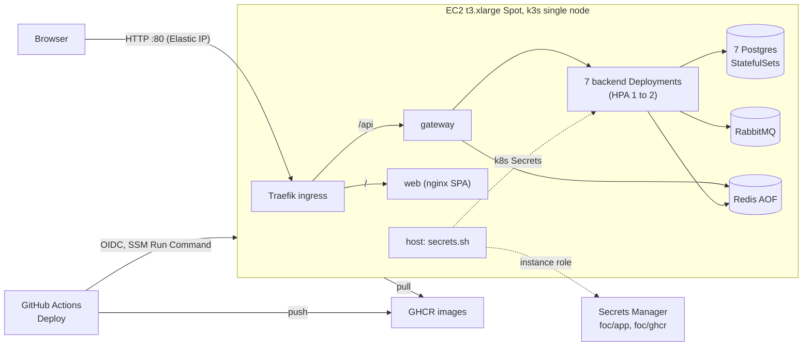

<!--
  AI-assisted (CS3219 AI Usage Policy disclosure):
  Tool: Claude Code (Opus 5.5), 2026-11-05, issue #48 (N5 cloud deployment).
  Scope: transcription of the team's cloud-deployment design. Every
  decision below was made by Leong Wei Zhi via neutral options Q&A
  (factual option comparisons and price lookups only; the tool
  recommended nothing); this document records them. Implementation and
  this write-up by the tool, per the allowed-use rules.
  Author review: Leong Wei Zhi, pending pull request review.
  2026-11-08, Claude Code (Fable 5.1): rewritten after the seven-PR stack
  (#289 to #297) was closed. DP14 to DP20 come from three further options
  rounds the same day; the options-considered tables list the
  alternatives as facts only, with no reasons, by Leong Wei Zhi's choice.
  Author review: Leong Wei Zhi, pending pull request review.
-->

# Cloud deployment (N5, issue #48)

FoC runs in the cloud as one EC2 Spot instance in the NUS Innovation
Sandbox account, running k3s. The same images as `docker compose` run
there. It stays up until about 2026-11-19 and is then destroyed with
nothing kept. The runbook is [`infra/README.md`](../infra/README.md).
Local `docker compose` stays the development stack and the demo fallback.

## What runs where

## Decisions

Decider: Leong Wei Zhi, by options Q&A. The AI tool presented facts and
prices only. DP1 to DP13 date from 2026-11-05. DP14 to DP20 date from
2026-11-08, after the first PR stack (#289 to #297) was closed as too
heavy to land before D4.

| # | Topic | Choice |
| --- | --- | --- |
| DP1 | Account, region | NUS Innovation Sandbox account, `ap-southeast-1` (its SCPs allow writes there and in `us-east-1` only) |
| DP2 | Host | One EC2 **t3.xlarge Spot** (4 vCPU, 16 GB), persistent request, **stop** on interruption, CPU credits `standard` |
| DP3 | Runtime | **k3s** single node: Traefik ingress, local-path volumes, metrics-server |
| DP4 | Data stores | In-cluster StatefulSets: 7 Postgres (supplier `postgres:16`, the rest `17`), RabbitMQ, Redis with AOF (G7 unchanged) |
| DP5 | Public access | Elastic IP, plain HTTP on port 80, no domain. Only port 80 open; shell through SSM Session Manager |
| DP6 | IaC | Terraform, state in S3 (`use_lockfile`), a bootstrap stack for the bucket |
| DP7 | Secrets | AWS Secrets Manager (`foc/app`, `foc/ghcr`). The reader changed with DP20 |
| DP8 | Images, rollout | GHCR, pushed by GitHub Actions; rollout by SSM Run Command from an OIDC role trusted for `main` only |
| DP9 | Replicas | 1 per Deployment at rest, HPA min 1 / max 2 on CPU 70 % for every Deployment (N5.4) |
| DP10 | Multi-replica backends | Superseded by DP15 (was: ShedLock, STOMP fanout, Flyway, seed lock, dedupe) |
| DP11 | Demo data | Seed on in the cloud; realistic usernames everywhere, same passwords and counts |
| DP12 | Lifetime | Up to about 2026-11-19, then `terraform destroy`, nothing kept |
| DP13 | Repo layout | `infra/` (Terraform + manifests), the second non-service top-level folder |
| DP14 | Design after the stack was closed | DP1 to DP9, DP12 and DP13 kept as built in #289 |
| DP15 | Multi-replica hardening | Dropped (#290 to #294 stay closed). HPA 1 to 2 stays on every Deployment; the behaviour at 2 replicas is listed below |
| DP16 | PR split | One infra PR (infra, gateway, deploy workflow, docs) plus independent PRs off `main` |
| DP17 | Demo names | Kept, as its own PR off `main` |
| DP18 | Documentation | This decision page plus a short runbook (`infra/README.md`) |
| DP19 | PR numbers | Fresh PRs; the closed ones get a pointer comment |
| DP20 | IMDS finding (#289 review) | Hop limit 1; External Secrets Operator dropped. `secrets.sh` on the host copies `foc/app` and `foc/ghcr` into k8s Secrets at first boot and on every deploy |

## Options considered

Rows are the options, columns their properties as checked on the day.
The chosen row names its decision. No reasons are recorded, by Leong Wei
Zhi's choice (2026-11-08).

### Platform, against the $50 budget (2026-11-05)

| Option | Managed pieces | 2-week cost | Chosen |
| --- | --- | --- | --- |
| EKS + 7 RDS + Amazon MQ + ElastiCache | all | ~$280 to 350 | |
| One EC2 Spot host + k3s, everything in-cluster | none | ~$30 | DP2 to DP4 |

### Runtime on the host (DP14)

| Option | New files | Scaling path | N5.4 wording ("Kubernetes") | Chosen |
| --- | --- | --- | --- | --- |
| Docker Compose + a cloud override file | ~2 | `--scale` on one host, gateway DNS round-robin, no autoscaler | not met | |
| k3s, trimmed (plain Secret, no ESO, no Terraform) | ~20 manifests | HPA on the node; `k3s agent` join later | met | |
| #289 design as built | ~35 | HPA on the node; `k3s agent` join later | met | DP14 |

### Provisioning (DP14)

| Option | Tooling | State | Teardown | Chosen |
| --- | --- | --- | --- | --- |
| AWS CLI script | AWS CLI v2 | none, resources found by tag | delete by tag | |
| CloudFormation | AWS CLI v2 | kept by AWS | `delete-stack` | |
| Terraform | Terraform (not installed locally; run from its Docker image) | S3 bucket from a bootstrap stack | `destroy` twice | DP6 |
| Console, documented | none | none | manual | |

### Secrets (DP14, DP20)

| Option | Where the values sit | Reader | New value reaches pods | Chosen |
| --- | --- | --- | --- | --- |
| Env file on the host | host disk, plaintext | compose, or `kubectl create secret --from-env-file` | edit + restart | |
| Secrets Manager + External Secrets Operator | AWS | ESO pod through the instance role; IMDS hop limit 2, so any pod can use the role | hourly sync | built in #289 |
| Secrets Manager + a static IAM key for ESO | AWS; the key in Terraform state | ESO pod | hourly sync | |
| Secrets Manager, copied by the host at deploy | AWS | `secrets.sh` on the host; IMDS hop limit 1 | next Deploy run | DP7 + DP20 |
| GitHub Actions secrets | GitHub | the deploy workflow writes the file | next Deploy run | |

### Deploy path (DP14)

| Option | Inbound port | Credentials held in GitHub | N5.3.3 | Chosen |
| --- | --- | --- | --- | --- |
| Manual on the host | none (SSM) | none | not met | |
| Actions, GHCR, SSH | 22 | a deploy key | met | |
| Actions, GHCR, SSM over OIDC | none | none (OIDC role) | met | DP8 |
| Pull-based timer on the host | none | none | met; outcome visible on the host only | |

### Multi-replica hardening (DP15)

Facts on 2026-11-08: 6 of 7 services run `@Scheduled` jobs; notification
and chat push STOMP from a per-JVM simple broker; supplier and
notification use `ddl-auto: update`; supplier and user seed at startup.

| Option | Backend code changed | Behaviour at 2 replicas | Chosen |
| --- | --- | --- | --- |
| Drop all; HPA on gateway + web only | none | backends never reach 2 | |
| Drop all; HPA 1 to 2 everywhere | none | the table below | DP15 |
| Keep #290 + #291 (ShedLock, STOMP fanout) | 70 files | jobs once, pushes everywhere; notification dedupe and first-boot races remain | |
| Keep all five (#290 to #294) | 146 files, all 7 services | all covered | |

### PR split, demo names, docs, PR numbers (DP16 to DP19)

| Question | Options | Chosen |
| --- | --- | --- |
| Split | one infra PR + independent PRs; infra then docs; stacked chain; one PR for everything | one infra PR + independent PRs |
| #295 demo names | keep as its own PR; drop | keep |
| Docs | decision page + short runbook; decision page + the full #297 runbook; single page | decision page + short runbook |
| PR numbers | reopen #289 and #295; fresh PRs | fresh PRs |

## Scaling

| Lever | Today | What it takes |
| --- | --- | --- |
| Replicas | HPA 1 to 2 per Deployment at CPU 70 % | nothing; `kubectl -n foc get hpa` shows it |
| Headroom | CPU requests at every HPA max are about 3.4 of 4 vCPU | an HPA max above 2 needs a bigger host |
| Vertical | t3.xlarge | the `instance_type` variable and `terraform apply` (the host restarts) |
| Horizontal | one node | a second instance joining with `k3s agent` (not provisioned) |

## Behaviour at 2 replicas (DP15)

| Services | At 2 replicas | The dropped fix |
| --- | --- | --- |
| user, order, credit, rating, chat, notification | each scheduled job runs on both replicas per tick | #290 ShedLock |
| notification, chat | a STOMP push reaches only the replica that holds the browser's socket | #291 fanout over AMQP |
| notification | the same event can be processed twice (read-then-insert dedupe) | #294 insert-first dedupe, single active consumer |
| supplier, notification | `ddl-auto: update` and the seeders race only when two replicas start against an empty database. The HPA starts at 1, so first boot is one replica | #292, #294 Flyway + advisory lock |

Below the CPU threshold every Deployment runs one replica and none of
this occurs.

## Cost (2 weeks, AWS price files, 2026-11-05)

| Item | ~USD |
| --- | --- |
| t3.xlarge Spot (~$0.074/h, floats) | 25 |
| 40 GB gp3 | 2 |
| Elastic IP ($0.005/h) | 2 |
| Secrets Manager (2 secrets) | 0.5 |
| **Total** | **~30** |

## Lifetime

Up until about 2026-11-19 (D4 on 2026-11-11, Week 13 demo). Then
`terraform destroy` in `infra/terraform` and in its `bootstrap/`. Secrets
are deleted without a recovery window, the volumes go with the instance,
nothing is kept.
