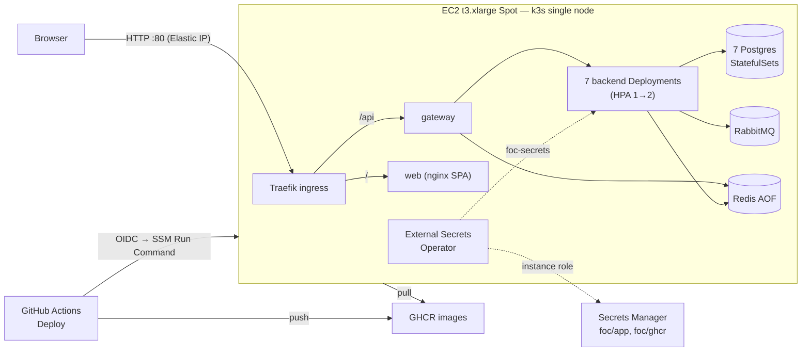

<!--
  AI-assisted (CS3219 AI Usage Policy disclosure):
  Tool: Claude Code (Opus 5.5), 2026-11-05, issue #48 (N5 cloud deployment).
  Scope: transcription of the team's cloud-deployment design. Every
  decision below was made by Leong Wei Zhi on 2026-11-05 via neutral
  options Q&A (factual option comparisons and price lookups only — the
  tool recommended nothing); this document records them. Implementation
  and this write-up by the tool, per the allowed-use rules.
  Author review: Leong Wei Zhi, pending pull request review.
-->

# Cloud deployment (N5, issue #48)

Runbook: [`infra/README.md`](../infra/README.md). Local `docker compose`
stays the development stack and the fallback for demos.

## Decisions

All decided by **Leong Wei Zhi via options Q&A** on 2026-11-05 (AI made
no design decisions; comparisons presented were factual only). A first
design (EKS, RDS, Amazon MQ, ElastiCache) was priced at ~$280–350 for two
weeks against a **$50 budget** and replaced the same day by DP1–DP8.

| # | Decision | Choice |
| --- | --- | --- |
| DP1 | Account / region | NUS Innovation Sandbox account, `ap-southeast-1` (the sandbox's SCPs allow writes only there and in `us-east-1`) |
| DP2 | Host | One EC2 **t3.xlarge Spot** instance (16 GB, amd64), persistent request, **stop** on interruption; CPU credits `standard` |
| DP3 | Runtime | **k3s** single node (Traefik ingress, local-path volumes, metrics-server bundled) |
| DP4 | Data stores | In-cluster StatefulSets: **7 Postgres** (one per service as in compose; supplier `postgres:16`, the rest `17`), RabbitMQ, Redis with AOF — G7 unchanged |
| DP5 | Public access | **Elastic IP**, plain HTTP on port 80, no domain; only port 80 open (no SSH, no k3s API — shell via SSM Session Manager) |
| DP6 | IaC | **Terraform**, state in S3 with `use_lockfile` (bootstrap bucket) |
| DP7 | Secrets | **AWS Secrets Manager + External Secrets Operator**; ESO authenticates with the instance role |
| DP8 | Images + rollout | **GHCR**, pushed by GitHub Actions; rollout by **SSM Run Command** from an OIDC role trusted for `main` only |
| DP9 | Replicas | 1 per Deployment at rest, **HPA min 1 / max 2** on CPU for every Deployment (N5.4 on one node) |
| DP10 | Multi-replica backends | Backends made safe for >1 replica (stacked issue-#48 PRs): ShedLock (JDBC) on scheduled jobs, STOMP fanout over AMQP, Flyway in supplier + notification, advisory lock on the supplier seed, Persistable dedupe + single-active-consumer in notification |
| DP11 | Demo data | Demo seed on in the cloud; realistic usernames everywhere, same public passwords and counts |
| DP12 | Lifetime | Up until ~**2026-11-19**, then `terraform destroy` with nothing kept (secrets deleted without recovery window, no snapshots) |
| DP13 | Repo layout | `infra/` (Terraform + Kubernetes manifests) — the second non-service top-level folder after `foc-contracts/` |

## Cost (2 weeks, from AWS price files)

| Item | ~USD |
| --- | --- |
| t3.xlarge Spot (~$0.074/h, floats) | 25 |
| 40 GB gp3 | 2 |
| Elastic IP ($0.005/h) | 2 |
| Secrets Manager (2 secrets) | 0.5 |
| **Total** | **~30** |
