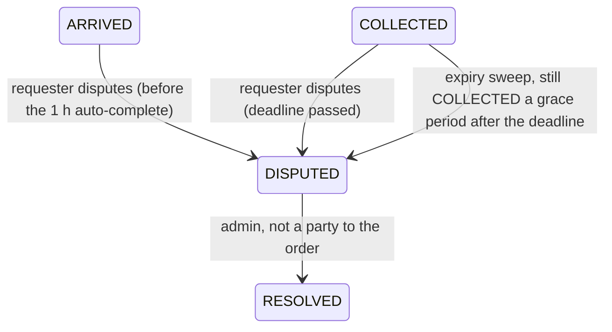

<!--
  AI-assisted (CS3219 AI Usage Policy disclosure):
  Tool: Claude Code (Opus 5.5), 2026-10-21.
  Scope: transcribed the team's decisions for N3 dispute resolution and
  failed-order management (DSP-1 to DSP-17, rev 2, with the revisions
  made the same day during the issue review and issue #234, and the
  rules for fixed-value String fields) into this
  document. Every decision and every reason in the "Why" column is the
  team's (given by Ryan Ang); the tool only formatted them and made no
  design decisions.
  Author review: Ryan Ang, pending pull request review.
-->

# N3 — Dispute Resolution and Failed-Order Management

**Scope:** the team's decisions for nice-to-have N3 (issue #46, owner
Ryan Ang): requesters dispute an order whose items were not delivered
successfully (N3.1), admins divide the held reward between requester
and courier (N3.2), and admins see failed orders and orders whose
credits are stuck between services. Spans order-service,
credit-service, notification-service, `foc-contracts` and `web/`; no
new service. \
Original design sketch: wiki *D3 Design — Order and Credit Services*,
§P5.2.1. Where that sketch and this page differ, this page holds the
decisions. \
Related: [`credit-service.md`](credit-service.md),
[`notification-service.md`](notification-service.md) (D18, the event
contract rules), [`../foc-contracts/README.md`](../foc-contracts/README.md).

## Order states

Disputes are only possible while the reward is still HELD in the Credit
Service, so a resolution only divides credits already held and never
takes any back from a courier.

## Decisions

| # | Topic | Decision | Why |
| --- | --- | --- | --- |
| DSP-1 | Failure reason | `close_reason` column on `requests`: `REQUESTER_CANCELLED`, `RESERVATION_TIMEOUT`, `INSUFFICIENT_CREDITS`, `INVALID_REWARD`, `DEADLINE_PASSED`, `DISPUTE_RESOLVED`. Null for COMPLETED and for rows that already exist. No `TIMED_OUT` state: timeouts stay CANCELLED and keep publishing `request.cancelled`. A rejection's reason comes from the reply's `reasonCode`, never its text; a null `reasonCode` (a message from before #234) leaves `close_reason` null. | A new state would need a new event, and Credit and Notification already handle `request.cancelled` correctly for timeouts. A column says why an order closed without changing the state machine. |
| DSP-2 | Dispute data | New table `request_dispute`, `request_id` as primary key (one dispute per order): `category`, `dispute_note`, `raised_by`, `raised_at`, `auto_escalated`, `resolved_by`, `resolved_at`, `courier_amount`, `requester_amount`, `resolution_note`. | Keeps `requests` free of columns that are empty for almost every order. `dispute_note` matches the event field, so one name means one thing in the database too. |
| DSP-3 | Admin awareness | Pull, not push: a dispute queue and a count badge on the admin dashboard. Notification stays parties-only (requester and courier). | Pushing to every admin would make Notification ask the User Service for a list of admins: new coupling for little benefit. |
| DSP-4 | Credit schema and settlement | V4 migration: `RESOLVED` added to the `credit_reservation` status CHECK; nullable `courier_share` (the requester's share is `amount - courier_share`); CHECK `status <> 'RESOLVED' or (courier_id is not null and courier_share between 0 and amount)`. History reuses the existing types: the courier's share writes `TRANSFER_OUT`/`TRANSFER_IN`, the requester's share writes `RELEASE`; a zero share writes no row for that side. Settlement locks both accounts in user-ID order, as transfer does; requester `reserved -= amount` and `available += requesterAmount`; courier `available += courierAmount` as a new lot; the requester's share goes back to the reservation's slices with the latest expiry first. | Credits move exactly as in a normal payment or refund; `request_ref` ties the rows to the order and the order's RESOLVED state explains them. The record says who the courier was even when their share is 0, and the stored split lets duplicates be detected (DSP-13). Latest expiry first gives the requester back the credits that last longest. |
| DSP-5 | API | **Order:** `POST /dispute {requestId, category, note}` (requester); `POST /resolve {requestId, courierAmount, requesterAmount, note}` (ADMIN/OWNER, not a party); `POST /retry-settlement {requestId}` (ADMIN/OWNER); `GET /requests/admin?state=&closeReason=&createdFrom=&createdTo=` (ADMIN/OWNER, all users; the dispute queue is `state=DISPUTED`); `POST /requests/admin/statuses {ids:[...]}` → `{id: state}` (ADMIN/OWNER, at most 100). **Credit:** `GET /credits/admin/reservations/held?olderThan=PT1H` (ADMIN/OWNER, HELD only, at most 100, oldest first). **Errors:** 400 invalid fields or amounts that don't add up to the reward; 401 no token; 403 not an admin; 404 not your order; 409 wrong state, deadline not yet passed, admin is a party, or (retry) the order isn't finished or has no final event. | Matches Order's existing POST-with-body style and its error mapping ("admin is a party" is 409, like a requester accepting their own order). One admin list endpoint instead of three. The Credit endpoint is named for what it does instead of taking a status that only accepts HELD. |
| DSP-6 | Grace period | 1 hour, `ORDER_DISPUTE_ESCALATION_GRACE_MS` (default 3600000), checked in the existing expiry sweep. The escalation publishes `request.disputed`, like `POST /dispute`. | Same as the auto-complete window, so the two timers are easy to reason about; configurable so the demo can use 1 minute. |
| DSP-7 | Dispute reason | Required category `NOT_DELIVERED` \| `WRONG_ITEM` \| `DAMAGED` \| `OTHER`; note optional, at most 500 characters, required when the category is `OTHER`. Auto-escalation uses `NOT_DELIVERED` with the note "auto-escalated: not delivered by deadline". | Categories can be filtered and counted; free text alone can't. |
| DSP-8 | Split | `courierAmount >= 0`, `requesterAmount >= 0`, and they add up to the reward. Checked by Order (400) and by Credit (INVALID_STATE, dead-lettered). | A full refund and a full payout are the two most common resolutions. |
| DSP-9 | Notifications | `request.disputed` and `request.dispute-resolved` carry `parties` = [requester, courier]. Web templates are cosmetic: an untemplated type shows as "Update: <type>". | Both users are affected. Notification already receives every `request.#` event. |
| DSP-10 | Retry settlement | Takes the newest outbox row for the order's `request_id` whose `event_type` is a final event (`request.completed`, `request.cancelled`, `request.expired`, `request.dispute-resolved`) and sets `sent_at` and `next_attempt_at` to null. Same event ID; Order keeps sent outbox rows. | Notification de-duplicates by event ID, so users get no duplicate notification; Credit is idempotent either way. A resolved dispute can get stuck between services like the other final events. |
| DSP-11 | Stuck detection | The dashboard lists Credit's HELD reservations older than X, checks them against Order in one batch call (DSP-5), and flags orders that Order shows finished (COMPLETED, CANCELLED, EXPIRED, RESOLVED). A DISPUTED order holds its credits legitimately and is never flagged. | No N+1 calls. |
| DSP-12 | Contracts | One `foc-contracts` PR, merged first. `RequestDisputed`: envelope + `requestId`, `requesterId`, `courierId`, `pickupLocation`, `dropoffLocation`, `note` (@Nullable, the request's item note), `category`, `disputeNote` (@Nullable). `RequestDisputeResolved`: envelope + `requestId`, `requesterId`, `courierId` (required), `pickupLocation`, `dropoffLocation`, `note` (@Nullable), `courierAmount`, `requesterAmount`, `resolutionNote` (@Nullable). `CreditReservationRejected` gains `reasonCode` (`INSUFFICIENT_CREDITS` \| `INVALID_AMOUNT`), @Nullable per D18: always set by credit-service, null only on messages published before it; `reason` stays as text for people. Fixed values (`category`, `reasonCode`) are `String` fields; each record holds them as `String` constants plus a value set (`CATEGORIES`, `REASON_CODES`). Services convert them to their own enums at the edge, with unknown or null values mapping to a fallback; API input outside the set is a 400; every consumer `switch` on them has a default branch that logs and carries on. Routing keys `request.disputed` and `request.dispute-resolved`; Credit adds `RequestDisputeResolved` to `CONSUMED_EVENTS`. | Follows the standing rules rather than making exceptions: D18 (a field added to an existing event is nullable, so messages already queued and dead-letter replays still convert) and the PR #166 rule that every request event carries the request's `note`, so one field name means one thing everywhere. A dispute always has a courier, because it can only come after an accept. |
| DSP-13 | Repeated resolutions | In Credit: RESOLVED with the same `courier_id` and `courier_share` → DUPLICATE (acknowledged); different values or any other status → INVALID_STATE (dead-lettered); no reservation for the request → NO_RESERVATION (retried, then dead-lettered), as for `request.completed`. | The same handling Credit already gives repeated transfers. |
| DSP-14 | Auto-complete | No change: `AutoCompleteSweeper` only picks ARRIVED orders and DISPUTED has no COMPLETE transition. Covered by a test. | A disputed order is already excluded; a test proves it rather than a special case. |
| DSP-15 | Deploy order | Merge the contracts, rebuild Notification and Credit, and only then let Order publish the new events. | Notification dead-letters event types missing from its registry. |
| DSP-16 | Order schema | Order moves to Flyway: `V1` reproduces the current schema exactly; `V2` (#240) adds `close_reason` and the outbox `request_id` with its index and back-fill; `V3` (#239) adds `DISPUTED` and `RESOLVED` to the status CHECK and the `request_dispute` table. Order's tests move from H2 to Testcontainers Postgres; the status CHECK is removed from `Requests.java`'s `columnDefinition`. Existing `order-db` volumes are reset once (no real data), documented in the README. Fallback if the Order owner declines: reset and document, with the debt logged under the migration-standardisation item (§P4.4). | `ddl-auto: update` cannot change the existing CHECK, and every later schema change would hit the same problem. The migrations use Postgres-only SQL that H2 rejects, so they would otherwise go untested until `docker compose up`. |
| DSP-17 | Order outbox | Nullable, indexed `request_id` on `outbox_event`, filled by `EventOutbox.enqueue` from `correlationId` (which is the request ID). Existing rows back-filled from the payload's `correlationId`. | Searching inside the payload JSON is slow and fragile. |

## Implementation issues

| Issue | Part | Blocked by |
| --- | --- | --- |
| #234 | Contracts (merge first) | — |
| #235 | Credit split settlement | #234 |
| #236 | Credit held-reservations list | — |
| #237 | Notification accepts the new events | #234 |
| #238 | Order Flyway (V1) | — |
| #240 | Order failed-order management (V2) | #234, #238 |
| #239 | Order disputes (V3) | #240 |
| #241 | Web: report a problem, admin dispute queue | #239, #240 |
| #242 | Web: admin failed and stuck orders | #236, #240 |

## Revisions (2026-10-21)

- **Issue review:**
  - #234 also updates every place that builds `CreditReservationRejected`, so the contracts PR keeps CI green.
  - The Order migrations were split into V2 and V3 (DSP-16), and Order's tests moved to Testcontainers.
  - Settlement mechanics and slice order were added (DSP-4); NO_RESERVATION was added (DSP-13).
  - The Credit endpoint was renamed to `/reservations/held` (DSP-5).
  - The sweep's escalation publishes `request.disputed` (DSP-6).
  - DISPUTED orders are never flagged as stuck (DSP-11).
- **#234:**
  - `reasonCode` was first decided as required. It was changed to @Nullable to follow D18.
  - The dispute events first used `note` for the dispute text. They now keep `note` as the request's note and add `disputeNote` and `resolutionNote` (DSP-12).
  - The `request_dispute` column became `dispute_note` (DSP-2).
  - Fixed values stay `String` constants on the records, plus a set of all values; services convert at the edge, check API input against the set and never throw on an unknown value in a message (DSP-12).
