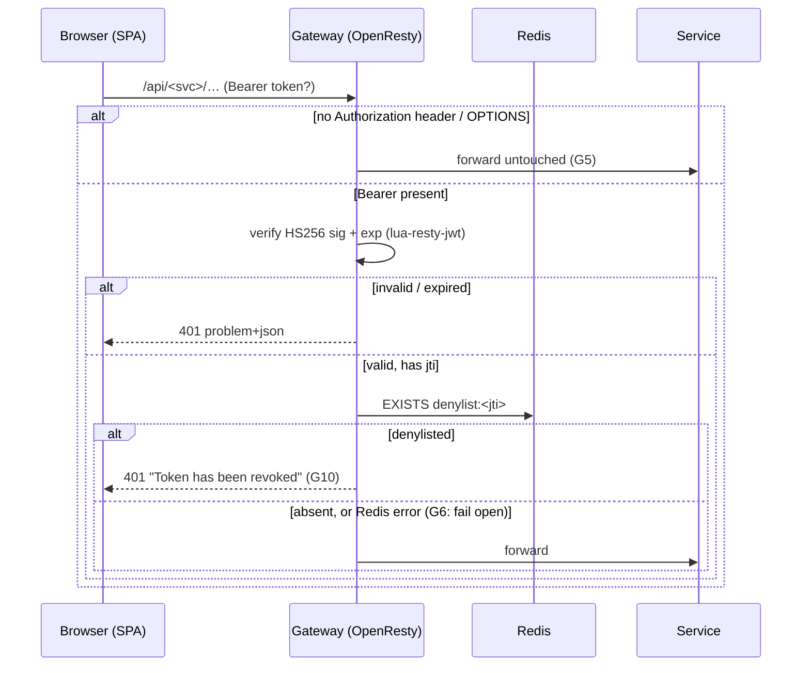

<!--
  AI-assisted (CS3219 AI Usage Policy disclosure):
  Tool: Claude Code (Fable 5), 2026-10-11, issue #151.
  Scope: transcription of the team's API-gateway/denylist design. Every
  decision below was made by Leong Wei Zhi on 2026-10-11 via neutral
  options Q&A (factual option comparisons only — the tool recommended
  nothing); this document records them. Implementation and this write-up
  by the tool, per the allowed-use rules.
  2026-10-11, PR #176 Copilot review: G5 row, request-flow note and the
  order-stub row updated for the review fixes (public-auth skip, CORS-
  readable stub, no Redis startup gating) — behavior-preserving fixes,
  no new decisions.
  Reviewed by: Leong Wei Zhi (via pull request).
-->

# FoC API Gateway — Design

**Scope:** the `gateway/` container — the single entry point for every
backend API — and the Redis token denylist it enforces (issue #151,
the logout half of the JWT design). \
High-level system architecture: [`architecture.md`](architecture.md)

## Why

JWTs are stateless: a logged-out token stays signature-valid until its
`exp` (1 h). A denylist checked only inside user-service would leave the
other services accepting revoked tokens — each one verifies signature +
exp on its own. The alternatives (every service querying user-service per
request; every service mirroring revocation events in local memory) cost
a network hop per request or lose state on restart. The team chose a
gateway: one place that checks every browser request against a shared
Redis denylist.

## Decisions

All decided by **Leong Wei Zhi, 2026-10-11, via options Q&A** (AI made
no design decisions; comparisons presented were factual only).

| # | Decision | Choice |
| --- | --- | --- |
| G1 | Gateway technology | OpenResty (nginx + Lua): `lua-resty-jwt` verifies HS256 signature + exp, `lua-resty-redis` checks the denylist in-process — no extra HTTP hop per request |
| G2 | Denylist store | Redis only: `denylist:<jti>` keys with `EX` = seconds until the token's own `exp`; Redis expiry replaces any purge job. The never-used `token_denylist` table is dropped (user-service `V6`) |
| G3 | Routing scope | Full cutover: the SPA's five service URLs all point at the gateway (`/api/user`, `/api/supplier`, `/api/credit`, `/api/notification`; `/api/order` reserved); backend containers have **no published host ports** |
| G4 | Enforcement depth | Gateway only. No backend service reads the denylist; user-service gains Redis solely to **write** it at logout |
| G5 | Anonymous requests | Pass through untouched (incl. OPTIONS preflights and non-Bearer schemes); each service's Spring Security still decides what needs auth. A Bearer token present is verified + denylist-checked — except on user-service's public `/auth/**` routes (logout excluded), which the gateway skips like `JwtAuthenticationFilter` does, so a stale token stored by the SPA can never block login/sign-up (PR #176 review) |
| G6 | Redis outage | Fail open: a connect/lookup error forwards the request if signature + exp are valid (availability over revocation, bounded by the ≤1 h token lifetime) |
| G7 | Redis durability | AOF (`--appendonly yes`) + named volume: revoked-but-unexpired tokens stay revoked across container restarts |
| G8 | Logout writer | user-service `POST /auth/logout` (authenticated): reads the verified token's `jti`/`exp` and writes the Redis key via Spring Data Redis |
| G9 | Logout on Redis failure | Best-effort **204**: the failed write is logged, never surfaced — the token lives out its remaining `exp` (consistent with G6) |
| G10 | Revoked-token response | 401 problem+json with detail **"Token has been revoked"** (alongside the existing "Token has expired" / "Invalid token") |

## Request flow

Exception mirrored from `JwtAuthenticationFilter`: `/api/user/auth/**`
except logout is forwarded without reading the Authorization header at
all — the SPA attaches any stored token to every call, and an expired
one must not 401 the login that would replace it.

Logout: `POST /api/user/auth/logout` → user-service
`SET denylist:<jti> "1" EX <seconds-until-exp>` → 204 (G8/G9). From that
moment every gateway route rejects that token.

## Routing table

| Prefix | Upstream | Notes |
| --- | --- | --- |
| `/api/user/**` | `user-service:8080` | prefix stripped |
| `/api/supplier/**` | `supplier-service:8080` | prefix stripped |
| `/api/credit/**` | `credit-service:8080` | prefix stripped |
| `/api/notification/**` | `notification-service:8080` | prefix stripped; WebSocket upgrade + SockJS streaming enabled for `/ws/**` |
| `/api/order/**` | — | reserved: same auth check as real routes, then a CORS-readable 503 problem+json (incl. answering the preflight itself) until order-service exists |
| anything else | — | 404 problem+json |

Upstream names resolve per request through compose's DNS
(`resolver 127.0.0.11`), so the gateway starts and keeps routing while
individual backends restart or are rebuilt.

## Known limits (accepted with G4/G5)

- **WebSocket CONNECT tokens are not denylist-checked.** The STOMP JWT
  travels in the CONNECT frame, not an HTTP header, so the gateway
  proxies the upgrade and notification-service verifies signature + exp
  itself. A logged-out token can open the socket until its `exp`.
- **CORS stays per-service.** The browser origin (`WEB_ALLOWED_ORIGIN`)
  differs from the gateway origin, and services' CORS headers pass
  through unchanged; only the gateway's own Lua-generated 401s stamp
  `Access-Control-Allow-Origin` themselves.
- **Role gates stay in the services.** The gateway checks validity and
  revocation, not authorization — `role` enforcement is unchanged
  (fail-closed rules in each `SecurityConfig`).
- `docs/notification-service.md` D10 ("no Redis") predates this: Redis
  now exists as platform infrastructure for the denylist. D10's
  scale-out question (Redis pub/sub vs broker relay) remains open and
  unrelated.

## Container

| | |
| --- | --- |
| Image | `openresty/openresty:1.31.1.1-alpine-fat` + `opm get cdbattags/lua-resty-jwt` |
| Host port | `${GATEWAY_PORT:-8090}` → 8080 |
| Config | `gateway/nginx.conf` (routing) + `gateway/lua/auth.lua` (auth) |
| Env | `JWT_SECRET` (shared platform secret), `WEB_ALLOWED_ORIGIN` |
| Redis | `redis:8.8-alpine`, `--appendonly yes`, volume `redis-data`, loopback host port `${REDIS_HOST_PORT:-6379}` |
