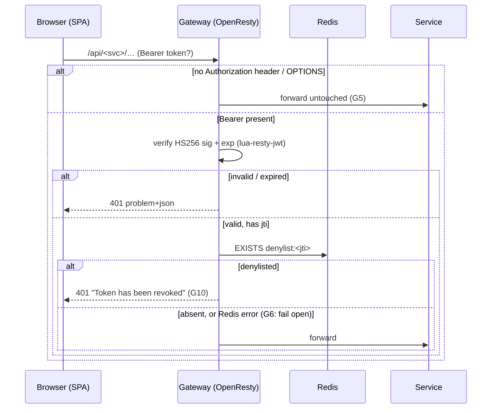

<!--
  AI-assisted (CS3219 AI Usage Policy disclosure):
  Tool: Claude Code (Fable 5), 2026-10-11, issue #151.
  Scope: transcription of the team's API-gateway/denylist design. Every
  decision below was made by Leong Wei Zhi on 2026-10-11 via neutral
  options Q&A (factual option comparisons only — the tool recommended
  nothing); this document records them. Implementation and this write-up
  by the tool, per the allowed-use rules.
  2026-10-11, PR #176 Copilot review: G5 row, request-flow note and the
  order-stub row updated for the review fixes (public-auth skip, CORS-
  readable stub, no Redis startup gating) — behavior-preserving fixes,
  no new decisions.
  2026-10-11, PR #176 review (@Sinnez1): the skip rebuilt as location
  blocks (the raw-path match was bypassable with dot segments),
  /actuator/health mirrored, gateway-origin errors made CORS-readable
  problem+json, the opm package pinned, and the encoded-slash limit
  recorded. Fixes to recorded behavior; no new decisions.
  2026-10-20, Claude Code (Opus 5.5), Aung Ko Khant: the `/api/order/**`
  routing row now records the proxied location that replaced the stub
  (the change logged 2026-10-17), and the stub left the gateway-origin
  response list. No new decisions. Pending pull request review.
  2026-10-12, Claude Code (Fable 5), PR #179 review (@Sinnez1): G11
  added — per-user session revocation on password reset, decided by
  Leong Wei Zhi via options Q&A — with its request-flow note.
  2026-10-12, Claude Code (Fable 5), issue #67: the WebSocket known
  limit retired and G4's exception noted — notification-service now
  checks the denylist at STOMP CONNECT itself (author decision D23,
  docs/notification-service.md, via options Q&A).
  2026-10-12, Claude Code (Fable 5), issue #178: G12 added — admin role
  change and removal write the same G11 stamp, decided by Leong Wei Zhi
  via options Q&A (option A of the issue's table; issue scope only) —
  with its request-flow note. No gateway code changed.
  2026-10-14, Claude Code (Fable 5), PR #185 review (@Sinnez1): that
  limit's wording corrected — the CONNECT check now covers the G11
  cutoff too, and what it still does not cover (an already-open
  session) is stated.
  2026-10-17, Claude Code (Opus 5), issue #203: G12's note now says
  self-deletion writes no stamp, so the paragraph's scope (the
  admin-initiated paths) is explicit. Accepted as-is (option C) by
  Leong Wei Zhi via options Q&A. No gateway code changed.
  2026-10-26, Claude Code (Sonnet 5.5), issue #225: the supplier routing
  row notes that `/api/supplier/purge` is answered 404 by its own
  location block (Alastair Tan Choon Wei's decision, D12 in
  docs/supplier-service.md). No new gateway decision number.
  Reviewed by: Leong Wei Zhi (via pull request).
-->

# FoC API Gateway — Design

**Scope:** the `gateway/` container — the single entry point for every
backend API — and the Redis token denylist it enforces (issue #151,
the logout half of the JWT design). \
High-level system architecture: [`architecture.md`](architecture.md)

## Why

JWTs are stateless: a logged-out token stays signature-valid until its
`exp` (1 h). A denylist checked only inside user-service would leave the
other services accepting revoked tokens — each one verifies signature +
exp on its own. The alternatives (every service querying user-service per
request; every service mirroring revocation events in local memory) cost
a network hop per request or lose state on restart. The team chose a
gateway: one place that checks every browser request against a shared
Redis denylist.

## Decisions

All decided by **Leong Wei Zhi via options Q&A** — G1–G10 on
2026-10-11, G11 on 2026-10-12 with the rest of the PR #179 review
response, G12 on 2026-10-12 with issue #178 (AI made no design
decisions; comparisons presented were factual only).

| # | Decision | Choice |
| --- | --- | --- |
| G1 | Gateway technology | OpenResty (nginx + Lua): `lua-resty-jwt` verifies HS256 signature + exp, `lua-resty-redis` checks the denylist in-process — no extra HTTP hop per request |
| G2 | Denylist store | Redis only: `denylist:<jti>` keys with `EX` = seconds until the token's own `exp`; Redis expiry replaces any purge job. The never-used `token_denylist` table is dropped (user-service `V6`) |
| G3 | Routing scope | Full cutover: the SPA's five service URLs all point at the gateway (`/api/user`, `/api/supplier`, `/api/credit`, `/api/notification`; `/api/order` reserved); backend containers have **no published host ports** |
| G4 | Enforcement depth | Gateway only. No backend service reads the denylist; user-service gains Redis solely to **write** it at logout. *2026-10-12 exception (D23, issue #67):* notification-service reads it at STOMP CONNECT (both the per-token key and the G11 per-user cutoff) — the frame-level token never reaches the gateway's access phase |
| G5 | Anonymous requests | Pass through untouched (incl. OPTIONS preflights and non-Bearer schemes); each service's Spring Security still decides what needs auth. A Bearer token present is verified + denylist-checked — except on user-service's public `/auth/**` routes (logout excluded) and `/actuator/health`, which get their own auth-free location blocks mirroring `JwtAuthenticationFilter`'s skip, so a stale token stored by the SPA can never block login/sign-up. Location blocks, not a path match in Lua: nginx routes on the normalized URI, so a dot-segment path cannot be skipped one way and routed another (PR #176 reviews) |
| G6 | Redis outage | Fail open: a connect/lookup error forwards the request if signature + exp are valid (availability over revocation, bounded by the ≤1 h token lifetime) |
| G7 | Redis durability | AOF (`--appendonly yes`) + named volume: revoked-but-unexpired tokens stay revoked across container restarts |
| G8 | Logout writer | user-service `POST /auth/logout` (authenticated): reads the verified token's `jti`/`exp` and writes the Redis key via Spring Data Redis |
| G9 | Logout on Redis failure | Best-effort **204**: the failed write is logged, never surfaced — the token lives out its remaining `exp` (consistent with G6) |
| G10 | Revoked-token response | 401 problem+json with detail **"Token has been revoked"** (alongside the existing "Token has expired" / "Invalid token") |
| G11 | Per-user revocation (PR #179) | A password reset writes `denylist:user:<id>` = the reset's epoch second, `EX` = one token TTL; the gateway rejects that subject's tokens whose `iat` is strictly before the stamp, so the old password's sessions end with it. Same G6/G9 best-effort semantics; a token minted the same second as the reset survives (spares the owner's own post-reset login) |
| G12 | Privilege revoke (issue #178) | Admin role change (any actual change, self-demotion included — a promotion's old token carries a stale claim too) and admin removal write the same G11 stamp, so the target's outstanding tokens die on the next gateway request instead of at `exp`. The target signs in again for a fresh token with the current role; a removed account can still log in and self-restore (login postdates the stamp). No new gateway code — the G11 check covers it, and D23's CONNECT lookup reads the same stamp, so a new STOMP session is refused too |

## Request flow

Exception mirrored from `JwtAuthenticationFilter`: `/api/user/auth/**`
except logout, plus `/api/user/actuator/health`, are forwarded without
reading the Authorization header at all — the SPA attaches any stored
token to every call, and an expired one must not 401 the login that
would replace it. The exception is expressed as nginx location blocks
(matched on the normalized URI), so `/api/user/auth/../users/me` and
its percent-encoded variants match the protected location, never the
public one.

Logout: `POST /api/user/auth/logout` → user-service
`SET denylist:<jti> "1" EX <seconds-until-exp>` → 204 (G8/G9). From that
moment every gateway route rejects that token.

Password reset: `POST /api/user/auth/password-reset/confirm` →
user-service `SET denylist:user:<id> <epoch-second> EX <token-TTL>`
(G11). From that moment every gateway route rejects the account's
tokens issued before the stamp.

Privilege revoke: `PATCH /api/user/users/<id>` (role actually changed)
and `DELETE /api/user/users/<id>` write the same stamp for the target
(G12) — a demoted admin's next request answers 401 "Token has been
revoked" rather than keeping the admin API until `exp`. Self-deletion
(`DELETE /api/user/users/me`) deliberately writes no stamp and no
demotion (#203, option C), so a self-deleted admin's tokens — and the
fresh ones its logins keep minting for 30 days — stay valid.

## Routing table

| Prefix | Upstream | Notes |
| --- | --- | --- |
| `/api/user/**` | `user-service:8080` | prefix stripped; `/auth/**` (except logout) and `/actuator/health` route through auth-free locations (G5) |
| `/api/supplier/**` | `supplier-service:8080` | prefix stripped; except `/api/supplier/purge…`, which a dedicated location block answers 404 — supplier-service's internal account-purge cleanup is reached over the compose network, never through the gateway (issue #225, D12) |
| `/api/credit/**` | `credit-service:8080` | prefix stripped |
| `/api/notification/**` | `notification-service:8080` | prefix stripped; WebSocket upgrade + SockJS streaming enabled for `/ws/**` |
| `/api/order/**` | `order-service:8080` | prefix stripped (replaced the reserved 503 stub once order-service existed, as G3 anticipated) |
| anything else | — | 404 problem+json |

Every gateway-origin response — the Lua 401s, the 404,
and the 502/504 a briefly-restarting backend produces — is problem+json
with `Access-Control-Allow-Origin`, so the SPA reads a status instead
of a blocked response (PR #176 review).

Upstream names resolve per request through compose's DNS
(`resolver 127.0.0.11`), so the gateway starts and keeps routing while
individual backends restart or are rebuilt.

## Known limits (accepted with G4/G5)

- ~~WebSocket CONNECT tokens are not denylist-checked.~~ *Resolved
  2026-10-12 (issue #67, decision D23 in
  [`notification-service.md`](notification-service.md)):* the STOMP JWT
  travels in the CONNECT frame, not an HTTP header, so the gateway
  still cannot check it — notification-service makes both of this
  file's lookups itself when the session opens (the `denylist:<jti>`
  key, G10, and the subject's `denylist:user:<id>` cutoff, G11),
  failing open on a Redis outage like the gateway (G6).
- **A revoked token keeps an already-open WebSocket session.** The
  CONNECT check is a point-in-time one; nothing re-checks a live STOMP
  session, so a logout, a password reset, an admin demote/remove (G12)
  or the token's own `exp` ends it only once the socket closes (the SPA
  closes its own on logout, and on the forced sign-out any of those
  revocations triggers — issue #178's web half, PR #182).
  Recorded with D23's Session mechanics
  ([`notification-service.md`](notification-service.md)).
- **CORS stays per-service.** The browser origin (`WEB_ALLOWED_ORIGIN`)
  differs from the gateway origin, and services' CORS headers pass
  through unchanged; only the gateway's own Lua-generated 401s stamp
  `Access-Control-Allow-Origin` themselves.
- **Role gates stay in the services.** The gateway checks validity and
  revocation, not authorization — `role` enforcement is unchanged
  (fail-closed rules in each `SecurityConfig`).
- **Percent-encoded slashes are decoded in transit**: the
  prefix-stripping `rewrite` forwards the normalized path, so
  `a%2Fb` in a path segment reaches the backend as `a/b`. No current
  route puts user text in a path segment; flagged as a known limit
  (PR #176 review) for whoever first designs one that does.
- `docs/notification-service.md` D10 ("no Redis") predates this: Redis
  now exists as platform infrastructure for the denylist. D10's
  scale-out question (Redis pub/sub vs broker relay) remains open and
  unrelated.

## Container

| | |
| --- | --- |
| Image | `openresty/openresty:1.31.1.1-alpine-fat` + `opm get cdbattags/lua-resty-jwt=0.3.2` (both pinned) |
| Host port | `${GATEWAY_PORT:-8090}` → 8080 |
| Config | `gateway/nginx.conf` (routing) + `gateway/lua/auth.lua` (auth) |
| Env | `JWT_SECRET` (shared platform secret), `WEB_ALLOWED_ORIGIN` |
| Redis | `redis:8.8-alpine`, `--appendonly yes`, volume `redis-data`, loopback host port `${REDIS_HOST_PORT:-6379}` |
