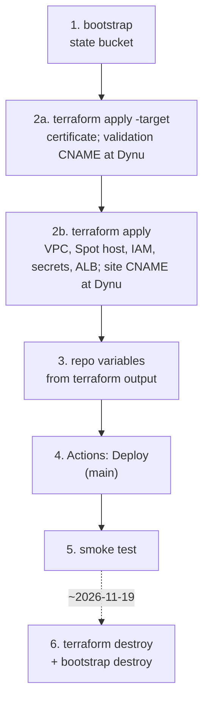
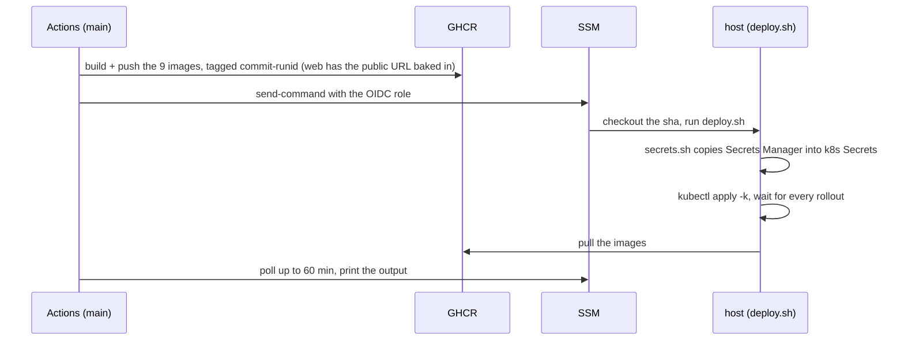

<!--
  AI-assisted (CS3219 AI Usage Policy disclosure):
  Tool: Claude Code (Opus 5.5), 2026-11-05, issue #48 (N5 cloud deployment).
  Scope: runbook for the deployment designed in docs/deployment.md (all
  decisions Leong Wei Zhi's, via options Q&A).
  Author review: Leong Wei Zhi, pending pull request review.
  2026-11-08, Claude Code (Fable 5.1): External Secrets Operator steps
  replaced by secrets.sh (DP7); deploy sequence, secret-change notes,
  operating and troubleshooting tables added (short runbook).
  Author review: Leong Wei Zhi, pending pull request review.
  2026-11-08, Claude Code (Fable 5.1), first deploy: the OIDC troubleshooting
  row covers GitHub's immutable subject. Author review: Leong Wei Zhi,
  pending pull request review.
  2026-11-08, Claude Code (Fable 5.1), issue #48 (HTTPS): the certificate
  and DNS steps, https smoke test and troubleshooting rows (DP18 to
  DP21). Author review: Leong Wei Zhi, pending pull request review.
  Same day: the DNS provider is Dynu (DP18 revised). Author review: Leong
  Wei Zhi, pending pull request review.
-->

# infra: cloud deployment runbook

Design and decisions: [`docs/deployment.md`](../docs/deployment.md).
One EC2 Spot instance running k3s behind a load balancer that serves
`https://foc23.ddnsfree.com`; everything else runs in the cluster.



| Path | What |
| --- | --- |
| `terraform/bootstrap/` | S3 state bucket (local state, applied once) |
| `terraform/` | network (two public subnets), Spot instance, ACM certificate + Application Load Balancer (`tls.tf`), IAM (instance role, GitHub OIDC role), Secrets Manager, first-boot `cloud-init` |
| `k8s/` | kustomization applied on the host: data StatefulSets, app Deployments, Traefik ingress, HPAs |
| `k8s/secrets.sh` | copies `foc/app` and `foc/ghcr` from Secrets Manager into the k8s Secrets (first boot, every deploy) |
| `k8s/deploy.sh` | run on the host by the Deploy workflow over SSM |

## Before the first apply

- **Lease:** the ISB lease must outlast 2026-11-19. Check expiry and budget in the ISB portal.
- **Tools:** Terraform 1.10 or newer, AWS CLI v2, the Session Manager plugin.
- **Credentials:** `export AWS_PROFILE=nusisb_IsbUsersPS-555552813604`, then `aws sso login`.
- **Team values:** a Gmail app password and a GHCR token with `read:packages`, for `secrets.auto.tfvars`.
- **DNS:** a Dynu account (dynu.com) holding the hostname in the
  `domain_name` variable (`foc23.ddnsfree.com`) under **DDNS Services**. Two
  CNAME records are added there by hand during step 2; Terraform prints
  both. (FreeDNS was tried first and refuses CNAME records on its shared
  domains.)

## 1 and 2a. Bootstrap and certificate

```sh
cd infra/terraform/bootstrap && terraform init && terraform apply
cd .. && cp secrets.auto.tfvars.example secrets.auto.tfvars   # fill in Gmail + GHCR token
terraform init -backend-config=backend.hcl
terraform apply -target=aws_acm_certificate.site
terraform output acm_validation_record
```

The output holds one record per certificate name (today just
`foc23.ddnsfree.com`). In Dynu, **DDNS Services**, the hostname, **DNS
Records**, add one: type `CNAME`, node name = its `name` with the
trailing `.foc23.ddnsfree.com` removed (the part starting with `_`), host name
= its `value` without the trailing dot. ACM issues the certificate
within minutes of the record resolving:

```sh
aws acm list-certificates --query 'CertificateSummaryList[?DomainName==`foc23.ddnsfree.com`].Status'
# ISSUED
```

## 2b. Everything else

```sh
terraform apply
terraform output                     # public_host, alb_dns_name, instance_id, deploy_role_arn
terraform output -raw owner_setup_token
```

The apply waits for the certificate if it is still pending (up to 60
min), then creates the load balancer. In Dynu, make `foc23.ddnsfree.com` itself
a `CNAME` to `alb_dns_name`: remove the hostname's IPv4 address first (a
CNAME cannot sit next to an A record of the same name), then add a CNAME
record with an empty node name. From this apply on, the host
answers the load balancer only: nothing listens on its own public
address.

First boot installs k3s, clones the repo to `/opt/foc` and runs
`secrets.sh`. Give it about 3 minutes, then check:

```sh
aws ssm start-session --target <instance_id>
sudo cloud-init status                       # status: done
sudo k3s kubectl -n foc get secret           # foc-secrets, ghcr-pull
```

## 3. Repo variables

**Settings, Secrets and variables, Actions, Variables:**

| Variable | Value |
| --- | --- |
| `AWS_ROLE_ARN` | `terraform output deploy_role_arn` |
| `AWS_REGION` | `ap-southeast-1` |
| `INSTANCE_ID` | `terraform output instance_id` |
| `PUBLIC_HOST` | `terraform output public_host` (the hostname; the pipeline prefixes `https://`) |

## 4. Deploy

**Actions, Deploy, Run workflow**, on `main`. The workflow appears in the
Actions tab once this folder is on `main`.



A cold start of the 7 JVMs takes a few minutes. **Rollback:** re-run an
earlier Deploy run from the Actions tab. A new dispatch always builds the
head of `main`.

## 5. Smoke test

```sh
curl -sI http://<public_host>/ | head -3                          # 301, Location: https://...
curl -s https://<public_host>/api/user/actuator/health           # {"status":"UP"}
openssl s_client -connect <public_host>:443 -servername <public_host> </dev/null 2>/dev/null | openssl x509 -noout -subject -issuer
aws elbv2 describe-target-health --target-group-arn "$(aws elbv2 describe-target-groups --names foc-traefik --query 'TargetGroups[0].TargetGroupArn' --output text)"
aws ssm start-session --target <instance_id>
sudo k3s kubectl -n foc get pods,hpa
```

In the browser at `https://<public_host>`:

1. Sign in as a seeded account ([`user-service/README.md`](../user-service/README.md)).
2. Post a request and accept it as a second account.
3. Check the live notification and the two-way chat, then complete and rate.
4. Log out. The old token now gets a 401.

The live notification and the chat ride on `wss://` through the load
balancer; a notification arriving while the tab is open proves the
socket survived the hop.

## Changing a secret

Values live in Secrets Manager. Edit `secrets.auto.tfvars` and
`terraform apply`, or `terraform apply -replace=random_password.<name>`
for a generated value. The cluster picks it up on the next Deploy run:
`deploy.sh` re-runs `secrets.sh` and stamps the Secret's version into
the pod templates, so the Deployments roll with the new values.

- `JWT_SECRET`: every user is logged out.
- `CHAT_INTERNAL_TOKEN`: order and chat both read the new value after that rollout.
- DB and RabbitMQ passwords: Postgres and RabbitMQ set them on an **empty volume only**. A later change breaks that service's login until its volume is deleted.
- `MAIL_*`: used on the next OTP email.

Non-secret config (`foc-config`, for example the public origin) and a
rebuilt image at the same commit roll too: the pod templates carry a hash
of the ConfigMap, and the image tag carries the workflow run id.

## Operating

`kubectl` below means `sudo k3s kubectl` on the host, over
`aws ssm start-session --target <instance_id>`.

| Task | Command |
| --- | --- |
| Pods, HPAs | `kubectl -n foc get pods,hpa` |
| Logs | `kubectl -n foc logs deploy/<name>` |
| Restart one service | `kubectl -n foc rollout restart deploy/<name>` |
| Database shell | `kubectl -n foc exec -it user-db-0 -- psql -U user user` |
| Spot stopped the host | nothing to redeploy. It restarts when capacity returns, same EIP, same data |
| An HPA shows 2 replicas | expected under load for every service but chat and notification, which have no HPA (one replica, issue #305). The doubled scheduled runs are idempotent (DP10). It goes back to 1 about five minutes after CPU drops below 70 % |

## Troubleshooting

| Symptom | Check | Usual cause, fix |
| --- | --- | --- |
| `https://<public_host>` times out or the name does not resolve | `dig CNAME <public_host>` | the `foc23.ddnsfree.com` record is missing, still an `A` record, or not yet pushed to Dynu's name servers (minutes) |
| Browser shows a certificate warning | the URL | the load balancer's own `*.elb.amazonaws.com` name was opened; the certificate covers `<public_host>` only. Expected |
| Certificate stays `PENDING_VALIDATION` | `aws acm list-certificates`, `dig CNAME <name from acm_validation_record>` | the validation CNAME is missing, mistyped, or Dynu did not accept the underscore name (then the domain decision DP18 must be revisited again); ACM gives up after 72 h |
| 503 from the load balancer | `aws elbv2 describe-target-health`, EC2 console: instance state | the target is unhealthy: Spot stopped the host (wait; it comes back and re-registers by instance id), still booting (`cloud-init status`), or Traefik/web not ready yet |
| Deploy job: `Not authorized to perform sts:AssumeRoleWithWebIdentity` | run from `main`? `gh api repos/AY2627S1-CS3219-P23/foc/actions/oidc/customization/sub` | the role trusts `refs/heads/main` only, and only GitHub's immutable subject form (`repo:<owner>@<id>/<name>@<id>`): `use_immutable_subject` must be `true`. If the org or repo was renamed or transferred, update `github_repo` (the ids stay the same) and apply |
| Deploy job: `InvalidInstanceId` | instance running, SSM agent online | stopped by Spot, or the agent not registered yet after boot |
| `foc-secrets` or `ghcr-pull` missing | `sudo bash /opt/foc/infra/k8s/secrets.sh` | the instance role was denied `secretsmanager:GetSecretValue`, or the secret is not in `ap-southeast-1` |
| `ImagePullBackOff` | `kubectl -n foc describe pod <pod>` | GHCR token wrong or without `read:packages`; no image pushed for that sha |
| Pod `Pending` | `describe pod` events | `Insufficient cpu`: requests at every HPA max are about 3.0 of 4 vCPU. Or an unbound PVC |
| Backend `CrashLoopBackOff` | `kubectl -n foc logs <pod> -p` | DB password changed after first boot (see Changing a secret) |
| 502 / 504 on `/api/<svc>` | `kubectl -n foc get pods` | the backend is not ready yet (the startup probe allows 5 min) |
| Live updates or chat drop after about 60 s | Traefik args in `kube-system` | the `traefik` HelmChartConfig from cloud-init is missing |
| Login works, browser calls fail with CORS | `WEB_ALLOWED_ORIGIN` in `foc-config` | must be `https://<public_host>`; `deploy.sh` sets it from `PUBLIC_HOST`. A page opened over any other origin (the balancer's own name, an IP) fails this way by design |

## 6. Teardown (about 2026-11-19)

```sh
cd infra/terraform && terraform destroy
cd bootstrap && terraform destroy
aws resourcegroupstaggingapi get-resources --tag-filters Key=project,Values=foc   # expect []
```

Nothing is kept. The secrets are deleted without a recovery window, the
volumes go with the instance, and the bucket is force-destroyed. GHCR
images outlive the AWS account; delete them under the org's **Packages**
tab if wanted. The two Dynu records are not Terraform's: delete them in
**DNS Records** by hand.
