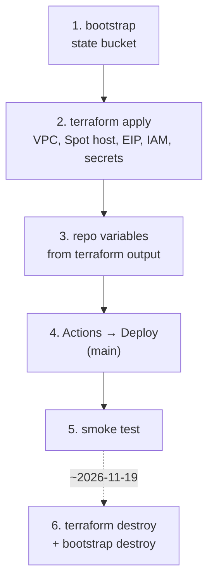

<!--
  AI-assisted (CS3219 AI Usage Policy disclosure):
  Tool: Claude Code (Opus 5.5), 2026-11-05, issue #48 (N5 cloud deployment).
  Scope: runbook for the deployment designed in docs/deployment.md (all
  decisions Leong Wei Zhi's, via options Q&A).
  Author review: Leong Wei Zhi, pending pull request review.
-->

# infra — cloud deployment

Design and decisions: [`docs/deployment.md`](../docs/deployment.md).
One EC2 Spot instance running k3s; everything else is in-cluster.



| Path | What |
| --- | --- |
| `terraform/bootstrap/` | S3 state bucket (local state, applied once) |
| `terraform/` | network, Spot instance + EIP, IAM (instance role, GitHub OIDC role), Secrets Manager, first-boot `cloud-init` |
| `k8s/` | kustomization applied on the host: data StatefulSets, app Deployments, ESO secrets, Traefik ingress, HPAs |
| `k8s/deploy.sh` | run on the host by the Deploy workflow over SSM |

## Before the first apply

- **Lease:** check the ISB lease expiry is after 2026-11-19 and its budget in the ISB portal.
- **Tools:** Terraform ≥ 1.10, AWS CLI v2, and the session-manager plugin (`aws ssm start-session`).
- **Credentials:** `export AWS_PROFILE=nusisb_IsbUsersPS-555552813604` and `aws sso login`.
- **Merge the whole issue-#48 stack before deploying.** The HPAs allow 2 replicas, which needs the multi-replica backend changes.

## 1–2. Provision

```sh
cd infra/terraform/bootstrap && terraform init && terraform apply
cd .. && cp secrets.auto.tfvars.example secrets.auto.tfvars   # fill in Gmail + GHCR token
terraform init -backend-config=backend.hcl
terraform apply
terraform output                     # public_host, instance_id, deploy_role_arn
terraform output -raw owner_setup_token
```

First boot installs k3s and External Secrets Operator and clones the repo to
`/opt/foc`. Give it about 3 minutes.

## 3. Repo variables

**Settings → Secrets and variables → Actions → Variables**:

| Variable | Value |
| --- | --- |
| `AWS_ROLE_ARN` | `terraform output deploy_role_arn` |
| `AWS_REGION` | `ap-southeast-1` |
| `INSTANCE_ID` | `terraform output instance_id` |
| `PUBLIC_HOST` | `terraform output public_host` |

Images go to `ghcr.io/ay2627s1-cs3219-p23/foc-<name>`. The `ghcr_token` in
`secrets.auto.tfvars` is a classic token with only `read:packages`, from a
user who can read the org's packages.

## 4. Deploy

**Actions → Deploy → Run workflow**, on `main`. It builds the 9 images
(amd64), pushes them, then runs `deploy.sh <sha> <public_host>` on the host
and prints the rollout output. A cold start of the 7 JVMs takes a few minutes.

## 5. Smoke test

```sh
curl -s http://<public_host>/api/user/actuator/health            # {"status":"UP"}
aws ssm start-session --target <instance_id>
sudo k3s kubectl -n foc get pods,hpa
```

Then in the browser at `http://<public_host>`:
1. Sign in as a seeded account.
2. Post a request, and accept it as a second account.
3. Check the live notification and two-way chat, then complete and rate.
4. Log out; the old token now gets a 401.

## Operating notes

- **Spot reclaim:** AWS can stop the instance at any time. It restarts by itself when capacity returns, with the same Elastic IP and the same data. Keep the local compose stack ready as the demo fallback.
- **Logs:** `sudo k3s kubectl -n foc logs deploy/<name>`.
- **Secrets:** change a value with `terraform apply` (Secrets Manager). ESO refreshes hourly; to apply it at once, run `kubectl -n foc annotate externalsecret foc-secrets force-sync=$(date +%s) --overwrite` and restart the Deployment.

## 6. Teardown (~2026-11-19)

```sh
cd infra/terraform && terraform destroy
cd bootstrap && terraform destroy
aws resourcegroupstaggingapi get-resources --tag-filters Key=project,Values=foc   # expect []
```

Nothing is kept. The Secrets Manager secrets are deleted without a recovery
window, the volumes go with the instance, and the bucket is force-destroyed.
GHCR images outlive the AWS account; delete them under the org's
**Packages** tab if wanted.

## Seeded accounts

`USER_SEED_DEMO=true` in the cloud. Accounts and passwords:
[`user-service/README.md`](../user-service/README.md).
