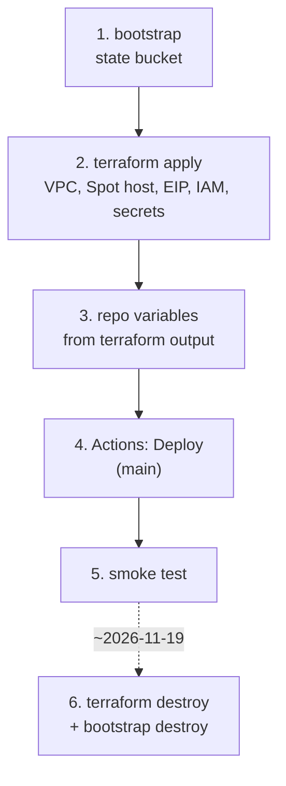
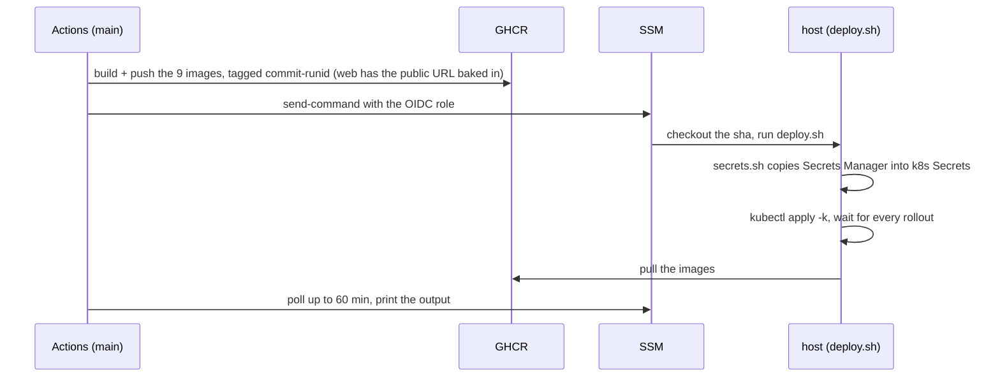

<!--
  AI-assisted (CS3219 AI Usage Policy disclosure):
  Tool: Claude Code (Opus 5.5), 2026-11-05, issue #48 (N5 cloud deployment).
  Scope: runbook for the deployment designed in docs/deployment.md (all
  decisions Leong Wei Zhi's, via options Q&A).
  Author review: Leong Wei Zhi, pending pull request review.
  2026-11-08, Claude Code (Fable 5.1): External Secrets Operator steps
  replaced by secrets.sh (DP7); deploy sequence, secret-change notes,
  operating and troubleshooting tables added (short runbook).
  Author review: Leong Wei Zhi, pending pull request review.
  2026-11-08, Claude Code (Fable 5.1), issue #305: the HPA row covers
  every service (chat and notification now scale). Author review: Leong
  Wei Zhi, pending pull request review.
-->

# infra: cloud deployment runbook

Design and decisions: [`docs/deployment.md`](../docs/deployment.md).
One EC2 Spot instance running k3s; everything else runs in the cluster.



| Path | What |
| --- | --- |
| `terraform/bootstrap/` | S3 state bucket (local state, applied once) |
| `terraform/` | network, Spot instance + EIP, IAM (instance role, GitHub OIDC role), Secrets Manager, first-boot `cloud-init` |
| `k8s/` | kustomization applied on the host: data StatefulSets, app Deployments, Traefik ingress, HPAs |
| `k8s/secrets.sh` | copies `foc/app` and `foc/ghcr` from Secrets Manager into the k8s Secrets (first boot, every deploy) |
| `k8s/deploy.sh` | run on the host by the Deploy workflow over SSM |

## Before the first apply

- **Lease:** the ISB lease must outlast 2026-11-19. Check expiry and budget in the ISB portal.
- **Tools:** Terraform 1.10 or newer, AWS CLI v2, the Session Manager plugin.
- **Credentials:** `export AWS_PROFILE=nusisb_IsbUsersPS-555552813604`, then `aws sso login`.
- **Team values:** a Gmail app password and a GHCR token with `read:packages`, for `secrets.auto.tfvars`.

## 1 and 2. Provision

```sh
cd infra/terraform/bootstrap && terraform init && terraform apply
cd .. && cp secrets.auto.tfvars.example secrets.auto.tfvars   # fill in Gmail + GHCR token
terraform init -backend-config=backend.hcl
terraform apply
terraform output                     # public_host, instance_id, deploy_role_arn
terraform output -raw owner_setup_token
```

First boot installs k3s, clones the repo to `/opt/foc` and runs
`secrets.sh`. Give it about 3 minutes, then check:

```sh
aws ssm start-session --target <instance_id>
sudo cloud-init status                       # status: done
sudo k3s kubectl -n foc get secret           # foc-secrets, ghcr-pull
```

## 3. Repo variables

**Settings, Secrets and variables, Actions, Variables:**

| Variable | Value |
| --- | --- |
| `AWS_ROLE_ARN` | `terraform output deploy_role_arn` |
| `AWS_REGION` | `ap-southeast-1` |
| `INSTANCE_ID` | `terraform output instance_id` |
| `PUBLIC_HOST` | `terraform output public_host` |

## 4. Deploy

**Actions, Deploy, Run workflow**, on `main`. The workflow appears in the
Actions tab once this folder is on `main`.



A cold start of the 7 JVMs takes a few minutes. **Rollback:** re-run an
earlier Deploy run from the Actions tab. A new dispatch always builds the
head of `main`.

## 5. Smoke test

```sh
curl -s http://<public_host>/api/user/actuator/health            # {"status":"UP"}
aws ssm start-session --target <instance_id>
sudo k3s kubectl -n foc get pods,hpa
```

In the browser at `http://<public_host>`:

1. Sign in as a seeded account ([`user-service/README.md`](../user-service/README.md)).
2. Post a request and accept it as a second account.
3. Check the live notification and the two-way chat, then complete and rate.
4. Log out. The old token now gets a 401.

## Changing a secret

Values live in Secrets Manager. Edit `secrets.auto.tfvars` and
`terraform apply`, or `terraform apply -replace=random_password.<name>`
for a generated value. The cluster picks it up on the next Deploy run:
`deploy.sh` re-runs `secrets.sh` and stamps the Secret's version into
the pod templates, so the Deployments roll with the new values.

- `JWT_SECRET`: every user is logged out.
- `CHAT_INTERNAL_TOKEN`: order and chat both read the new value after that rollout.
- DB and RabbitMQ passwords: Postgres and RabbitMQ set them on an **empty volume only**. A later change breaks that service's login until its volume is deleted.
- `MAIL_*`: used on the next OTP email.

Non-secret config (`foc-config`, for example the public origin) and a
rebuilt image at the same commit roll too: the pod templates carry a hash
of the ConfigMap, and the image tag carries the workflow run id.

## Operating

`kubectl` below means `sudo k3s kubectl` on the host, over
`aws ssm start-session --target <instance_id>`.

| Task | Command |
| --- | --- |
| Pods, HPAs | `kubectl -n foc get pods,hpa` |
| Logs | `kubectl -n foc logs deploy/<name>` |
| Restart one service | `kubectl -n foc rollout restart deploy/<name>` |
| Database shell | `kubectl -n foc exec -it user-db-0 -- psql -U user user` |
| Spot stopped the host | nothing to redeploy. It restarts when capacity returns, same EIP, same data |
| An HPA shows 2 replicas | expected under load for every service (chat and notification fan their STOMP pushes out over AMQP, issue #305). The doubled scheduled runs are idempotent (DP10). It goes back to 1 about five minutes after CPU drops below 70 % |

## Troubleshooting

| Symptom | Check | Usual cause, fix |
| --- | --- | --- |
| `curl` to the EIP times out | EC2 console: instance state | Spot stopped it: wait. Still booting: `cloud-init status` |
| Deploy job: `AccessDenied` on `AssumeRoleWithWebIdentity` | run from `main`? | the OIDC role trusts `refs/heads/main` only |
| Deploy job: `InvalidInstanceId` | instance running, SSM agent online | stopped by Spot, or the agent not registered yet after boot |
| `foc-secrets` or `ghcr-pull` missing | `sudo bash /opt/foc/infra/k8s/secrets.sh` | the instance role was denied `secretsmanager:GetSecretValue`, or the secret is not in `ap-southeast-1` |
| `ImagePullBackOff` | `kubectl -n foc describe pod <pod>` | GHCR token wrong or without `read:packages`; no image pushed for that sha |
| Pod `Pending` | `describe pod` events | `Insufficient cpu`: requests at every HPA max are about 3.0 of 4 vCPU. Or an unbound PVC |
| Backend `CrashLoopBackOff` | `kubectl -n foc logs <pod> -p` | DB password changed after first boot (see Changing a secret) |
| 502 / 504 on `/api/<svc>` | `kubectl -n foc get pods` | the backend is not ready yet (the startup probe allows 5 min) |
| Live updates or chat drop after about 60 s | Traefik args in `kube-system` | the `traefik` HelmChartConfig from cloud-init is missing |
| Login works, browser calls fail with CORS | `WEB_ALLOWED_ORIGIN` in `foc-config` | must be `http://<public_host>`; `deploy.sh` sets it from `PUBLIC_HOST` |

## 6. Teardown (about 2026-11-19)

```sh
cd infra/terraform && terraform destroy
cd bootstrap && terraform destroy
aws resourcegroupstaggingapi get-resources --tag-filters Key=project,Values=foc   # expect []
```

Nothing is kept. The secrets are deleted without a recovery window, the
volumes go with the instance, and the bucket is force-destroyed. GHCR
images outlive the AWS account; delete them under the org's **Packages**
tab if wanted.
