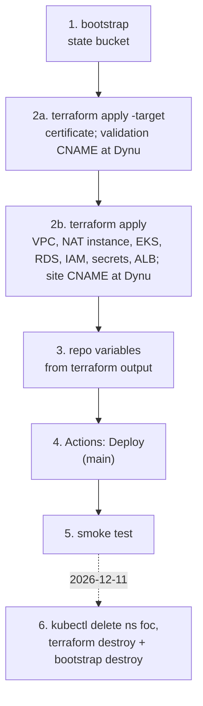
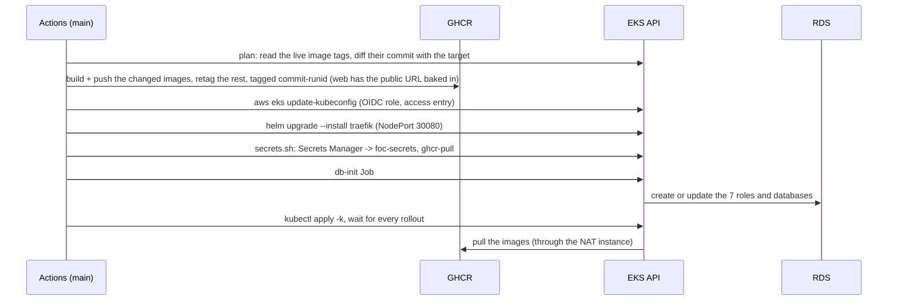

<!--
  AI-assisted (CS3219 AI Usage Policy disclosure):
  Tool: Claude Code (Opus 5.5), 2026-11-05, issue #48 (N5 cloud deployment).
  Scope: runbook for the deployment designed in docs/deployment.md (all
  decisions Leong Wei Zhi's, via options Q&A).
  Author review: Leong Wei Zhi, pending pull request review.
  2026-11-08, Claude Code (Fable 5.1): rewritten as the short runbook for
  the k3s host; the certificate and DNS steps (Dynu) added the same day.
  Author review: Leong Wei Zhi, pending pull request review.
  2026-11-09, Claude Code (Fable 5.1), issue #48 (EKS re-platform):
  rewritten for the EKS cluster, RDS and the NAT instance (DP2 to DP5,
  DP7, DP8, DP15, DP16, Leong Wei Zhi, options Q&A). Author review: Leong
  Wei Zhi, pending pull request review.  Same day, on request: the Spot row spells out the replacement sequence.
  Author review: Leong Wei Zhi, pending pull request review.
  PR #316 review: the HPA row and the smoke counts match issue #305 (nine
  HPAs, chat and notification scale); `foc-db-admin` named; the on-demand
  node for RabbitMQ and Redis (DP3) in the intro, checks, operating and
  troubleshooting rows. Author review: Leong Wei Zhi, pending pull request
  review.
  2026-11-09, Claude Code (Opus 5.5), continuous deployment (DP20): step 4
  covers the automatic runs, `changed-images.sh` in the layout table.
  Author review: Leong Wei Zhi, pending pull request review.
  PR #317 review: older automatic runs skip; `.dockerignore` listed.
-->

# infra: cloud deployment runbook

Design and decisions: [`docs/deployment.md`](../docs/deployment.md).
An EKS cluster (two t3a.medium Spot nodes across three zones plus one
on-demand node in zone a, all in private subnets, a NAT instance for egress), one RDS PostgreSQL instance
with the seven service databases, RabbitMQ and Redis on the on-demand
node with EBS volumes, behind a load balancer that serves
`https://foc23.ddnsfree.com`.



| Path | What |
| --- | --- |
| `terraform/bootstrap/` | S3 state bucket (local state, applied once) |
| `terraform/` | network (`network.tf`: two public + three private subnets), NAT instance (`nat.tf`), EKS cluster, the Spot and on-demand node groups, add-ons and the deploy role's access entry (`eks.tf`), RDS (`rds.tf`), ACM certificate + Application Load Balancer (`tls.tf`), GitHub OIDC deploy role (`iam.tf`), Secrets Manager (`secrets.tf`) |
| `k8s/` | kustomization applied by the Deploy job: gp3 StorageClass, RabbitMQ and Redis StatefulSets, app Deployments, Traefik Ingress, HPAs; `data/db-init.yaml` is the Job that creates the seven database roles |
| `k8s/secrets.sh` | copies `foc/app` and `foc/ghcr` from Secrets Manager into the k8s Secrets `foc-secrets`, `foc-db-admin` (the RDS master credentials, mounted by db-init only) and `ghcr-pull` (every deploy, from the Deploy job) |
| `k8s/deploy.sh` | run by the Deploy workflow: kubeconfig, Traefik chart, secrets, db-init, apply, rollouts |
| `k8s/changed-images.sh` | the Deploy workflow's plan: compares the commit the cluster runs with the target, lists the images to build and the ones to retag (DP20) |
| `helm/traefik-values.yaml` | the ingress controller's chart values (NodePort 30080, WebSocket timeouts) |

## Before the first apply

- **Lease:** the ISB lease must outlast 2026-12-11; the budget is $250.
  Check both in the ISB portal. The estimate for the 32 days is about
  $208 (`docs/deployment.md`, Cost).
- **Tools:** Terraform 1.10 or newer, AWS CLI v2; `kubectl` and `helm`
  for operating the cluster from a laptop (the Deploy job brings its own).
- **Credentials:** `export AWS_PROFILE=nusisb_IsbUsersPS-555552813604`, then `aws sso login`.
- **Team values:** a Gmail app password and a GHCR token with `read:packages`, for `secrets.auto.tfvars`.
- **DNS:** a Dynu account (dynu.com) holding the hostname in the
  `domain_name` variable (`foc23.ddnsfree.com`) under **DDNS Services**.
  Two CNAME records are added there by hand during step 2; Terraform
  prints both. Both already exist if the k3s stack ran before: the load
  balancer and its name are kept across the re-platform.
- **SCPs:** the sandbox's guardrails were verified for EC2 only. EKS,
  RDS, launch templates and access entries are first exercised by step
  2b; a denial there shows in the apply.

## 1 and 2a. Bootstrap and certificate

```sh
cd infra/terraform/bootstrap && terraform init && terraform apply
cd .. && cp secrets.auto.tfvars.example secrets.auto.tfvars   # fill in Gmail + GHCR token
terraform init -backend-config=backend.hcl
terraform apply -target=aws_acm_certificate.site
terraform output acm_validation_record
```

The output holds one record per certificate name (today just
`foc23.ddnsfree.com`). In Dynu, **DDNS Services**, the hostname, **DNS
Records**, add one: type `CNAME`, node name = its `name` with the
trailing `.foc23.ddnsfree.com.` removed, trailing dot included (the part
starting with `_`), host name = its `value` without the trailing dot. ACM
issues the certificate within minutes of the record resolving:

```sh
aws acm list-certificates --query 'CertificateSummaryList[?DomainName==`foc23.ddnsfree.com`].Status'
# ISSUED
```

Skip this step when the certificate already exists from the k3s stack.

## 2b. Everything else

```sh
terraform plan -out=eks.tfplan      # read it: the k3s host goes, the cluster comes
terraform apply eks.tfplan
terraform output                    # public_host, alb_dns_name, cluster_name, deploy_role_arn, rds_endpoint, nat_public_ip
terraform output -raw owner_setup_token
```

The apply takes about 25 minutes: the EKS control plane about 10, the
node group about 3, RDS about 10, in parallel where it can. **Cutover
from the k3s stack:** the same apply destroys the host, so the site
answers 503 from the load balancer until step 4 finishes; the demo data is
reseeded (DP11). The load balancer, certificate and the two Dynu records
stay; only the target group behind the balancer is replaced.

If this is a fresh account, make `foc23.ddnsfree.com` a `CNAME` to
`alb_dns_name` in Dynu: remove the hostname's IPv4 address first (a CNAME
cannot sit next to an A record of the same name), then add a CNAME record
with an empty node name.

Check the cluster from the laptop (the SSO role that ran the apply is
cluster admin):

```sh
aws eks update-kubeconfig --name "$(terraform output -raw cluster_name)"
kubectl get nodes -L foc.dev/pool                  # 3 Ready, t3a.medium: 2 spot, 1 stable
kubectl -n kube-system get pods                    # aws-node, kube-proxy, coredns, metrics-server, ebs-csi-*, eks-pod-identity-agent
```

## 3. Repo variables

**Settings, Secrets and variables, Actions, Variables:**

| Variable | Value |
| --- | --- |
| `AWS_ROLE_ARN` | `terraform output deploy_role_arn` |
| `AWS_REGION` | `ap-southeast-1` |
| `CLUSTER_NAME` | `terraform output cluster_name` (replaces `INSTANCE_ID`, which can be deleted) |
| `PUBLIC_HOST` | `terraform output public_host` (the hostname; the pipeline prefixes `https://`) |

## 4. Deploy

Deploy runs by itself after every CI run that succeeds on a push to
`main` (DP20). The first one after this step needs the cluster and the
repo variables; until then each merge's Deploy run fails at its plan job.
By hand: **Actions, Deploy, Run workflow**, on `main` (always deploys,
also when only Secrets Manager or the docs changed).

The plan job reads the image tag running in the cluster
(`<commit>-<run id>`) and diffs that commit against the target:

- only docs changed (`*.md`, `docs/`, `ai/`): no deploy (automatic runs);
- the target is older than the live commit (a later merge's CI finished
  first and deployed): no deploy (first attempt of an automatic run);
- an image's sources changed (its folder, the root `.dockerignore` for the
  seven backend images, `foc-contracts/` for the five services that use
  it, or `deploy.yml`): built;
- otherwise: the live image retagged to this run's tag;
- no Deployment yet, or a commit not in the history: built.

The web bundle has `PUBLIC_HOST` baked in, which no diff sees: after
changing it, run Deploy by hand with **rebuild_all** ticked.



A cold start of the 7 JVMs takes a few minutes; the whole job about 10.
**Rollback:** re-run an earlier Deploy run (all jobs) from the Actions
tab: the diff runs from the live commit back to that run's, so what
differs is rebuilt there (a re-run is not subject to the older-commit
skip). A new dispatch always builds the head of
`main`. To retry a failed rollout, re-run its **failed jobs** or
dispatch: a full re-run finds the cluster already on its tag (the apply
happened) and skips the deploy.

## 5. Smoke test

```sh
curl -sI http://<public_host>/ | head -3                          # 301, Location: https://...
curl -s https://<public_host>/api/user/actuator/health           # {"status":"UP"}
openssl s_client -connect <public_host>:443 -servername <public_host> </dev/null 2>/dev/null | openssl x509 -noout -subject -issuer
aws elbv2 describe-target-health --target-group-arn "$(aws elbv2 describe-target-groups --names foc-traefik-np --query 'TargetGroups[0].TargetGroupArn' --output text)"   # 2 healthy
kubectl -n foc get pods,hpa,pvc                                  # 11 pods Running, 9 HPAs at 1, 2 PVCs Bound
kubectl -n foc logs job/db-init | tail -1                        # db-init: chat ready
```

In the browser at `https://<public_host>`:

1. Sign in as a seeded account ([`user-service/README.md`](../user-service/README.md)).
2. Post a request and accept it as a second account.
3. Check the live notification and the two-way chat, then complete and rate.
4. Log out. The old token now gets a 401.

The live notification and the chat ride on `wss://` through the load
balancer and Traefik; a notification arriving while the tab is open
proves the socket survived the hops. From inside a pod, the node role
must be out of reach and the database connection encrypted:

```sh
kubectl -n foc exec deploy/user-service -- curl -s -m 2 http://169.254.169.254/ || echo "IMDS unreachable (expected)"
kubectl -n foc run psql --rm -it --restart=Never --image=postgres:17 --env=PGPASSWORD=<USER_DB_PASSWORD from foc/app> -- \
  psql "host=<rds_endpoint> user=user dbname=user sslmode=require" -c "select ssl from pg_stat_ssl where pid = pg_backend_pid()"   # t
```

## Changing a secret

Values live in Secrets Manager. Edit `secrets.auto.tfvars` and
`terraform apply`, or `terraform apply -replace=random_password.<name>`
for a generated value. The cluster picks it up on the next Deploy run:
`deploy.sh` re-runs `secrets.sh` and stamps the Secret's version into
the pod templates, so the Deployments roll with the new values.

- `JWT_SECRET`: every user is logged out.
- `CHAT_INTERNAL_TOKEN`: order and chat both read the new value after that rollout.
- `<SVC>_DB_PASSWORD`: the db-init Job re-applies it to the role on the next deploy, then the service rolls. (The RDS master password, `random_password.rds_master`, is changed by RDS itself on apply.)
- `RABBITMQ_PASSWORD`: RabbitMQ sets it on an **empty volume only**. A later change breaks the services' login until the `rabbitmq` PVC is deleted.
- `MAIL_*`: used on the next OTP email.

Non-secret config (`foc-config`, for example the public origin) and a
rebuilt image at the same commit roll too: the pod templates carry a hash
of the ConfigMap, and the image tag carries the workflow run id.

## Operating

`kubectl` works from any laptop whose AWS role has an access entry (the
one that ran the apply, and the deploy role): `aws eks update-kubeconfig
--name foc`.

| Task | Command |
| --- | --- |
| Pods, HPAs, volumes | `kubectl -n foc get pods,hpa,pvc -o wide` (rabbitmq-0 and redis-0 sit on the `stable` node) |
| Logs | `kubectl -n foc logs deploy/<name>` |
| Restart one service | `kubectl -n foc rollout restart deploy/<name>` |
| Database shell | `kubectl -n foc run psql --rm -it --restart=Never --image=postgres:17 -- psql "host=<rds_endpoint> user=<svc> dbname=<svc> sslmode=require"` (password from `foc/app`) |
| Spot took a node | nothing to redeploy: the pods are recreated on the other nodes as soon as the drain evicts them, and the group launches a replacement that joins in 2 to 3 min (on a rebalance recommendation the replacement comes first). RabbitMQ and Redis are on the on-demand node and unaffected. Open WebSockets drop and the browsers reconnect once chat/notification are back (1 to 2 min). Both Spot nodes at once: what fits on the on-demand node keeps running, the rest returns in 5 to 10 min; see `docs/deployment.md`, Spot behaviour |
| The on-demand node is replaced (hardware failure, node group update) | `kubectl get nodes -L foc.dev/pool` | RabbitMQ and Redis are down for the minutes it takes; the new node comes up in zone a and their volumes reattach by themselves |
| NAT instance shell | `aws ssm start-session --target <id of the foc-nat instance>` |
| An HPA shows 2 replicas | expected under load for every service (chat and notification fan their STOMP pushes out over AMQP, issue #305). The doubled scheduled runs are idempotent (DP10). It goes back to 1 about five minutes after CPU drops below 70 %. With two Spot nodes, the second replica may stay `Pending` on memory unless `node_count` is raised and applied |

## Troubleshooting

| Symptom | Check | Usual cause, fix |
| --- | --- | --- |
| `https://<public_host>` times out or the name does not resolve | `dig CNAME <public_host>` | the `foc23.ddnsfree.com` record is missing, still an `A` record, or not yet pushed to Dynu's name servers (minutes) |
| Browser shows a certificate warning | the URL | the load balancer's own `*.elb.amazonaws.com` name was opened; the certificate covers `<public_host>` only. Expected |
| Certificate stays `PENDING_VALIDATION` | `aws acm list-certificates`, `dig CNAME <name from acm_validation_record>` | the validation CNAME is missing or mistyped; ACM gives up after 72 h |
| 503 from the load balancer | `aws elbv2 describe-target-health` | no healthy target: no node registered yet (node group still creating), Traefik not ready, or the cluster security group lost the 30080 rule from the balancer's group |
| Deploy job: `Not authorized to perform sts:AssumeRoleWithWebIdentity` | run from `main`? `gh api repos/AY2627S1-CS3219-P23/foc/actions/oidc/customization/sub` | the role trusts `refs/heads/main` only, and only GitHub's immutable subject form (`repo:<owner>@<id>/<name>@<id>`): `use_immutable_subject` must be `true`. If the org or repo was renamed or transferred, update `github_repo` (the ids stay the same) and apply |
| Deploy job: `kubectl` gets `Unauthorized` or `403` | `aws eks list-access-entries --cluster-name foc` | the deploy role's access entry or its `AmazonEKSClusterAdminPolicy` association is missing (`eks.tf`); `terraform apply` |
| Deploy job: `helm` cannot reach `traefik.github.io` | the runner's network | GitHub-side; re-run the job |
| `db-init` Job fails | `kubectl -n foc logs job/db-init` | RDS still creating or `DB_HOST` stale in `foc/app` (apply, then redeploy); `password authentication failed` means `RDS_MASTER_PASSWORD` in `foc/app` differs from the instance (apply again) |
| Backend `CrashLoopBackOff` with `FATAL: too many connections` | `kubectl -n foc logs <pod> -p` | the pool cap (`SPRING_DATASOURCE_HIKARI_MAXIMUM_POOL_SIZE`, 5) was raised or removed; db.t4g.micro allows about 110 |
| Backend `CrashLoopBackOff` with `password authentication failed` | `kubectl -n foc logs job/db-init` | the Job did not run after the password changed; re-run Deploy |
| `foc-secrets`, `foc-db-admin` or `ghcr-pull` missing | the Deploy job's `secrets.sh` output | the deploy role was denied `secretsmanager:GetSecretValue`, or the secret is not in `ap-southeast-1` |
| `ImagePullBackOff` on every pod | `aws ec2 describe-instances --filters Name=tag:Name,Values=foc-nat --query 'Reservations[].Instances[].State.Name'` | the NAT instance is stopped (start it), its interface has source/destination checking on, or the private route table lost its default route |
| `ImagePullBackOff` on one pod | `kubectl -n foc describe pod <pod>` | GHCR token wrong or without `read:packages`; no image pushed for that sha |
| Nodes `NotReady` or none join | EC2 console, the node group's health in the EKS console | Spot capacity (`InsufficientInstanceCapacity`: wait or change `node_instance_type`), or no egress (NAT instance, as above) |
| Pod `Pending` | `describe pod` events | `Insufficient memory` or `cpu`: raise `node_count` in `variables.tf` and apply. `didn't match Pod's node affinity/selector` on rabbitmq-0 or redis-0: the `stable` node is missing (node group `foc-stable` in the EKS console). `volume node affinity conflict`: the volume's zone (a) has no node; wait for the on-demand node, or as a last resort delete the PVC (RabbitMQ: queued messages lost; Redis: logout denylist lost) |
| Add-on `DEGRADED` | `aws eks describe-addon --cluster-name foc --addon-name <name>` | usually a pod `Pending` for the reasons above; `ebs-csi-controller` also needs its Pod Identity association |
| 502 / 504 on `/api/<svc>` | `kubectl -n foc get pods` | the backend is not ready yet (the startup probe allows 5 min) |
| Live updates or chat drop after about 60 s | `helm get values traefik -n traefik` | the two `respondingTimeouts` values from `helm/traefik-values.yaml` are missing |
| Login works, browser calls fail with CORS | `WEB_ALLOWED_ORIGIN` in `foc-config` | must be `https://<public_host>`; `deploy.sh` sets it from `PUBLIC_HOST`. A page opened over any other origin (the balancer's own name, an IP) fails this way by design |

## 6. Teardown (2026-12-11)

```sh
kubectl delete namespace foc --wait            # releases the two EBS volumes (not Terraform's)
helm uninstall traefik -n traefik
cd infra/terraform && terraform destroy
cd bootstrap && terraform destroy
aws resourcegroupstaggingapi get-resources --tag-filters Key=project,Values=foc   # expect []
aws ec2 describe-volumes --filters Name=tag:kubernetes.io/created-for/pvc/namespace,Values=foc --query 'Volumes[].VolumeId'   # expect []
```

Nothing is kept. The secrets are deleted without a recovery window, the
database without a final snapshot, and the bucket is force-destroyed.
GHCR images outlive the AWS account; delete them under the org's
**Packages** tab if wanted. The two Dynu records are not Terraform's:
delete them in **DNS Records** by hand.
