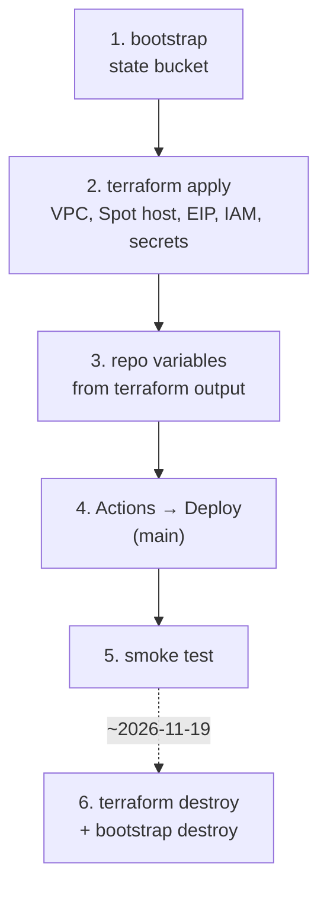
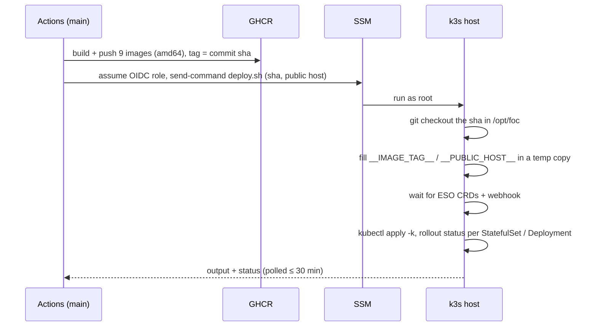
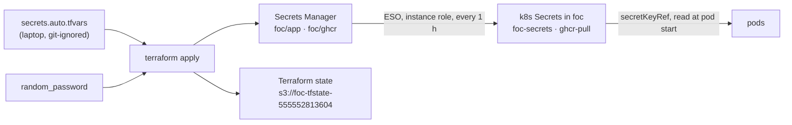

<!--
  AI-assisted (CS3219 AI Usage Policy disclosure):
  Tool: Claude Code (Opus 5.5), 2026-11-05, issue #48 (N5 cloud deployment).
  Scope: runbook for the deployment designed in docs/deployment.md (all
  decisions Leong Wei Zhi's, via options Q&A).
  Author review: Leong Wei Zhi, pending pull request review.
  2026-11-06, Claude Code (Opus 5.5), issue #48 DP11: seeded-accounts
  table with the realistic usernames. Author review: Leong Wei Zhi,
  pending pull request review.
  2026-11-06, Claude Code (Opus 5.5), issue #48 docs: what runs on the
  host, the deploy sequence, where secrets live and what a change needs,
  operating commands and a troubleshooting table. Facts read from
  infra/terraform and infra/k8s; no design changes.
  Author review: Leong Wei Zhi, pending pull request review.
-->

# infra — cloud deployment

Design and decisions: [`docs/deployment.md`](../docs/deployment.md).
One EC2 Spot instance running k3s; everything else is in-cluster.



| Path | What |
| --- | --- |
| `terraform/bootstrap/` | S3 state bucket (local state, applied once) |
| `terraform/` | network, Spot instance + EIP, IAM (instance role, GitHub OIDC role), Secrets Manager, first-boot `cloud-init` |
| `k8s/` | kustomization applied on the host: data StatefulSets, app Deployments, ESO secrets, Traefik ingress, HPAs |
| `k8s/deploy.sh` | run on the host by the Deploy workflow over SSM |

## What runs on the host

t3.xlarge: 4 vCPU, 16 GiB. All in namespace `foc` except ESO (`external-secrets`) and Traefik (`kube-system`).

| Workload | Kind | Image | Requests (CPU / mem) | Mem limit | Volume |
| --- | --- | --- | --- | --- | --- |
| 7 backends (`user-service` … `chat-service`) | Deployment, HPA 1→2 | `ghcr.io/ay2627s1-cs3219-p23/foc-<name>:<sha>` | 200m / 384Mi each | 768Mi | — |
| `gateway` | Deployment, HPA 1→2 | `foc-gateway:<sha>` | 50m / 64Mi | 256Mi | — |
| `web` | Deployment, HPA 1→2 | `foc-web:<sha>` | 20m / 32Mi | 128Mi | — |
| `<svc>-db` × 7 | StatefulSet | `postgres:17` (`supplier-db`: `postgres:16`) | 50m / 64Mi each | 256Mi | 2Gi local-path |
| `rabbitmq` | StatefulSet | `rabbitmq:4-management` | 100m / 256Mi | 512Mi | 1Gi local-path |
| `redis` | StatefulSet | `redis:8.8-alpine`, `--appendonly yes` | 20m / 32Mi | 128Mi | 1Gi local-path |

- **Totals:** requests ≈ 1.9 vCPU / 3.4 GiB at 1 replica each. With every HPA at 2, CPU requests are ≈ 3.4 vCPU and memory limits ≈ 13.6 GiB.
- **Ingress:** Traefik on port 80, `/api` → `gateway:8080`, `/` → `web:80`. Read timeout off, idle 3600 s, for the STOMP sockets.
- **Names:** Service names match compose (`user-db`, `rabbitmq`, `redis`, `user-service`, …), so the services' env defaults work unchanged.

## Before the first apply

- **Lease:** check the ISB lease expiry is after 2026-11-19 and its budget in the ISB portal.
- **Tools:** Terraform ≥ 1.10, AWS CLI v2, and the session-manager plugin (`aws ssm start-session`).
- **Credentials:** `export AWS_PROFILE=nusisb_IsbUsersPS-555552813604` and `aws sso login`.
- **Merge the whole issue-#48 stack before deploying.** The HPAs allow 2 replicas, which needs the multi-replica backend changes.

## 1–2. Provision

```sh
cd infra/terraform/bootstrap && terraform init && terraform apply
cd .. && cp secrets.auto.tfvars.example secrets.auto.tfvars   # fill in Gmail + GHCR token
terraform init -backend-config=backend.hcl
terraform apply
terraform output                     # public_host, instance_id, deploy_role_arn
terraform output -raw owner_setup_token
```

First boot installs git and k3s (pinned `v1.36.5+k3s1`), drops the ESO
Helm chart and the Traefik timeouts into k3s' auto-deploy folder, and
clones the repo to `/opt/foc`. Give it about 3 minutes, then check:

```sh
aws ssm start-session --target <instance_id>
sudo cloud-init status --wait          # status: done
sudo k3s kubectl get nodes             # Ready
sudo k3s kubectl -n external-secrets get pods
```

No Terraform or Docker locally? Lint with the image:
`docker run --rm -v "$PWD:/w" -w /w/infra/terraform hashicorp/terraform:1.13.4 fmt -check -recursive`.
Render the manifests with `kubectl kustomize infra/k8s`.

## 3. Repo variables

**Settings → Secrets and variables → Actions → Variables**:

| Variable | Value |
| --- | --- |
| `AWS_ROLE_ARN` | `terraform output deploy_role_arn` |
| `AWS_REGION` | `ap-southeast-1` |
| `INSTANCE_ID` | `terraform output instance_id` |
| `PUBLIC_HOST` | `terraform output public_host` |

Images go to `ghcr.io/ay2627s1-cs3219-p23/foc-<name>`. The `ghcr_token` in
`secrets.auto.tfvars` is a classic token with only `read:packages`, from a
user who can read the org's packages.

## 4. Deploy

**Actions → Deploy → Run workflow**, on `main`. A cold start of the 7 JVMs takes a few minutes.



- The web bundle has `http://<PUBLIC_HOST>/api/<svc>` baked in at build time. A new Elastic IP means a new build.
- To roll back, open an earlier Deploy run and **Re-run all jobs**. A re-run keeps that run's commit, while a new dispatch always builds the head of `main`.

## 5. Smoke test

```sh
curl -s http://<public_host>/api/user/actuator/health            # {"status":"UP"}
aws ssm start-session --target <instance_id>
sudo k3s kubectl -n foc get pods,hpa
```

Then in the browser at `http://<public_host>`:
1. Sign in as a seeded account.
2. Post a request, and accept it as a second account.
3. Check the live notification and two-way chat, then complete and rate.
4. Log out; the old token now gets a 401.

## Secrets



| Secret Manager entry | Keys | Source | k8s Secret | Used by |
| --- | --- | --- | --- | --- |
| `foc/app` | `<SVC>_DB_PASSWORD` × 7, `RABBITMQ_PASSWORD`, `JWT_SECRET`, `OWNER_SETUP_TOKEN`, `CHAT_INTERNAL_TOKEN` | generated | `foc-secrets` | DBs + backends |
| `foc/app` | `MAIL_USERNAME`, `MAIL_PASSWORD`, `MAIL_FROM` | `secrets.auto.tfvars` | `foc-secrets` | user-service |
| `foc/ghcr` | `username`, `token` | `secrets.auto.tfvars` | `ghcr-pull` (dockerconfigjson) | image pulls |

**Where the values sit in plaintext:**
- The Terraform state holds every value. The bucket has S3's default encryption, but anyone in the account who can read the bucket can read the values.
- The k3s Secrets sit in k3s' datastore on the root volume. The volume is encrypted with EBS, but k3s itself was installed without `--secrets-encryption`.
- `terraform output -raw owner_setup_token` prints the owner token.

**Changing a value.** Edit `secrets.auto.tfvars` and run `terraform apply`. For a generated value, use `terraform apply -replace=random_password.<name>` (`db["<svc>"]`, `rabbitmq`, `jwt`, `owner_setup`, `chat_internal`). ESO picks the change up within an hour, or force it:
`sudo k3s kubectl -n foc annotate externalsecret foc-secrets force-sync=$(date +%s) --overwrite`.
Then restart whatever reads the value. Some values need more than a restart:

| Value | Takes effect after | Caveat |
| --- | --- | --- |
| `MAIL_*`, `OWNER_SETUP_TOKEN`, `CHAT_INTERNAL_TOKEN` | restart the reading Deployment(s) | `CHAT_INTERNAL_TOKEN` is shared by order and chat, so restart both |
| `JWT_SECRET` | restart every backend + gateway | every issued token stops validating, so everyone is logged out |
| `<SVC>_DB_PASSWORD`, `RABBITMQ_PASSWORD` | **not by a restart** | Postgres and RabbitMQ read them only when the volume is empty. Change the password inside the store too, or delete its PVC (data lost) |
| `foc/ghcr` | next image pull | — |

## Operating

All on the host (`aws ssm start-session --target <instance_id>`), as `sudo k3s kubectl …`, shortened to `k` below.

| Task | Command |
| --- | --- |
| Status | `k -n foc get pods,hpa -o wide` |
| Logs | `k -n foc logs deploy/<name> --since=30m` (add `-p` after a crash) |
| Restart | `k -n foc rollout restart deploy/<name>` |
| SQL | `k -n foc exec -it <svc>-db-0 -- psql -U <svc> -d <svc>` (`<svc>` = user, supplier, order, credit, notification, rating, chat) |
| Redis | `k -n foc exec -it redis-0 -- redis-cli` |
| Resource use | `k top pods -n foc`, `k top node` |
| Secrets sync | `k -n foc get externalsecret` (`READY True`) |

RabbitMQ UI from your laptop, in two terminals:

```sh
# on the host
sudo k3s kubectl -n foc port-forward pod/rabbitmq-0 15672:15672
# on the laptop; then open http://localhost:15672 (user foc, RABBITMQ_PASSWORD)
aws ssm start-session --target <instance_id> \
  --document-name AWS-StartPortForwardingSession \
  --parameters portNumber=15672,localPortNumber=15672
```

- **Spot reclaim:** AWS can stop the instance at any time. It restarts by itself when capacity returns, with the same Elastic IP and the same data. Keep the local compose stack ready as the demo fallback.
- **CPU credits:** the instance runs in `standard` mode, so once the credit balance runs out it is held to the t3 baseline (~40 % of each vCPU). Check `CPUCreditBalance` in the EC2 console's Monitoring tab.

## Troubleshooting

| Symptom | Check | Usual cause / fix |
| --- | --- | --- |
| `curl` to the EIP times out | EC2 console: instance state | Spot stopped it: wait for capacity, nothing to redeploy. Still in first boot: `cloud-init status` |
| Deploy job: `AccessDenied` on `AssumeRoleWithWebIdentity` | ran from `main`? | The OIDC role trusts `refs/heads/main` only |
| Deploy job: `InvalidInstanceId` | instance running + SSM online | stopped by Spot, or the SSM agent not registered yet after boot |
| `deploy.sh` stuck waiting for CRDs | `k -n external-secrets get pods` | the ESO chart is still installing; the deploy waits up to 10 min |
| `ExternalSecret` not `READY` | `k -n foc describe externalsecret foc-secrets` | instance role or IMDS (hop limit 2) issue; check the secret exists in `ap-southeast-1` |
| `ImagePullBackOff` | `k -n foc describe pod <pod>` | GHCR token wrong or missing `read:packages`; image not pushed for that sha |
| Pod `Pending` | `k -n foc describe pod <pod>` (events) | `Insufficient cpu`: CPU requests at every HPA max ≈ 3.4 of 4 vCPU. Or an unbound PVC (`k -n foc get pvc`) |
| Backend `CrashLoopBackOff` | `k -n foc logs <pod> -p` | DB password changed after first boot (see Secrets); Flyway `validate` mismatch |
| notification: `PRECONDITION_FAILED` on a queue | logs | queue declared earlier with other arguments: delete it in the RabbitMQ UI and restart notification |
| 502 / 504 on `/api/<svc>` | `k -n foc get pods` | the backend not ready yet (startup probe allows up to 5 min) |
| Live updates / chat drop after ~60 s | Traefik args in `kube-system` | the `traefik` HelmChartConfig from cloud-init missing |
| Login works, browser calls fail with CORS | `WEB_ALLOWED_ORIGIN` in `foc-config` | must be `http://<public_host>`; set by `deploy.sh` from the workflow's `PUBLIC_HOST` |

## 6. Teardown (~2026-11-19)

```sh
cd infra/terraform && terraform destroy
cd bootstrap && terraform destroy
aws resourcegroupstaggingapi get-resources --tag-filters Key=project,Values=foc   # expect []
```

Nothing is kept. The Secrets Manager secrets are deleted without a recovery
window, the volumes go with the instance, and the bucket is force-destroyed.
GHCR images outlive the AWS account; delete them under the org's
**Packages** tab if wanted.

## Seeded accounts

`USER_SEED_DEMO=true` in the cloud (DP11). Log in by username or email.

| Role | Username(s) | Email | Password |
| --- | --- | --- | --- |
| OWNER | `daniel_koh` | `e9000001@u.nus.edu` | `OwnerPass123` |
| ADMIN | `priya_menon`, `farhan_ismail`, `chloe_ng` | `e9000101`–`e9000103@u.nus.edu` | `AdminPass123` |
| USER | `weiling_tan`, `arjun_nair`, `siti_rahman`, … (100) | `e9100001`–`e9100100@u.nus.edu` | `StudentPass123` |

All 100 users: [`user-service/README.md`](../user-service/README.md#demo-accounts-local-only).
